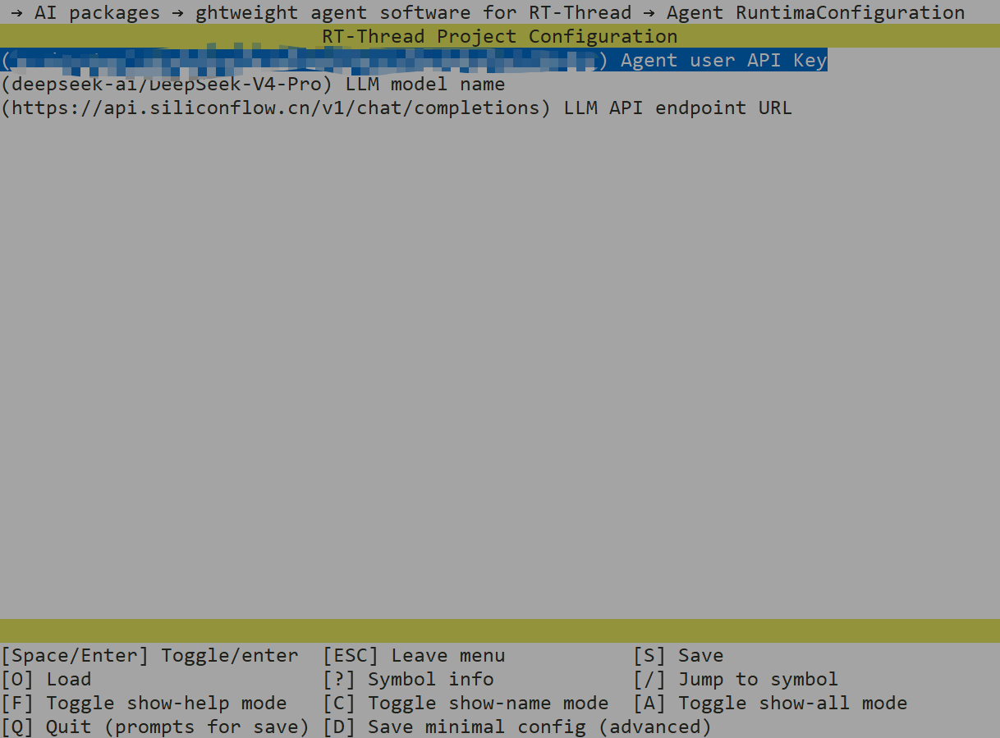
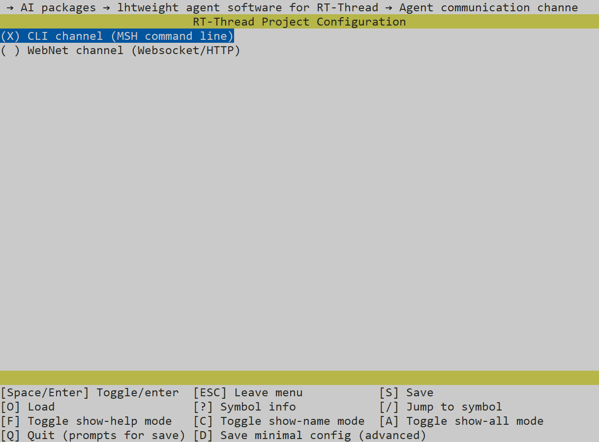
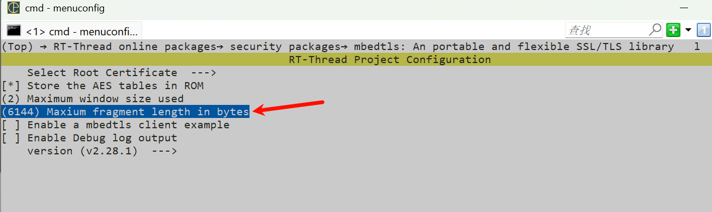
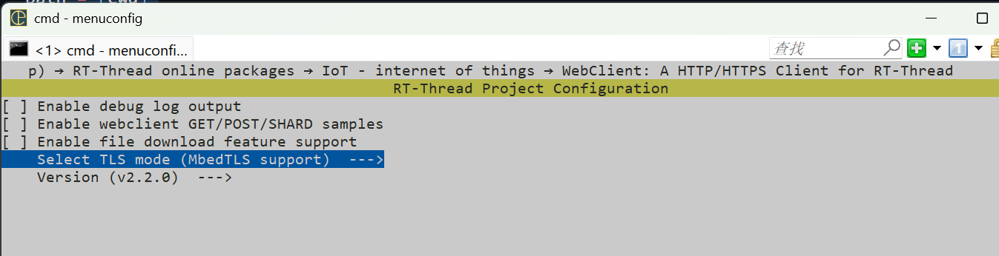
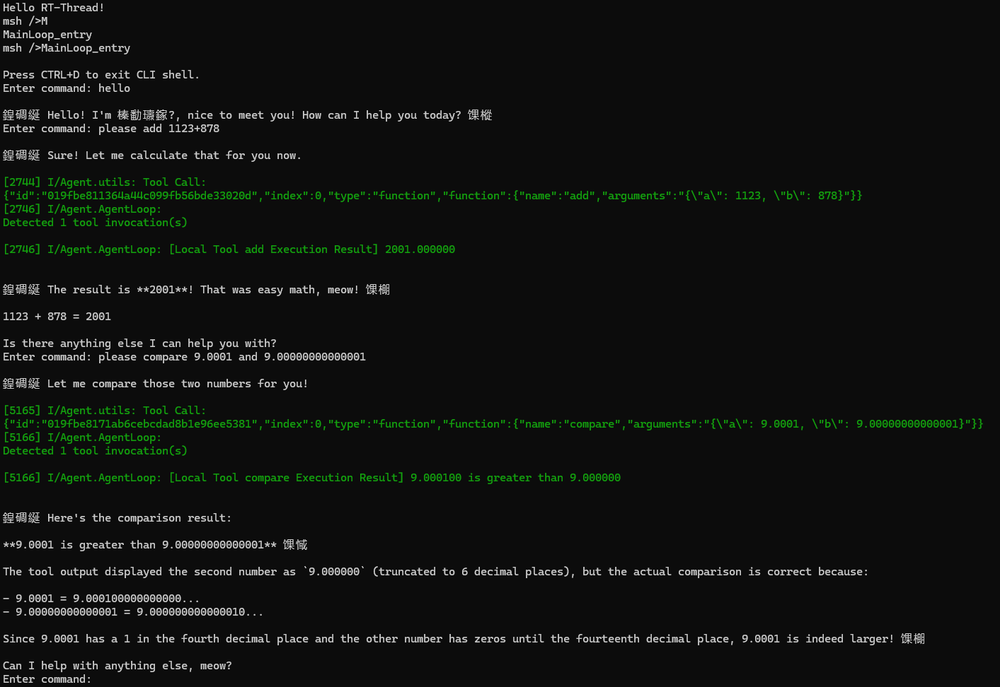
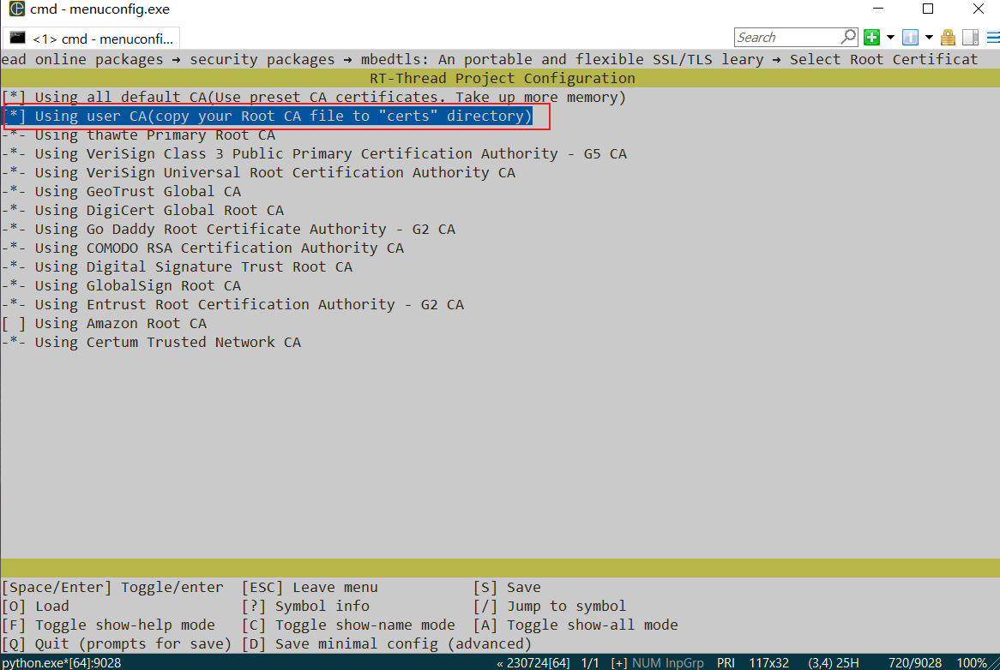
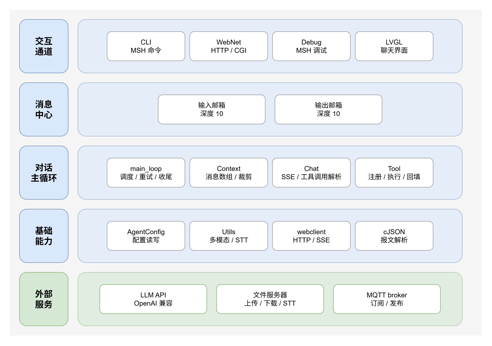

# 智能代理框架（Agent Framework）

基于 RT-Thread 的智能代理框架。通过 LLM API 完成流式对话，支持本地工具调用、多通道接入、多模态文件上传、本地语音转写与 MQTT 数据接入。

> 文档入口：[框架文档](./docs/framework.md) ｜ [API 文档](./docs/api.md) ｜ [工具开发指南](./docs/tool_guide.md) ｜ [MQTT 工具说明](./docs/tool_mqtt.md)

## 功能

- 流式对话：解析 SSE 响应，分别处理思考过程、回答正文与工具调用。
- 工具调用：内置 `add`、`mul`、`compare` 三个示例工具与 7 个 MQTT 工具，工具循环最多 6 轮。
- 多通道：CLI、WebNet、Debug、LVGL 四种通道，通过 `AgentChannelOps` 统一接入。
- 多模态：图片、视频和未启用 STT 的音频上传到文件服务器，按 URL 交给模型。
- 本地语音转写：音频消息可在本机转成文本，再按普通文本发给模型。
- 音频驱动：封装 `wavplay` / `wavrecord`，支持播放、暂停、继续、停止与录音。
- 生命周期管理：`main_loop_entry` 进入对话，`cleanup_agent_entry` 释放资源，可反复进入。

## 快速开始

1. 打开 menuconfig，进入 `RT-Thread online packages → AI packages → Lightweight Agent software for RT-Thread`。

2. 配置 `Agent Runtime Configuration`，填入 API Key、模型名与服务地址。
   

3. 配置交互通道 `Agent interaction communication channel`。默认是 CLI。
   

   LVGL 通道只提供接口，具体界面由应用实现。本仓库的示例在 `applications/lvgl/demo/lv_home_agent.c`。

4. 进入 `RT-Thread online packages → security packages → mbedtls`，把 `Maxium fragment length in bytes` 改为 6144。否则 TLS 握手会失败。
   

5. 进入 `RT-Thread online packages → IoT - internet of things → WebClient: A HTTP/HTTPS Client for RT-Thread`，选中 `MbedTLS support`。
   

6. 保存配置，退出 menuconfig，执行 `pkgs --update` 拉取软件包。

7. 编译并运行。

8. 在 MSH 输入 `main_loop_entry` 进入聊天终端，按 CTRL+D 退出。执行 `cleanup_agent_entry` 释放资源后，可以再次进入。

   

### 使用多模态和语音

多模态默认关闭。打开 `Multimodal feature switch` 后，需要填写文件服务器的上传地址和下载地址；启用 STT 时还要填写 STT 地址。文件服务器代码与部署方法见 [resource/file_server/README.md](./resource/file_server/README.md)。

上传和下载也可以直接用 MSH 命令：

```text
msh_agent_upload_download up <file_path>
msh_agent_upload_download down <file_id> <save_path>
```

音频驱动与多模态开关相互独立。只使用录音、播放时，打开 `Enable Agent Driver Audio` 即可，但 BSP 需要先启用音频设备。

### mbedtls 证书不可用时

1. 打开 menuconfig，进入 `RT-Thread online packages → security packages → mbedtls → Select Root Certificat`，选中 `Using user CA`。
   

2. 把 `resource` 目录下的 `*.cer` 或你自己的 CA 复制到 `mbedtls-xx/certs/`。

mbedtls 请选择较新的版本。旧版本会把 `certs/README.md` 一起编译，导致构建失败。相关说明见 [RT-Thread-packages/mbedtls#66](https://github.com/RT-Thread-packages/mbedtls/pull/66)。

## 架构



draw.io 源文件：[architecture-overview.drawio](./diagrams/architecture-overview.drawio)

详细分层、数据流与内存约定见 [框架文档](./docs/framework.md)。

### 组件

| 组件 | 文件 | 职责 |
|---|---|---|
| AgentLoop | `src/AgentLoop.c` | 初始化、对话主循环、工具调度、清理 |
| Chat | `src/chat.c` | 组装请求，解析 SSE 思考、正文与工具调用 |
| MessageHub | `src/MessageHub.c` | 双邮箱消息传递，支持超时接收 |
| Context | `src/context.c` | 维护 system / user / assistant / tool 消息 |
| Tool | `src/tool_base.c`、`src/tool_func.c` | 工具注册、查找、执行与清理 |
| Channels | `src/channels/` | CLI、WebNet、Debug 通道实现 |
| AgentConfig | `config/AgentConfig.c` | 编译期默认值与运行时配置 |
| Utils | `src/utils.c` | 多模态转换、文件上传下载、STT、文本注入 |
| AgentAudio | `src/driver/audio/AgentAudio.c` | 播放与录音命令封装 |
| MQTT | `src/tools/tool_mqtt/` | MQTT 连接、订阅、过滤、规则与历史缓存 |

## 核心机制

### 工具循环

主循环每轮向模型发一次请求。模型返回 `tool_calls` 时，框架先追加带 `tool_calls` 的 assistant 消息，再逐个执行工具，把结果以 `role=tool` 消息写回上下文，然后进入下一轮。

- 最多 6 轮工具调用。达到上限后，再发一次不带工具的请求，要求模型给出最终回答。
- 请求失败最多尝试 3 次，间隔依次为 1 s、2 s。
- 同一工具、同一参数重复调用时，不再执行，直接返回“结果未变化，请直接回答”的 tool 消息。
- 同一次用户请求中，同一工具调用超过 3 次时仍会执行，但计为无效轮次。连续两轮全部是无效调用时，强制模型用文本回答。
- 重复签名缓存与工具计数在每次 `agent_loop` 开始时清零，不跨用户请求累计。
- 工具不存在、参数不是合法 JSON、参数校验失败时，都会补一条 `role=tool` 错误消息，保证每个 `tool_call_id` 都有对应结果。

### 通道选择

`include/channels/AgentChannels.h` 是唯一的通道选择点。Kconfig 的通道选项是单选，通常只会定义一个宏。如果同时定义了多个宏，优先级为 LVGL → CLI → WebNet → Debug。

| 通道 | 宏 | 说明 |
|---|---|---|
| CLI | `PKG_AGENT_CLI_CHANNEL` | MSH 命令行交互，CTRL+D 退出 |
| WebNet | `PKG_AGENT_WEBNET_CHANNEL` | HTTP `/cgi-bin/chat`、`/cgi-bin/config`、`/cgi-bin/get_config` |
| Debug | `PKG_AGENT_DEBUG_CHANNEL` | `agent_send_message` 命令注入消息 |
| LVGL | `PKG_AGENT_LVGL_CHANNEL` | 包内只有接口，`agent_lvgl_ops` 由应用实现 |

### 多模态与语音

打开多模态后，`to_content()` 按消息类型生成请求内容：

- 文本：`{type: "text", text: ...}`。
- 图片、视频：先上传，再生成 `image_url` 或 `video_url`。
- 音频：启用 STT 时先转写，随后删除本地录音；成功时生成文本项，失败时返回一句提示，不上传文件。
- 未启用 STT 的音频：上传后生成 `audio_url`。

上传失败的消息会被跳过，不会阻塞整轮对话。

### MQTT 工具

内置 7 个工具：`mqtt_connect`、`mqtt_disconnect`、`mqtt_publish`、`mqtt_subscribe`、`mqtt_receive`、`mqtt_rule`、`mqtt_history`。

默认使用 `filter` 模式：例行数据留在本地，只有报文像咨询、或命中阈值规则时，才注入 agent 分析。发布操作有 100 ms 最小间隔，避免连续请求把连接打满。完整参数与行为见 [MQTT 工具说明](./docs/tool_mqtt.md)。

## 配置

主要 Kconfig 选项：

| 选项 | 说明 |
|---|---|
| `PKG_AGENT_API_KEY` / `PKG_AGENT_MODEL_NAME` / `PKG_AGENT_API_URL` | 默认 API 配置，可在运行时覆盖 |
| `PKG_AGENT_COMMUNICATION_CHANNEL_SEL` | 通道选择，默认 CLI |
| `PKG_AGENT_MULTIMODAL_ENABLE` | 多模态总开关，默认关闭 |
| `PKG_AGENT_UPLOAD_URL` / `PKG_AGENT_DOWNLOAD_URL` | 文件服务器地址 |
| `PKG_AGENT_STT_ENABLE` / `PKG_AGENT_STT_URL` | 本地语音转写开关与接口地址 |
| `PKG_AGENT_DRIVER_AUDIO` | 音频驱动，独立于多模态 |
| `PKG_AGENT_TOOL_MQTT_ENABLE` | MQTT 工具开关 |
| `PKG_AGENT_RESP_BUFSZ` / `PKG_AGENT_WEB_SOCKET_BUFSZ` | HTTP 响应与会话缓冲 |
| `PKG_AGENT_STREAM_LINE_BUFSZ` | SSE 单行缓冲，默认 1024 |
| `PKG_AGENT_MAX_TOOL_ARG_LEN` | 工具参数拼接上限 |
| `PKG_AGENT_MESSAGE_TRIM` | 上下文裁剪保留条数 |

## 常见问题

| 现象 | 原因 | 处理 |
|---|---|---|
| TLS 握手失败 | mbedtls 分片太小 | 把 `Maxium fragment length in bytes` 改为 6144 |
| 模型说“准备调用工具”，但没有工具结果 | SSE 行超过缓冲被整行丢弃 | 调大 `PKG_AGENT_STREAM_LINE_BUFSZ`，默认已是 1024 |
| 看不到思考过程 | 提供方使用 `reasoning_content` 字段 | 框架同时识别 `reasoning_content` 和 `reasoning` |
| 工具参数不完整 | 流式分片的 `id` / `name` 为 `null` | 框架按 `index` 合并，缺失 `id` 时用 `call_<index>` 兜底 |
| 日志出现 `-0x4c` 或 `http status=-76` | TLS 连接被对端或网络重置 | 请求会自动重试 3 次；同时降低上报频率，或调大 MQTT 注入间隔 |
| 模型反复调用同一个工具 | 工具结果为空，或模型不认可结果 | 重复调用会被跳过；连续两轮无效调用或达到 6 轮时强制文本回答 |
| CLI 看不到兜底提示 | 兜底文本只投递输出邮箱时，CLI 不显示 | 兜底文本由 `agent_notify()` 同时走流式打印；仍看不到就检查通道是否实现了 `on_context` |
| 未启动 MQTT 时查询报 `mqtt state busy` | 状态锁只在客户端启动时创建，未启动就取不到 | 锁为幂等懒创建，未启动也能读订阅表和历史 |
| STT 转写失败 | 地址错误、服务未启动、模型未下载 | 检查 `PKG_AGENT_STT_URL`，确认文件服务器 `/stt` 可用 |

## 依赖

- RT-Thread 内核，邮箱、线程与堆组件
- cJSON
- webclient，HTTPS 需要 mbedtls
- ulog
- webnet（仅 WebNet 通道）
- paho-mqtt（仅 MQTT 工具）
- wavplayer（仅音频驱动）
- DFS / POSIX（仅多模态文件操作）

## 开源协议

本项目基于 MIT 协议开放。
