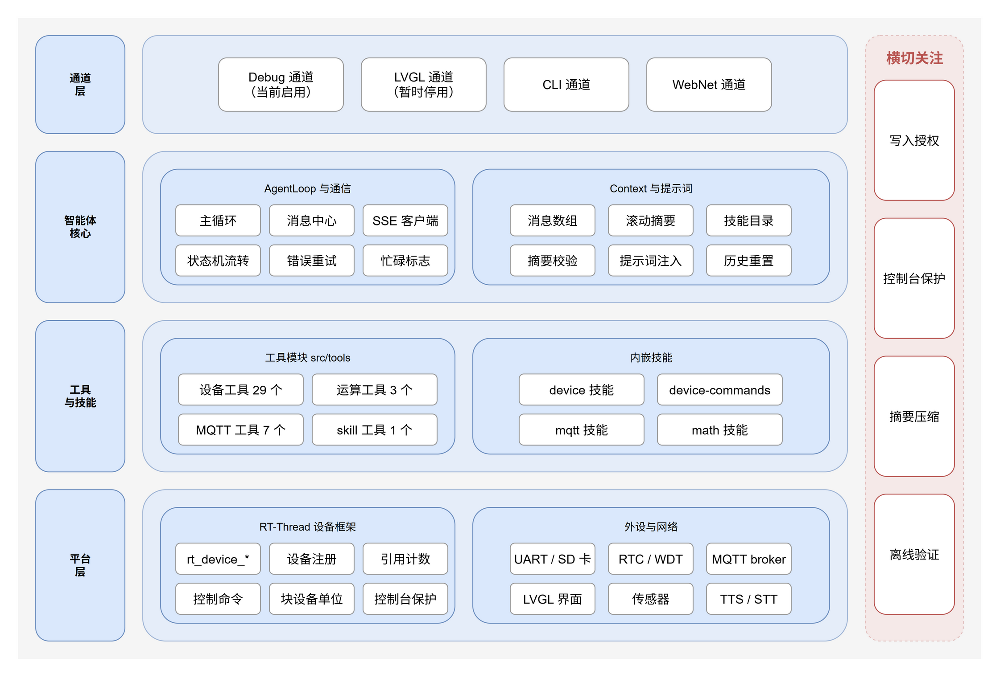
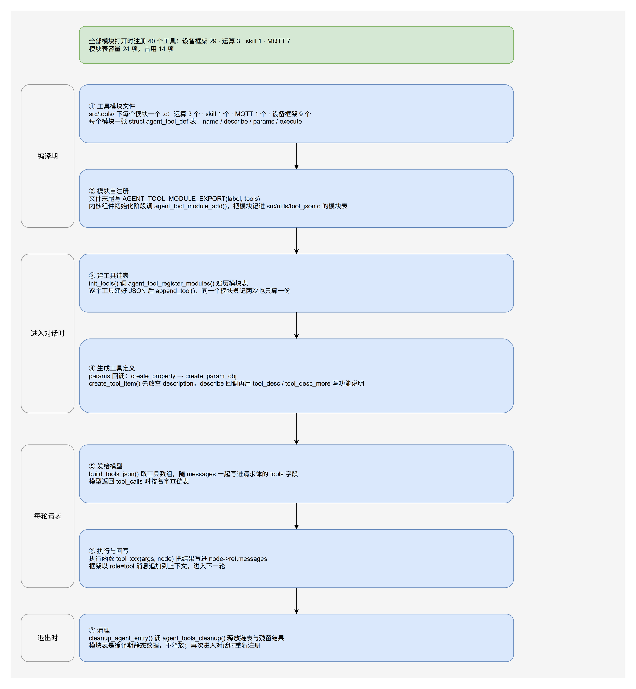
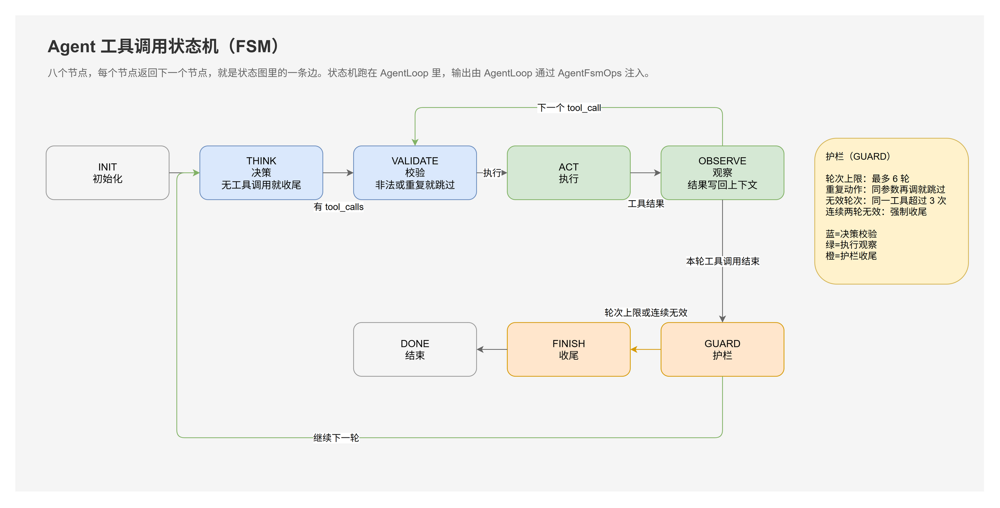
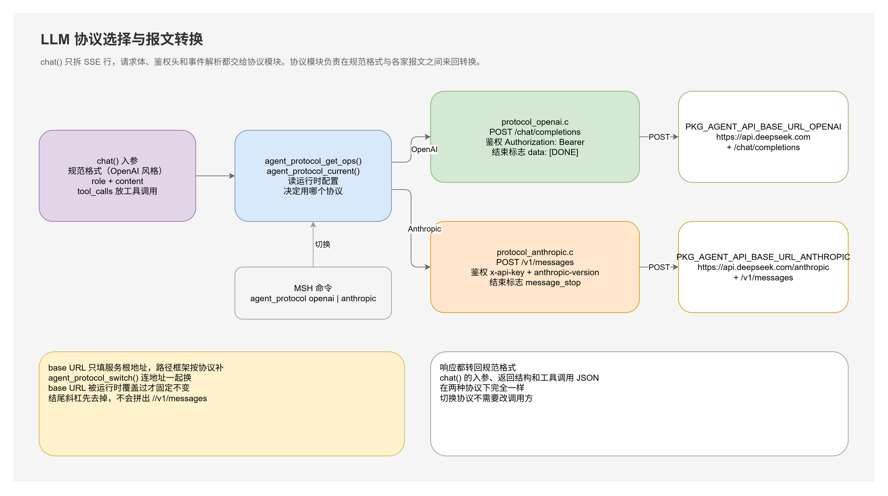
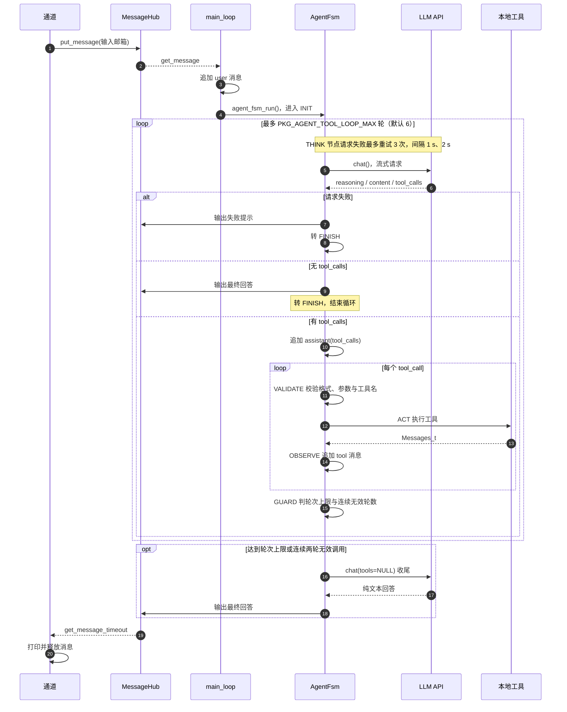
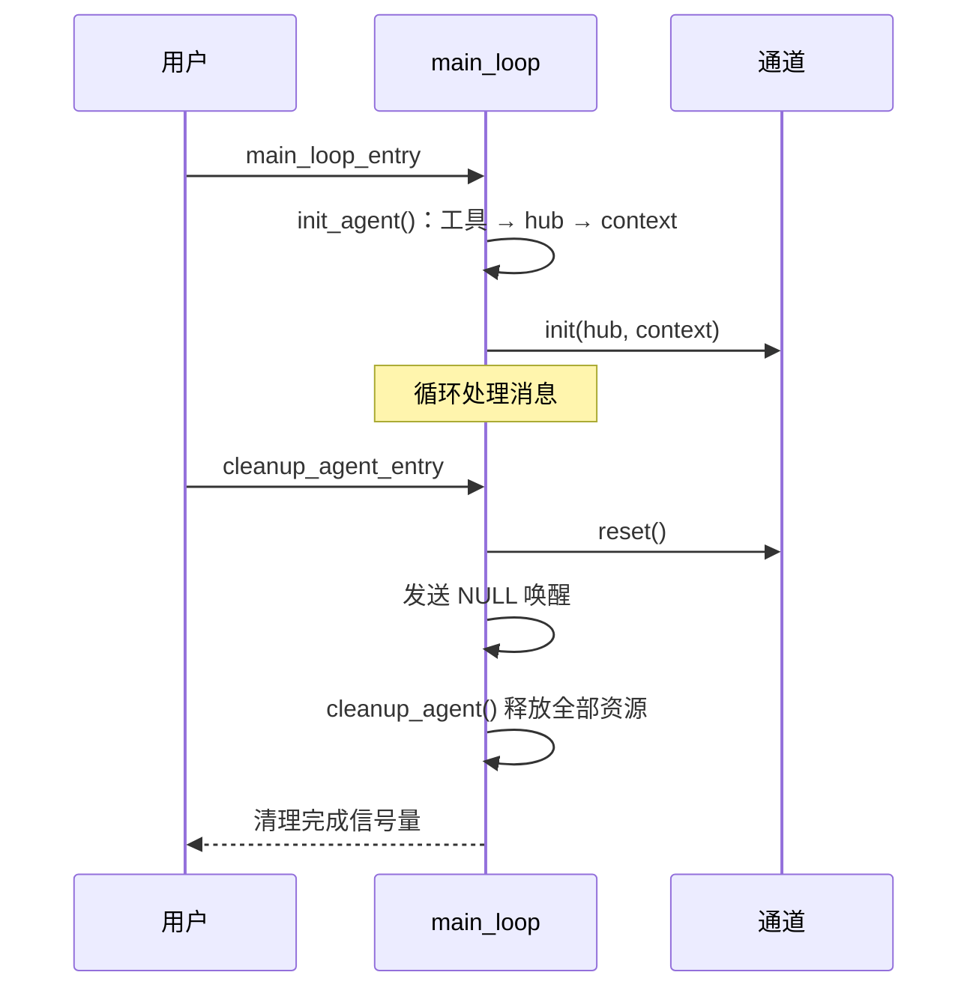

# Agent 框架文档

本文档说明框架的架构、组件、数据流、内存约定与配置。接口细节见 [api.md](./api.md)。

## 1. 概述

框架运行在 RT-Thread 上，处理一次用户请求的完整过程：接收消息、请求 LLM、执行工具、写回结果、输出回答。主要能力：

- 流式对话：解析 SSE 中的思考过程、正文与工具调用。
- 工具系统：注册、查找、执行本地工具，内置运算示例、技能加载、设备框架工具与 7 个 MQTT 工具。
- 技能模块：把 `skills/*.md` 内嵌进固件，模型按需加载正文。
- 上下文管理：按 system / user / assistant / tool 角色维护历史，支持清空与滚动摘要压缩。
- 多通道：CLI、WebNet、Debug、LVGL，通过 `AgentChannelOps` 接入。
- 多模态：图片、视频和未启用 STT 的音频上传到文件服务器。
- 本地语音转写：音频先转成文本，再发给模型。
- 音频驱动：播放与录音命令封装。
- 生命周期：进入对话、清理、再次进入，清理后堆内存回到基线。

## 2. 架构总览



draw.io 源文件：[agent-architecture.drawio](diagrams/agent-architecture.drawio)

图里画的是当前工程的实际状态：通道层选中 A2A 通道，其余通道暂时停用；平台层是 RT-Thread 设备框架与挂在其下的外设。工具层按模块划分，模块全开时共 40 个工具，设备框架 29 个、运算 3 个、MQTT 7 个、skill 1 个，每个模块自己登记到模块表；内嵌技能是编进固件的 5 份 Markdown。右侧为跨层关注点：写入授权、控制台保护、摘要压缩、离线验证。

工具从模块文件到模型手里的完整链路：



draw.io 源文件：[tool-registration.drawio](diagrams/tool-registration.drawio)

AgentAudio 由应用直接调用，不参与对话主循环。

### 分层职责

| 层 | 组件 | 职责 |
|---|---|---|
| 顶层调度 | `AgentLoop` | 初始化与清理、对话主循环、组装全局状态并启动状态机 |
| 顶层调度 | `AgentFsm` | 工具调用状态机：决策、校验、执行、观察、护栏、收尾 |
| 核心 | `MessageHub` | 基于 RT-Thread 邮箱的组件间消息传递 |
| 核心 | `Context` | 对话历史的追加、清空、滚动摘要压缩 |
| 核心 | `Chat` | LLM API 通信与 SSE 行拆分，报文格式按协议模块分发 |
| 核心 | `Tool` | 工具注册、查找、执行、结果回填 |
| 通道 | `CLI / WebNet / Debug / LVGL` | 外部交互界面，通过 `AgentChannelOps` 接入 |
| 基础 | `AgentConfig / Utils / Prompt` | 运行时配置、多模态与文本注入、系统提示词 |
| 基础 | `Skill` | 内嵌技能注册表、技能目录与加载入口 |
| 工具 | `src/tools/*` | 运算、技能、MQTT 与设备框架工具模块，各自带一张描述符表 |
| 驱动 | `AgentAudio` | 播放与录音的命令封装 |

## 3. 核心组件

### 3.1 AgentLoop

文件：`src/core/AgentLoop.c`

主循环线程名为 `AgentLoop`，栈 10240 字节，优先级 10。

- 启动时调用 `init_agent()` 创建工具、MessageHub、Context，并调用通道的 `init`。
- 阻塞等待输入邮箱。收到消息后追加为 user 消息，释放消息对象，再调用 `agent_loop`。
- 一次请求结束后调用 `compress_context(g_context, PKG_AGENT_MESSAGE_TRIM)`。排除 system 和已有摘要后的消息数超过阈值时，尝试压缩旧历史，保留策略见 3.3。
- 处理期间 `g_agent_busy` 为真，摘要请求期间也保持为真。`agent_is_busy()` 在此期间返回 `RT_TRUE`，等待新消息时返回 `RT_FALSE`。MQTT 注入等外部模块可据此错峰。

`agent_loop` 只做两件事：组装全局状态（`AgentFsm_t`），把状态机跑完。工具循环的流转规则在 `src/core/AgentFsm.c`，每个节点做完本状态的事就返回下一个节点，也就是状态图里的一条边。

| 节点 | 做什么 | 下一个节点 |
|---|---|---|
| `INIT` | 清零轮次、重复签名缓存与工具计数 | `THINK` |
| `THINK` | 调 `chat()`，失败最多重试 3 次，间隔 1 s、2 s | `FINISH` 或 `VALIDATE` |
| `VALIDATE` | 校验工具调用的格式、参数与工具名，判定是执行、跳过还是记错误 | `ACT` 或 `OBSERVE` |
| `ACT` | 把动作交给工具执行，读取返回值 | `OBSERVE` |
| `OBSERVE` | 把结果或错误写成 `role=tool` 消息写回上下文 | `VALIDATE` 或 `GUARD` |
| `GUARD` | 判轮次上限与连续无效轮数 | `THINK` 或 `FINISH` |
| `FINISH` | 输出最终回答，或再发一次不带工具的请求 | `DONE` |
| `DONE` | 结束 | 无 |



draw.io 源文件：[agent-fsm.drawio](diagrams/agent-fsm.drawio)

`agent_loop` 的规则：

- 工具循环最多跑几轮由 Kconfig 的 `PKG_AGENT_TOOL_LOOP_MAX` 决定，默认 6，取值范围 1～32。`inc/core/AgentFsm.h` 里的 `AGENT_LOOP_MAX` 读取这个宏。
- 每轮由 `THINK` 节点调一次 `chat()`。请求失败最多尝试 3 次，退避间隔为 1 s、2 s。
- `THINK` 判定没有 `tool_calls` 时，本轮回答即为最终回答，转 `FINISH`。
- 有 `tool_calls` 时，先追加带 `tool_calls` 的 assistant 消息，再由 `VALIDATE` 逐个校验、`ACT` 执行、`OBSERVE` 写回。
- `VALIDATE` 发现同一工具、同一参数再次出现时跳过执行，回一条“结果未变化，请直接回答”的 tool 消息。
- `VALIDATE` 发现同一工具调用超过 3 次时仍会执行，但计为无效调用。
- `GUARD` 发现连续两轮全部是重复或无效调用时，跳出循环，强制生成文本回答。
- 重复签名缓存与工具计数在 `INIT` 节点清零，不跨用户请求累计。
- `GUARD` 判定达到轮次上限时转 `FINISH`，`FINISH` 再发一次不带工具的请求，要求模型给出最终回答。
- 工具不存在、参数不是合法 JSON、参数校验失败时，`OBSERVE` 补一条 tool 错误消息，保证每个 `tool_call_id` 都有结果。

状态机不碰邮箱和 TTS，这两件事由 `AgentLoop.c` 通过 `AgentFsmOps` 注入：`emit_answer` 输出最终回答，`notify` 投递兜底提示。

兜底文本通过 `agent_notify()` 同时写入输出邮箱和流式打印路径。CLI 通道只打印流式内容，这样用户能看到“工具循环超限”“请求失败”等提示。

MSH 命令：

- `main_loop_entry`：创建并启动主循环线程。
- `cleanup_agent_entry`：停止通道，发送停止信号，等待主循环退出。

### 3.2 MessageHub

文件：`src/core/MessageHub.c`、`inc/core/MessageHub.h`

- 输入邮箱 `AgentInputMb`，容量 10，方向为通道 → 主循环。
- 输出邮箱 `AgentOutMb`，容量 10，方向为主循环 → 通道。
- 消息载体是 `Messages_t`，容量不足时按 5 条递增。
- `message_hub_get_timeout()` 提供带超时的接收，供通道做可中断等待。
- `message_hub_destroy()` 会排空两个邮箱，释放残留消息。

所有权规则见第 5 节。

### 3.3 Context

文件：`src/core/context.c`、`inc/core/context.h`

维护一个 cJSON 消息数组，角色包括 system、user、assistant、tool。`has_summary` 标记索引 1 处是否有滚动摘要。

- 创建时调用 `build_system_prompt`。保留 `src/core/prompt.c` 中 `get_system_prompt()` 的内容，再追加自动生成的内置技能 JSON 目录和加载说明。
- 技能加载说明要求模型在使用任务工具前调用 `skill({"name":"<name>"})`。完整说明仍在上下文中时可复用；只剩摘要时要重新加载。
- `append_assistant_message`：
  - 没有工具调用时，写入 assistant 的正文。
  - 有工具调用时，写入 `content` 为空的 assistant 消息，并复制 `tool_calls`。
- `append_tool_message`：把工具结果拼成一个字符串，写入 `content`。只拼接 `TYPE_TEXT` 项，多模态数组不适用于 `role=tool`。
- `clear_message`：删除全部消息并新建空数组，复位 `has_summary`。调用方需先重建 system 提示词，再追加新消息。
- `compress_context(self, threshold)` 替代 `trim_context`，用滚动摘要压缩旧历史。主循环传入 `PKG_AGENT_MESSAGE_TRIM`，沿用原配置名。

压缩只在消息数严格大于阈值时触发，计数排除 system 和已有摘要。先保留最近 `threshold / 2` 条消息，除法向下取整，再向前扩到 user 消息边界。这样会保留完整轮次，不拆开 `assistant(tool_calls)` 与对应的 tool 结果；实际保留条数可能超过半阈值。若只有一轮超长对话，或没有可压缩的完整旧轮次，则跳过。

压缩会额外请求一次模型。旧历史前缀（含上一份摘要，不含 system）先序列化为 JSON，作为 user 数据提交给专用摘要 system 提示词。请求的 `tools` 和三个回调均为 `RT_NULL`，`max_tokens` 为 512；不会调用工具或流式输出摘要。

只有正文非空白、`complete` 为真且没有工具调用的摘要才可提交。带历史标记的摘要消息还必须减少序列化后的历史字节数。所有检查通过后才替换旧前缀：system 留在索引 0，assistant 摘要放在索引 1，最近消息保持原样，并设置 `has_summary`。任何失败都保留全部原历史，不回退到直接裁剪。

摘要是语义压缩，不是逐字记录，可能遗漏细节。它只作为历史数据，不能当作新指令或当前设备状态的证明。摘要提示词要求记录已加载的技能名，不保留完整技能说明；需要使用时应重新加载技能。

assistant 消息必须排在对应的 tool 消息之前，否则 OpenAI 兼容接口会返回 400。

### 3.4 Chat

文件：`src/core/chat.c`、`inc/core/chat.h`

`chat.c` 只管 HTTP 与 SSE 行拆分，报文格式交给 `src/utils/protocol/` 下的协议模块。当前协议由 `agent_protocol_get_ops()` 给出：OpenAI 走 `protocol_openai.c`，Anthropic 走 `protocol_anthropic.c`，切换见 3.8。

请求地址由「服务根地址 + 协议路径」拼出来，菜单里填两个 base URL，路径框架自己接：

| 协议 | base URL 选项 | 默认值 | 补的路径 | 实际请求地址 |
|---|---|---|---|---|
| OpenAI | `PKG_AGENT_API_BASE_URL_OPENAI` | `https://api.deepseek.com` | `/chat/completions` | `https://api.deepseek.com/chat/completions` |
| Anthropic | `PKG_AGENT_API_BASE_URL_ANTHROPIC` | `https://api.deepseek.com/anthropic` | `/v1/messages` | `https://api.deepseek.com/anthropic/v1/messages` |

拼接在 `get_dynamic_agent_request_url()` 里做，base URL 结尾的斜杠先去掉，避免拼出 `//v1/messages`。base URL 没被运行时覆盖过时，切换协议会跟着换用另一份；覆盖过就固定用覆盖值。



draw.io 源文件：[llm-protocol.drawio](diagrams/llm-protocol.drawio)

- 请求体、鉴权头、SSE 事件解析都由协议模块实现，`chat.c` 不区分协议。
- `max_tokens` 由调用方指定：普通对话为 32 × 1024，上下文摘要请求为 512。
- webclient 超时为 30 s。
- 解析 `data:` 开头的 SSE 行，冒号后允许一个空格，支持 LF 和 CRLF 换行。OpenAI 遇到 `[DONE]` 结束，Anthropic 遇到 `message_stop` 结束。
- OpenAI 的思考内容优先取 `delta.reasoning_content`，没有时取 `delta.reasoning`；Anthropic 取 `delta.thinking`。
- OpenAI 的正文取 `delta.content`；Anthropic 取 `delta.text_delta.text`。
- 工具调用按 `index` 合并。`id`、`name` 取第一个非空值，`arguments` 逐片追加，超过 `PKG_AGENT_MAX_TOOL_ARG_LEN` 后丢弃后续分片并打印告警。
- 单行超过 `PKG_AGENT_STREAM_LINE_BUFSZ` 时整行丢弃，并提示调大该选项。
- JSON 解析失败时重置行缓冲，继续处理后续数据。
- 响应结束后归一化工具调用：缺失 `id` 用 `call_<index>`，空参数改为 `{}`，没有函数名的调用丢弃。
- 返回 `ChatResponse_t`，使用后必须调用 `chat_response_free()`。

`ChatResponse.complete` 只表示自然文本完整结束，要求流正常收尾（OpenAI 的 `[DONE]` 加 `finish_reason: "stop"`，Anthropic 的 `message_stop` 加 `stop_reason: "end_turn"`），正文没有丢弃或截断，且没有工具调用。JSON 或响应字段格式错误、超长 SSE 行、正文超限或流未完整结束，都会使它为假。工具调用即使在归一化时被丢弃，也不能算完整文本响应。

普通对话仍按原方式返回和处理部分响应，目前只有上下文摘要调用方检查 `complete`。它不是工具执行成功标志，非空响应指针也不保证正文完整。

### 3.5 Tool 工具系统

文件：`src/core/tool_base.c`、`src/core/tool_func.c`、`src/utils/tool_json.c`（模块表）、`src/tools/*`（设备工具在 `src/tools/tool_device/`，MQTT 工具在 `src/tools/tool_mqtt/`）

- 全局单例工具链表，节点保存工具定义 JSON 与执行函数。
- 工具函数签名：`void tool_xxx(cJSON *args, AgentToolNode_t node)`，结果写入 `node->ret.messages`。
- 注册走模块表：每个工具模块在自己的 `.c` 末尾写一张 `struct agent_tool_def` 表，用 `AGENT_TOOL_MODULE_EXPORT` 在内核组件初始化阶段登记到 `src/utils/tool_json.c`。`init_tools()` 调一次 `agent_tool_register_modules()` 把表里全部工具挂上链表，重复调用不会重复注册。
- 内置运算工具：`add`、`mul`、`compare`。
- 技能工具：`skill`，不带 `name` 时列出技能名与标题，带 `name` 时返回该技能的 Markdown 全文。
- 设备框架通用层（`PKG_AGENT_TOOL_DEVICE_CORE`）：`device_list`、`device_info`、`device_open`、`device_close`、`device_read`、`device_write`、`device_control` 共 7 个工具，统一走 `rt_device_*` 接口，屏蔽具体驱动。
- 设备类模块：GPIO、PWM、ADC、DAC、I2C、SPI、传感器、LED 八类共 22 个工具，一类一个 `.c`，由 `PKG_AGENT_TOOL_DEVICE_<模块>` 决定编不编。每个文件末尾用 `AGENT_TOOL_MODULE_EXPORT` 登记，功能说明写在 `<工具名>_desc`，参数说明用 `create_property` 逐项写进 `<工具名>_params`。关掉一个模块不需要改任何中心文件。
- 配套技能 `device`（工作流）与 `device-commands`（控制命令目录），见 [tool_device.md](./tool_device.md)。
- 内置 MQTT 工具：`mqtt_connect`、`mqtt_disconnect`、`mqtt_publish`、`mqtt_subscribe`、`mqtt_receive`、`mqtt_rule`、`mqtt_history`。注册表在 `src/tools/tool_mqtt/tool_mqtt_tools.c`，该文件受 `PKG_AGENT_TOOL_MQTT_ENABLE` 控制，开关决定编译，也就决定注册。
- `build_tools_json()` 把工具定义交给请求体，节点不再持有这部分 JSON。
- `agent_tools_cleanup()` 释放链表、残留结果与注册标志，再次进入时重新注册。模块表是静态数据，不参与清理。

模块表最多 24 项，全开时占用 14 项：设备框架 9 个、运算 3 个、skill 与 MQTT 各 1 个，工具总数 40。注册到调用的每一步见 [工具注册与调用链路](diagrams/tool-registration.png)。

### 3.6 Channels

文件：`src/channels/*`、`inc/channels/*`

四个通道实现同一个接口：

```c
typedef struct AgentChannelOps
{
    int  (*init)(MessageHub_t hub, Context_t ctx);
    void (*reset)(void);
} AgentChannelOps;
```

| 通道 | 宏 | ops 实例 | init | reset |
|---|---|---|---|---|
| LVGL | `PKG_AGENT_LVGL_CHANNEL` | `agent_lvgl_ops` | 应用侧实现，保存 hub | 应用侧实现，清空 hub |
| CLI | `PKG_AGENT_CLI_CHANNEL` | `agent_cli_ops` | 创建 readline 线程 | 停止线程并释放句柄 |
| WebNet | `PKG_AGENT_WEBNET_CHANNEL` | `agent_webnet_ops` | 注册 CGI | 置空缓存指针 |
| A2A | `PKG_AGENT_A2A_CHANNEL` | `agent_a2a_ops` | 注册 A2A CGI 并启动 webnet | 置空缓存指针 |
| Debug | `PKG_AGENT_DEBUG_CHANNEL` | `agent_debug_ops` | 保存 hub 与 ctx | 置空缓存指针 |

`inc/channels/AgentChannels.h` 是唯一的通道选择点，优先级为 LVGL → CLI → WebNet → A2A → Debug。Kconfig 的通道选项是单选，正常配置只会定义一个宏。

**当前工程的通道选择**：本项目在 `rtconfig.h` 里定义了 `PKG_AGENT_A2A_CHANNEL`，实际选中的是 A2A 通道，其余通道暂时没开。

A2A 通道跑在 webnet 之上，文件是 `src/channels/AgentA2aChannel.c`。它提供三个端点：`GET /.well-known/agent.json` 出能力卡，`POST /tasks/send` 同步等最终结果，`POST /tasks/sendSubscribe` 按 SSE 分帧推送。启动时把 CGI 根切到 `/`，否则 `/.well-known/agent.json` 这种带点号的路径匹配不到。端点与消息格式见 [api.md](./api.md) 的 5.5。

webnet 是单线程的，A2A 同步接口会一直等到 agent 跑完才返回，期间占住整个线程。同一台设备并发开两条连接时，后到的那条会把先到那条的响应顶掉，调用方要自己串行化。

Debug 通道由包内实现，文件是 `src/channels/AgentDebugChannel.c`。它提供 MSH 命令 `agent_send_message <type> <content>`，`type` 取 0 到 4，0 是文本。命令把消息投给 agent，再等输出，最多等 30 秒，超时返回 -1。

LVGL 通道在包内只有头文件 `AgentLvglChannel.h`。`agent_lvgl_ops` 由应用实现，本仓库的示例在 `applications/lvgl/demo/lv_home_agent.c`：保存 hub、用 `message_hub_get_timeout()` 轮询输出、用 MSH 命令启动 agent。

WebNet 通道提供三个 CGI：

- `POST /cgi-bin/chat`：JSON 请求，字段为 `message`、`stream`、`reset`。
- `POST /cgi-bin/config`：更新运行时配置。
- `GET /cgi-bin/get_config`：读取当前配置。

`stream` 为真时返回 `text/event-stream`，事件依次为 `delta`、`final`、`done`。

包内自带一个 WebNet 聊天页面 `resource/index.html`，调用 `/cgi-bin/chat`、`/cgi-bin/config`、`/cgi-bin/get_config`。把它放到 webnet 能访问的根目录后，打开 `http://<设备IP>/index.html` 即可使用。

页面删除对话时还会请求 `/cgi-bin/cleanup`，包内没有注册这个 CGI。请求失败只在浏览器控制台打日志，不影响聊天。

### 3.7 AgentConfig

文件：`src/core/AgentConfig.c`、`inc/core/AgentConfig.h`

- 编译期默认值来自 `PKG_AGENT_API_KEY`、`PKG_AGENT_MODEL_NAME`，以及两份 `PKG_AGENT_API_BASE_URL_*`。
- 运行时可用 `agent_config_set()` 修改，`get_dynamic_agent_*()` 优先返回运行时值。
- `get_dynamic_agent_base_url()` 给服务根地址，`get_dynamic_agent_request_url()` 再接上协议路径，发请求用后者。
- 纯静态存储，不使用堆。

### 3.8 Utils 与多模态

Utils 按模块拆成多个 c 文件，`src/utils/` 下一个 .c 对应 `inc/utils/` 下一个同名 .h。`inc/utils/utils_internal.h` 负责按启用的宏导入这些模块头，`inc/utils.h` 只做一行转发，包内其它模块仍然只 include `utils.h`。

| 文件 | 内容 |
|---|---|
| `src/utils/message.c` | 流式打印 `print_reasoning()`、`print_tool_call()`、`print_context()` |
| `src/utils/format.c` | `format_text()`、`create_content_array()`、`to_content()` |
| `src/utils/tool_json.c` | `create_tool_item()`、`create_param_obj()`、`create_property()`，以及工具模块表和 `agent_tool_register_modules()` |
| `src/utils/protocol/` | LLM 协议模块，统一入口 `inc/utils/protocol.h`，见下 |
| `src/utils/file_op.c` | 文件操作线程与 `msh_agent_upload_download` |
| `src/utils/stt.c` | 本地语音转写，见 3.9 |
| `src/utils/tts.c` | 文本转语音，见 3.10 |
| `src/utils/agent_endpoint.c` | 外部服务器地址解析，见 3.14 |
| `src/utils/webclient_util.c` | webclient 超时设置，见 3.8 |

协议目录按协议分文件：

| 文件 | 内容 |
|---|---|
| `src/utils/protocol/protocol.c` | 协议分发、运行时切换、流状态累积与工具调用归一化 |
| `src/utils/protocol/protocol_openai.c` | OpenAI 请求体、Bearer 头、delta 式 SSE 解析 |
| `src/utils/protocol/protocol_anthropic.c` | Anthropic 请求体、`x-api-key` 头、事件式 SSE 解析 |

上下文里的消息一律存规范格式，也就是 OpenAI 风格：`role` 加 `content`，`content` 是字符串或 `[{type, ...}]` 数组，工具调用放在 `tool_calls` 里。各协议模块负责把规范格式转成自己的报文，解析时再转回规范格式，工具调用在两种协议下都是同一套 `id`、`type`、`function.name`、`function.arguments`。

Anthropic 的报文差异由 `protocol_anthropic.c` 处理：

- `system` 消息提到请求体顶层的 `system` 字段。
- `user` 消息的 `content` 变成块数组，图片块用 `{"type":"image","source":{"type":"url",...}}`。音视频没有对应块，换成一句说明文本。
- `assistant` 消息里的工具调用变成 `tool_use` 块，`arguments` 字符串解析成对象放进 `input`。
- `tool` 消息变成 `user` 消息里的 `tool_result` 块。连续的工具结果合并进同一条 `user` 消息，Anthropic 不接受连续同角色消息。
- 工具定义的 `parameters` 改名成 `input_schema`，`name` 与 `description` 放在顶层。
- `max_tokens` 取调用值与 `PKG_AGENT_ANTHROPIC_MAX_TOKENS` 的较小值。模型对输出上限有硬限制，超了直接被拒。
- 鉴权头是 `x-api-key` 与 `anthropic-version`，没有 `Authorization`。

切换协议用 `agent_protocol_switch()`，它同时改写运行时配置，下次发请求就按新协议拼包。菜单里的 `PKG_AGENT_API_PROTOCOL_SEL` 只决定默认值。

`agent_protocol_switch()` 连请求地址一起改：base URL 没被运行时覆盖过时，切协议会换用另一份 Kconfig base URL；覆盖过就固定用覆盖值，只换报文格式。

`file_op`、`stt`、`tts` 三个模块各带一个开关，分别是 `PKG_AGENT_MULTIMODAL_ENABLE`、`PKG_AGENT_STT_ENABLE`、`PKG_AGENT_TTS_ENABLE`。同名 .c 与 .h 用同一个宏整文件包住，`utils_internal.h` 也按这组宏决定是否导入。两个语音开关在 Kconfig 里位于多模态菜单之下，不开多模态就没有这两个宏。其余三个模块没有开关，始终编译。

可调常量放在模块头里，用 `AGENT_` 前缀，例如 `AGENT_TTS_IO_BUF_SZ`、`AGENT_FILE_OP_TIMEOUT_MS`。.c 里不再写 `#define`，改缓冲大小或超时只动头文件。能在 menuconfig 里改的参数不放这里，它们保留 `PKG_AGENT_` 前缀，由 `rtconfig.h` 提供。

webclient v2.2.0 的超时接口有两个坑，包内统一走 `src/utils/webclient_util.c` 的 `agent_webclient_set_timeout()`：

- 超时设在 `session->socket` 上，连接建立前调用会被丢掉，那时 socket 还是 -1；`connect()` 之后又会用写死的 6 秒覆盖一次。所以它只能在连接成功之后调用，socket 没连上时这个函数直接返回。
- 毫秒换算成秒时算的是 `rt_tick_from_millisecond(ms) / 1000`，分母写死成 1000，等于假设 `RT_TICK_PER_SECOND` 是 1000。本工程是 100，请求的毫秒数被截掉 10 倍，15000 毫秒实际只设成 1 秒。封装按 `RT_TICK_PER_SECOND` 换算回去，15000 毫秒就是 15 秒。

聊天、MCP、TTS、STT、文件上传下载五条链路都用这个封装。MCP 客户端和聊天请求分两段发：先连上并发请求头，设好超时，再发请求体。远端工具和模型服务端算得慢，这段等待必须算在超时里。

日志按模块分路，每个 .c 的 `LOG_TAG` 写成 `Agent.utils.<模块名>`，ulog 输出能直接定位到模块，例如 `I/Agent.utils.tts: [tts] /tts.wav saved, 111404 bytes`。`tool_json.c` 不打日志，没有 `LOG_TAG`。

- 文本注入：`agent_inject_text()` 把一段文本作为 user 消息投递给 agent。agent 未运行时返回错误。
- 多模态开启后：
  - 图片、视频先上传，再生成 `image_url` 或 `video_url`。
  - 音频未启用 STT 时上传，生成 `audio_url`。
  - 上传失败的消息跳过，不影响其他内容。
- 多模态使用独立文件操作线程，栈大小由 `PKG_AGENT_FILE_OP_THREAD_SIZE` 配置，默认 4096。
- 上传返回 URL，下载按 `file_id` 保存到本地。
- MSH 命令 `msh_agent_upload_download` 可手工上传、下载。

### 3.9 本地语音转写

文件：`src/utils/stt.c`

- 仅在 `PKG_AGENT_STT_ENABLE` 时编译。
- `to_content()` 处理 `TYPE_AUDIO` 时调用 `agent_stt_transcribe()`。
- 使用 multipart POST 把 WAV 发到 `<文件服务器地址>/stt`。地址取自 `agent_endpoint_file_server()`，见 3.14。
- 连接超时 120 s，响应缓冲为静态 1024 字节。
- 解析 `{"code":0,"data":{"text":"..."}}`。
- 转写后删除本地录音，无论成功与否；成功时生成文本项，失败时生成一条提示文本，不上传音频。原因是纯文本模型收到 `audio_url` 会直接返回 422。

### 3.10 文本转语音

文件：`src/utils/tts.c`。板端到喇叭的完整过程见 [TTS 运行时链路](diagrams/tts-runtime-flow.png)。

- 仅在 `PKG_AGENT_TTS_ENABLE` 时编译。两个入口：`msh_agent_tts` 合成一条文本，回复自动播报走 `agent_tts_speak()`。
- 请求是 JSON POST，字段为 `text`、`sample_rate`（16000）、`channels`（1）。打开 `PKG_AGENT_TTS_AUTO_PLAY` 后多带两个字段：`stream=true` 和 `block_seconds`（1.5）。
- `channels=1` 由本板的 I2S 拓扑决定。`libraries/HAL_Drivers/drv_i2s.c` 的 `convert_mono_to_stereo()` 把每个采样复制成左右两个 PCM 槽，一个 2048 字节的块按 64 ms 播完，正好 32,000 B/s，等于 16 kHz 单声道。喂双声道会被再翻一倍：时长拖成两倍、音调低八度，文件体积和下载流量也翻倍。
- 流式响应是一串帧，格式 `[4 字节小端长度][自带 WAV 头的音频]`，响应头 `X-TTS-Framing: u32le-wav`。板侧 `wavplayer` 每次 `fread` 固定 2048 字节，读不满一条就当作文件结束，那半截一个样本也不写声卡。所以服务端把每帧数据段补零到 2048 的整数倍：1.5 s 一帧是 49,152 字节样本（24×2048）加 44 字节头，落盘 49,196 字节，板上一共读 49,200 字节。
- 补的 1,152 字节在块尾，是 36 ms 静音。改之前每帧只有 48,000 字节，尾巴 896 字节被 `fread` 丢掉，等于每个块边界少 28 ms 语音，多句连播时听着就是断句。
- 帧头用 `tts_read_exact()` 循环拼满，因为 `webclient_read()` 遇到 HTTP chunk 边界会提前返回。帧长小于 44 或大于 4 MiB 判为字节错位，只收到半帧就丢掉这一帧收尾，播半帧听着就是戛然而止。
- 落盘用两个槽乒乓。`tts_slot_path()` 从 `PKG_AGENT_TTS_SAVE_FILE` 派生 `/sdcard/tts0.wav` 和 `/sdcard/tts1.wav`，往空闲槽写满一帧才切过去播放。正在播的文件不会被 `O_TRUNC` 抢，下一帧的接收和当前帧的播放重叠。
- 一条回复最多收 64 帧，约 98 s。超限时丢掉尾巴，串口打 `dropped the tail`。
- 服务端合成到某一句失败时会正常收尾，板侧只看到帧头不足 4 字节，和“整条回复念完了”无法区分，串口不给任何提示；被截断的位置记在服务端日志 `stream stopped after N blocks`。没有这层兜底时异常会掐断连接，读帧头返回 `-7`（`-WEBCLIENT_DISCONNECT`），日志写成 `read frame header failed (-7)` 加 `stream broke after 14 blocks`，把截断误报成链路断。
- 播报线程 `tts_spk` 优先级 12、栈 8 K，队列 8 格。`agent_tts_speak()` 把回复拷到堆上，只让指针入队，合成和播放都在线程里做，主循环不等。
- 连上之后把收发超时放宽到 5 min。没预热的进程第一次推理要 52 s～60 s，服务端开 `TTS_AUTOLOAD=1` 可以在启动时把这笔开销花掉。
- 落盘路径必须可写。根目录挂 romfs 的板子要在 menuconfig 里把 `PKG_AGENT_TTS_SAVE_FILE` 改到 `/sdcard` 或 `/flash`，否则 `open()` 直接失败。
- 打开 `PKG_AGENT_TTS_AUTO_PLAY`（依赖 `PKG_AGENT_DRIVER_AUDIO`）后，`agent_emit_answer()` 只把模型正文交给播报线程。请求失败、无回答这类兜底提示走 `agent_notify()`，不发声。
- `msh_agent_tts` 的文本上限是 512 字节，超了直接报 `text too long`。`-f` 只合成不播放，`-o <path>` 改落盘路径，其余参数用空格拼成待合成文本。

服务端预热之后的实测延迟（本机 GPU，不含公网隧道，2026-10-31 补零之后复测）：首帧 0.78 s～1.64 s，帧间隔最长 1.26 s，短于 1.5 s 一块，播放饿不着，RTF 0.16～0.27。每帧补到 36 ms 静音不改变帧到达节奏。刚预热的进程第一条回复要另付一次形状搜索，实测首帧 14.14 s。换音色只重载权重，实测首帧 9.87 s。

### 3.11 AgentAudio

文件：`src/driver/audio/AgentAudio.c`、`inc/driver/audio/AgentAudio.h`

音频驱动封装 `wavplay` 与 `wavrecord` 命令，与多模态开关无关。

- 播放：`agent_driver_audio_play()`、`play_wait`、`stop`、`pause`、`resume`、`set_volume`。`agent_driver_audio_play_wait()` 每 100 ms 轮询一次播放状态，超时返回 `-RT_ETIMEOUT`，TTS 覆盖 WAV 前用它等上一句放完。
- 录音：`agent_driver_audio_record()` 在 `rec_work` 线程里执行，栈 1024 字节，优先级 13，不阻塞调用者。
- 录音参数固定为 16000 Hz、双声道、16 位。
- `agent_driver_audio_record_stop()` 停止录音。

### 3.12 MQTT 工具

文件：`src/tools/tool_mqtt/`

- 使用 paho MQTT 的 pipe 模式，QoS 固定为 1。
- 订阅、过滤、阈值规则、历史缓存都在本地完成。
- 三种投递模式：`filter`、`auto`、`poll`。默认 `filter`。
- 发布有 100 ms 最小间隔。
- 工具可调用 `mqtt_tool_publish()` 主动发布，也可用 `mqtt_tool_topic_latest()` 读取最新值。
- agent 忙时，注入侧会等待空闲，避免连续请求压垮 API 与网络。

完整说明见 [tool_mqtt.md](./tool_mqtt.md)。

### 3.13 Skill 技能模块

文件：`skills/`、`skills/SConscript`、`skills/embed_skills.py`、`src/core/skill.c`、`inc/core/skill.h`、`src/tools/tool_skill.c`

技能是放在 `skills/` 目录下的 Markdown 文件。文件名去掉 `.md` 就是技能名，例如 `device-commands.md` 的技能名是 `device-commands`。随包发布的有 `math`、`mqtt`、`device`、`device-commands`。

构建过程：

1. `skills/SConscript` 调用 `skills/embed_skills.py`，递归收集目录里的 `.md` 文件。
2. `embed_skills.py` 生成 `skill_data.c`，里面有三份数据：`agent_skill_table[]` 是技能正文，`agent_skill_table_count` 是技能个数，`agent_skill_catalog` 是目录的 JSON。
3. 技能目录可以改。menuconfig 选项 `PKG_AGENT_SKILL_DIR` 默认是 `skills`，相对路径按包目录解析，也支持绝对路径。SCons 参数 `agent_skill_dir` 只影响这一次构建。

目录是 JSON 数组，每项包含 `name`、`title`、`size`。`title` 取 Markdown 里第一个 `# ` 标题，没有标题就用技能名。

目录会注入系统提示词。`src/core/context.c` 的 `__build_system_prompt()` 在基础提示词后面依次接上目录和一段加载说明，要求模型在使用任务工具前调用 `skill({"name":"<name>"})` 并照着做。

模型通过 `skill` 工具取正文。不带 `name` 时返回目录，带 `name` 时返回该技能的完整 Markdown。工具实现在 `src/tools/tool_skill.c`，参数说明和注册表也在同一个文件末尾。

上下文被压缩后，摘要里只留技能名，不留正文。要继续用某个技能，先重新加载。

### 3.14 外部服务器地址解析

文件：`src/utils/agent_endpoint.c`、`inc/utils/agent_endpoint.h`

板端要连两台外部服务器：文件服务器和 MCP 网关。这个模块给出它们的当前地址。

地址有两个来源，由 Kconfig 的 `External Server` 菜单选：

| 模式 | 行为 |
|---|---|
| 手动（默认） | 直接用 `PKG_AGENT_WEB_SERVER_URL` 与 `PKG_AGENT_MCP_SERVER_URL`，启动时不发任何请求 |
| 自动 | 启动时向控制台问一次，用控制台报的地址；问不到就用手填的地址 |

自动模式下板端请求 `GET <PKG_AGENT_CONSOLE_URL><PKG_AGENT_CONSOLE_API>`，默认是 `http://10.0.2.2:8080/api/ops/endpoints`。回包里读 `data.fileServerUrl` 与 `data.mcpUrl` 两个字段。

调用关系：

- `init_agent()` 在 `init_tools()` 之前调 `agent_endpoint_init()`。MCP 客户端握手要用地址，所以解析必须先跑。
- `file_op.c`、`stt.c`、`tts.c` 和 `mcp_client.c` 调 `agent_endpoint_file_server()` 或 `agent_endpoint_mcp()` 取地址，不再直接读宏。
- 宏值在 `agent_endpoint.h` 里带 `#ifndef` 兜底，工程 `.config` 跟不上的包也有默认地址可用。

控制台连不上、回的不是 200、或者 JSON 缺字段，模块都返回失败并打告警，板端用手填的地址继续跑。地址写进两个静态缓冲区，取地址的函数在缓冲区为空时直接回宏值，所以回退不需要额外的分支。

`msh_agent_endpoint` 打印当前地址和来源，`msh_agent_endpoint refresh` 再问控制台一次。

## 4. 数据流

### 4.1 一次请求



### 4.2 工具消息顺序

一轮工具调用在上下文中的顺序固定为：

1. `assistant` 消息，`content` 为空，带 `tool_calls`。
2. 每个 `tool_call_id` 对应一条 `tool` 消息。

即使工具不存在或参数错误，也要补一条 tool 消息。缺一条就会破坏 OpenAI 兼容接口的校验。

### 4.3 清理流程

`cleanup_agent_entry` 先调用通道 `reset`，再向输入邮箱发送 NULL 唤醒主循环。主循环退出后执行 `cleanup_agent`：

1. 再次调用通道 `reset`（幂等）。
2. 向输出邮箱发送 NULL 哨兵，唤醒阻塞的输出等待。
3. 摘除全局 hub 引用，再销毁 MessageHub，内部排空两个邮箱。
4. 销毁 Context。
5. 清理工具链表与残留消息。
6. 停止文件操作线程（启用多模态时）。
7. 打印堆内存快照，释放清理完成信号量。

MQTT 客户端由 MQTT 工具自行管理，agent 清理不会断开连接。需要断开时执行 `mqtt_tool stop` 或 `mqtt_disconnect`。

## 5. 内存管理约定

| 对象 | 分配者 | 释放者 | 说明 |
|---|---|---|---|
| 输入 `Messages_t` | 通道 | 主循环 | `put_message` 成功后移交所有权 |
| 输出 `Messages_t` | 主循环 | 通道 | 投递输出邮箱后移交所有权 |
| `ChatResponse_t` | `chat()` | 调用者 | 必须调用 `chat_response_free()` |
| hub 与邮箱 | `message_hub_create` | `message_hub_destroy` | 销毁前排空邮箱 |
| context | `agent_context_create` | `agent_context_destroy` | — |
| 工具链表与 JSON | `init_tools` | `agent_tools_cleanup` | 再次进入时重新注册 |
| 通道缓存指针 | 通道 init | 通道 reset | 置空，避免悬垂 |
| HTTP 会话与缓冲 | `chat()` | `chat()` | 使用 `webclient_close` 与 `web_free` 释放 |
| 工具结果消息（`node->ret.messages`） | 工具函数 | 工具节点 | 下次执行前或 `agent_tools_cleanup` 时释放；`append_tool_message` 只复制文本到上下文 |
| MQTT 注入消息 | 注入方 | 主循环 | 注入失败时由注入方释放 |

邮箱是异步队列，`put_message` 只入队指针。入队即交接所有权，发送方不能立即释放，接收方负责释放。

## 6. 生命周期



清理后可以再次执行 `main_loop_entry`。每轮 `cleanup done` 的 `used` 持平，说明没有泄漏；逐轮上涨说明存在泄漏。

## 7. 配置项

### 通道

| 宏 | 说明 |
|---|---|
| `PKG_AGENT_CLI_CHANNEL` | CLI 通道，默认 |
| `PKG_AGENT_WEBNET_CHANNEL` | WebNet 通道 |
| `PKG_AGENT_DEBUG_CHANNEL` | Debug 通道 |
| `PKG_AGENT_LVGL_CHANNEL` | LVGL 通道 |

### LLM 与缓冲

| 宏 | 说明 |
|---|---|
| `PKG_AGENT_API_KEY` / `PKG_AGENT_MODEL_NAME` | 默认 API 配置 |
| `PKG_AGENT_API_BASE_URL_OPENAI` | OpenAI 的服务根地址，默认 `https://api.deepseek.com`，框架补 `/chat/completions` |
| `PKG_AGENT_API_BASE_URL_ANTHROPIC` | Anthropic 的服务根地址，默认 `https://api.deepseek.com/anthropic`，框架补 `/v1/messages` |
| `PKG_AGENT_API_PROTOCOL_SEL` | 协议选择，OpenAI 或 Anthropic，默认 OpenAI；只决定默认值，运行时可用 `agent_protocol_switch()` 切换 |
| `PKG_AGENT_ANTHROPIC_VERSION` | Anthropic 的 `anthropic-version` 请求头，默认 `2023-06-01`；仅在菜单选中 Anthropic 时显示 |
| `PKG_AGENT_ANTHROPIC_MAX_TOKENS` | Anthropic 请求的 `max_tokens` 上限，默认 4096；仅在菜单选中 Anthropic 时显示 |
| `PKG_AGENT_RESP_BUFSZ` | HTTP 响应接收缓冲，默认 2048 |
| `PKG_AGENT_WEB_SOCKET_BUFSZ` | webclient 会话缓冲，默认 2048 |
| `PKG_AGENT_MAX_REASONING_LEN` | 思考文本上限，默认 2048 |
| `PKG_AGENT_MAX_CONTENT_LEN` | 正文上限，默认 2048 |
| `PKG_AGENT_STREAM_LINE_BUFSZ` | SSE 单行缓冲，默认 1024 |
| `PKG_AGENT_MAX_TOOL_ARG_LEN` | 工具参数上限，默认 1024 |
| `PKG_AGENT_MESSAGE_TRIM` | 上下文压缩触发阈值，默认 6；排除 system 和摘要后，消息数严格大于此值才尝试压缩 |
| `PKG_AGENT_TOOL_LOOP_MAX` | 一次请求最多跑几轮工具调用，默认 6，取值范围 1～32 |

沿用 `PKG_AGENT_MESSAGE_TRIM` 配置名，帮助说明已改为摘要压缩语义。它不再表示固定保留条数，最近消息的保留范围见 3.3。

请求地址由两份 base URL 加协议路径拼出，拼接规则见 3.6 的表。

### 多模态与语音

| 宏 | 说明 |
|---|---|
| `PKG_AGENT_MULTIMODAL_ENABLE` / `PKG_AGENT_MULTIMODAL_DISABLE` | 多模态开关，默认关闭 |
| `PKG_AGENT_FILE_OP_THREAD_SIZE` | 文件操作线程栈，默认 4096 |
| `PKG_AGENT_STT_ENABLE` / `PKG_AGENT_STT_DISABLE` | 语音转写开关，默认启用 |
| `PKG_AGENT_TTS_ENABLE` / `PKG_AGENT_TTS_DISABLE` | 语音合成开关，默认启用 |
| `PKG_AGENT_TTS_SAVE_FILE` | 合成 WAV 的落盘路径，默认 `/tts.wav`，需可写文件系统 |
| `PKG_AGENT_TTS_AUTO_PLAY` | 回复自动播报，依赖 `PKG_AGENT_DRIVER_AUDIO`，默认关闭 |
| `PKG_AGENT_DRIVER_AUDIO` | 音频驱动开关，独立于多模态 |

### 外部服务器地址

地址选项单独放在 `External Server` 菜单里，见 3.14。

| 宏 | 说明 |
|---|---|
| `PKG_AGENT_EXT_SERVER_MANUAL` / `PKG_AGENT_EXT_SERVER_AUTO` | 地址来源，手动填死还是启动时向控制台问一次，默认手动 |
| `PKG_AGENT_WEB_SERVER_URL` | 文件服务器根地址，默认 `http://10.0.2.2:8000`，不含路径 |
| `PKG_AGENT_MCP_SERVER_URL` | MCP 网关地址，默认 `http://10.0.2.2:8765/mcp` |
| `PKG_AGENT_CONSOLE_URL` | 控制台地址，默认 `http://10.0.2.2:8080`，只有自动模式下显示 |
| `PKG_AGENT_CONSOLE_API` | 控制台上报地址的接口路径，默认 `/api/ops/endpoints`，只有自动模式下显示 |
| `PKG_AGENT_ENDPOINT_TIMEOUT_MS` | 读控制台响应体的超时，默认 3000 毫秒，只有自动模式下显示 |

### MQTT

MQTT 选项较多，见 [tool_mqtt.md](./tool_mqtt.md) 的配置章节。常用项：

- `PKG_AGENT_TOOL_MQTT_ENABLE`
- `PKG_AGENT_TOOL_MQTT_BROKER_URL`
- `PKG_AGENT_TOOL_MQTT_MAX_SUB_TOPICS`
- `PKG_AGENT_TOOL_MQTT_HISTORY_DEPTH`
- `PKG_AGENT_TOOL_MQTT_LOCK_WAIT_MS`

## 8. 构建与依赖

- menuconfig 中启用 `RT-Thread online packages → AI packages → Lightweight Agent software for RT-Thread`。
- 执行 `pkgs --update`，再执行 `scons`。
- 依赖：RT-Thread 内核、cJSON、webclient、ulog。
- HTTPS 需要 mbedtls，`Maxium fragment length` 至少 6144。
- WebNet 通道需要 webnet 与 CGI。
- MQTT 工具需要 paho-mqtt。
- 音频驱动需要 wavplayer、录音支持与音频框架。
- 多模态需要 DFS 与 POSIX 文件接口。

`SConscript` 的编译范围：

- `src/*.c`
- 通道：`CLI.c`、`AgentWebChannel.c`、`AgentDebugChannel.c`
- 工具目录
- MQTT 目录
- 协议目录 `src/utils/protocol/`
- 技能：`skills/SConscript` 在 `PKG_USING_AGENT` 打开时生成 `skill_data.c`
- 包内 utest 用例：`tests/` 目录，只在 `RT_USING_UTEST` 打开时编译
- 音频驱动（启用 `PKG_AGENT_DRIVER_AUDIO` 时）

LVGL 通道的实现不在包内，由应用工程编译。

## 9. 内存快照日志

启用 `RT_USING_HEAP` 时，启动与清理会打印堆内存：

```text
[mem] agent started: heap total=..., used=..., max_used=...
[mem] cleanup done: heap total=..., used=..., max_used=...
```

比较每轮 `cleanup done` 的 `used` 即可判断是否泄漏。

## 10. 已知说明

- 串口中文乱码是控制台编码问题，不影响框架内存与功能。
- `src/core/prompt.c` 里的系统提示词是示例内容，接入自己的产品时应按场景修改。
- `cleanup_agent_entry` 不停止 MQTT 客户端。需要断开连接时，先执行 `mqtt_tool stop`。
- LVGL 通道只提供接口，包内不包含聊天界面。
- `utils.h` 中下载函数的声明名与实际定义不一致，详见 [api.md](./api.md) 的“已知差异”。
- 上下文摘要会增加一次模型请求的耗时和 token 消耗，期间 agent 保持忙碌。压缩失败或仅有一轮超长对话时保留全部历史，后续对话可能使历史继续增长。`PKG_AGENT_MESSAGE_TRIM` 不是硬性容量上限。
- 本项目当前选中 A2A 通道，`rtconfig.h` 里定义了 `PKG_AGENT_A2A_CHANNEL`。LVGL 通道暂时没开，它的 ops 要由应用工程实现；A2A 与 WebNet 共用 webnet，同一台设备上要串行访问。
- 设备框架工具的完整说明见 [tool_device.md](./tool_device.md)，验证方法见 [testing.md](./testing.md)。
