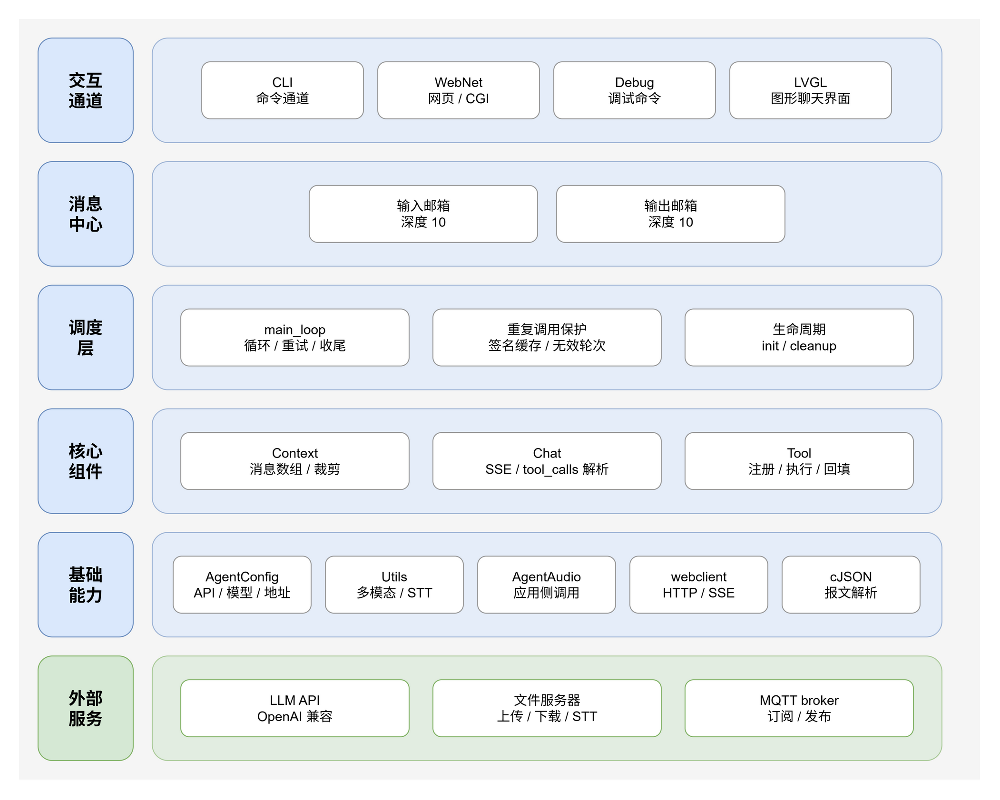
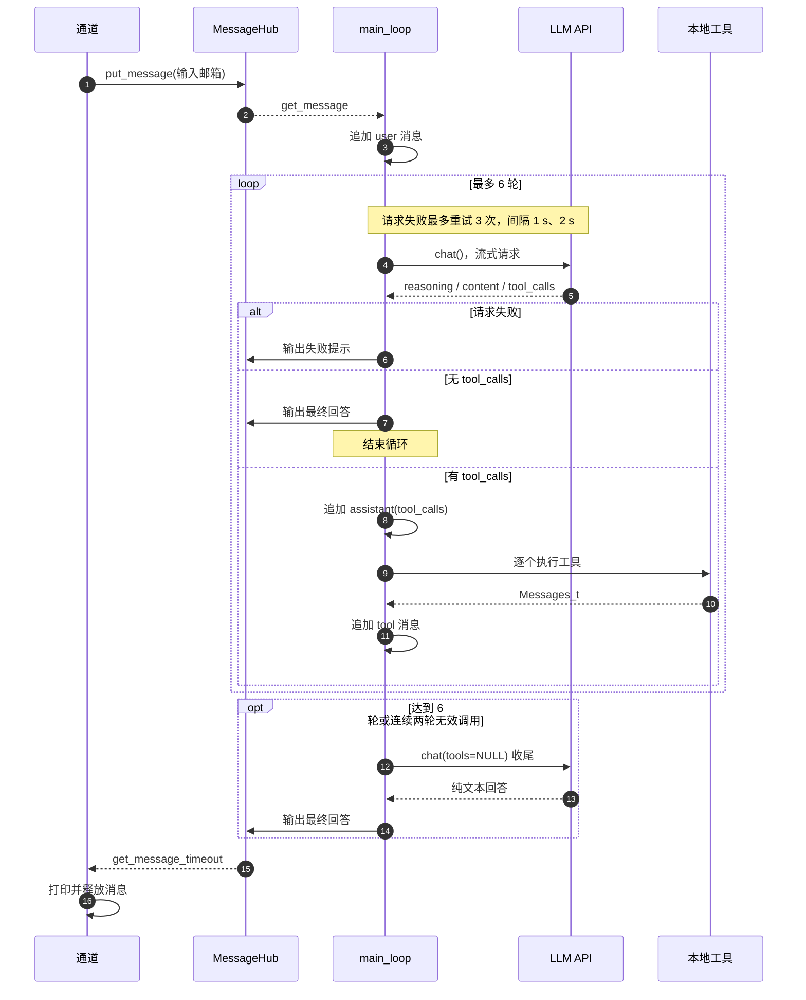
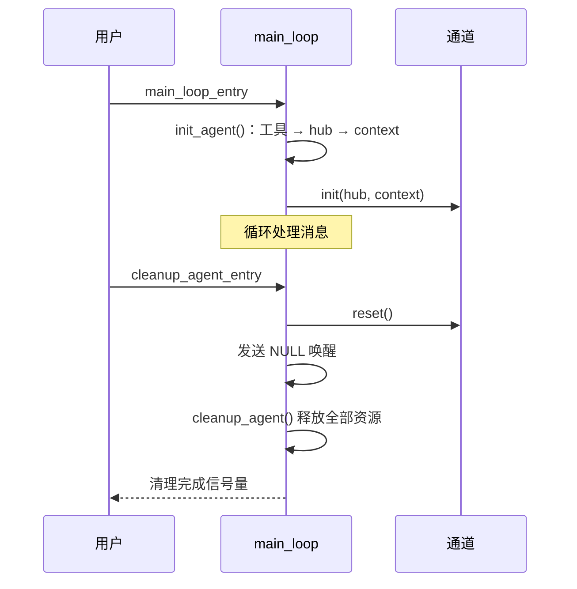

# Agent 框架文档

本文档说明框架的架构、组件、数据流、内存约定与配置。接口细节见 [api.md](./api.md)。

## 1. 概述

框架运行在 RT-Thread 上，处理一次用户请求的完整过程：接收消息、请求 LLM、执行工具、写回结果、输出回答。主要能力：

- 流式对话：解析 SSE 中的思考过程、正文与工具调用。
- 工具系统：注册、查找、执行本地工具，内置运算示例与 7 个 MQTT 工具。
- 上下文管理：按 system / user / assistant / tool 角色维护历史，支持清空与裁剪。
- 多通道：CLI、WebNet、Debug、LVGL，通过 `AgentChannelOps` 接入。
- 多模态：图片、视频和未启用 STT 的音频上传到文件服务器。
- 本地语音转写：音频先转成文本，再发给模型。
- 音频驱动：播放与录音命令封装。
- 生命周期：进入对话、清理、再次进入，清理后堆内存回到基线。

## 2. 架构总览



draw.io 源文件：[architecture-layers.drawio](../diagrams/architecture-layers.drawio)

AgentAudio 由应用直接调用，不参与对话主循环。

### 分层职责

| 层 | 组件 | 职责 |
|---|---|---|
| 顶层调度 | `AgentLoop` | 初始化与清理、对话主循环、工具调度、重复调用保护 |
| 核心 | `MessageHub` | 基于 RT-Thread 邮箱的组件间消息传递 |
| 核心 | `Context` | 对话历史的追加、清空、裁剪 |
| 核心 | `Chat` | LLM API 通信与 SSE 解析 |
| 核心 | `Tool` | 工具注册、查找、执行、结果回填 |
| 通道 | `CLI / WebNet / Debug / LVGL` | 外部交互界面，通过 `AgentChannelOps` 接入 |
| 基础 | `AgentConfig / Utils / Prompt` | 运行时配置、多模态与文本注入、系统提示词 |
| 驱动 | `AgentAudio` | 播放与录音的命令封装 |

## 3. 核心组件

### 3.1 AgentLoop

文件：`src/AgentLoop.c`

主循环线程名为 `AgentLoop`，栈 10240 字节，优先级 10。

- 启动时调用 `init_agent()` 创建工具、MessageHub、Context，并调用通道的 `init`。
- 阻塞等待输入邮箱。收到消息后追加为 user 消息，释放消息对象，再调用 `agent_loop`。
- 一次请求结束后裁剪上下文，保留最近 `PKG_AGENT_MESSAGE_TRIM` 条。
- 处理期间 `g_agent_busy` 为真，`agent_is_busy()` 返回 `RT_TRUE`；等待新消息时返回 `RT_FALSE`。MQTT 注入等外部模块可据此错峰。

`agent_loop` 的规则：

- 工具循环最多 6 轮，`loop_max = 6` 写死在代码里，不是 Kconfig 选项。
- 每轮调用 `chat()`。请求失败最多尝试 3 次，退避间隔为 1 s、2 s。
- 没有 `tool_calls` 时，本轮回答即为最终回答。
- 有 `tool_calls` 时，先追加带 `tool_calls` 的 assistant 消息，再逐个执行工具，把结果写成 `role=tool` 消息。
- 同一工具、同一参数再次出现时跳过执行，回一条“结果未变化，请直接回答”的 tool 消息。
- 同一次用户请求中，同一工具调用超过 3 次时仍会执行，但计为无效调用。
- 连续两轮全部是重复或无效调用时，跳出循环，强制生成文本回答。
- 重复签名缓存与工具计数在 `agent_loop` 开始时清零，不跨用户请求累计。
- 达到 6 轮上限时，再发一次不带工具的请求，要求模型给出最终回答。
- 工具不存在、参数不是合法 JSON、参数校验失败时，补一条 tool 错误消息，保证每个 `tool_call_id` 都有结果。

兜底文本通过 `agent_notify()` 同时写入输出邮箱和流式打印路径。CLI 通道只打印流式内容，这样用户能看到“工具循环超限”“请求失败”等提示。

MSH 命令：

- `main_loop_entry`：创建并启动主循环线程。
- `cleanup_agent_entry`：停止通道，发送停止信号，等待主循环退出。

### 3.2 MessageHub

文件：`src/MessageHub.c`、`include/MessageHub.h`

- 输入邮箱 `AgentInputMb`，容量 10，方向为通道 → 主循环。
- 输出邮箱 `AgentOutMb`，容量 10，方向为主循环 → 通道。
- 消息载体是 `Messages_t`，容量不足时按 5 条递增。
- `message_hub_get_timeout()` 提供带超时的接收，供通道做可中断等待。
- `message_hub_destroy()` 会排空两个邮箱，释放残留消息。

所有权规则见第 5 节。

### 3.3 Context

文件：`src/context.c`、`include/context.h`

维护一个 cJSON 消息数组，角色包括 system、user、assistant、tool。

- 创建时调用 `build_system_prompt`，系统提示词来自 `src/prompt.c`。
- `append_assistant_message`：
  - 没有工具调用时，写入 assistant 的正文。
  - 有工具调用时，写入 `content` 为空的 assistant 消息，并复制 `tool_calls`。
- `append_tool_message`：把工具结果拼成一个字符串，写入 `content`。只拼接 `TYPE_TEXT` 项，多模态数组不适用于 `role=tool`。
- `clear_message`：删除全部消息并新建空数组，不会自动重建 system 提示词。
- `trim_context(keep_rounds)`：保留 system 提示词和最近 `keep_rounds` 条消息，其余从数组头部删除。参数名是 `keep_rounds`，实际按消息条数计算，不是按对话轮次。

assistant 消息必须排在对应的 tool 消息之前，否则 OpenAI 兼容接口会返回 400。

### 3.4 Chat

文件：`src/chat.c`、`include/chat.h`

- 请求体包含 `model`、`messages`、`tools`、`max_tokens`、`stream: true`，使用 Bearer 认证。
- `max_tokens` 固定为 32 × 1024。
- webclient 超时为 30 s。
- 解析 `data: ` 开头的 SSE 行，遇到 `[DONE]` 结束。
- 思考内容优先取 `delta.reasoning_content`，没有时取 `delta.reasoning`。
- 正文取 `delta.content`。
- 工具调用按 `index` 合并。`id`、`name` 取第一个非空值，`arguments` 逐片追加，超过 `PKG_AGENT_MAX_TOOL_ARG_LEN` 后丢弃后续分片并打印告警。
- 单行超过 `PKG_AGENT_STREAM_LINE_BUFSZ` 时整行丢弃，并提示调大该选项。
- JSON 解析失败时重置行缓冲，继续处理后续数据。
- 响应结束后归一化工具调用：缺失 `id` 用 `call_<index>`，空参数改为 `{}`，没有函数名的调用丢弃。
- 返回 `ChatResponse_t`，使用后必须调用 `chat_response_free()`。

### 3.5 Tool 工具系统

文件：`src/tool_base.c`、`src/tool_func.c`、`src/tools/*`

- 全局单例工具链表，节点保存工具定义 JSON 与执行函数。
- 工具函数签名：`void tool_xxx(cJSON *args, AgentToolNode_t node)`，结果写入 `node->ret.messages`。
- `init_tools()` 注册内置工具，重复调用不会重复注册。
- 内置运算工具：`add`、`mul`、`compare`。
- 内置 MQTT 工具：`mqtt_connect`、`mqtt_disconnect`、`mqtt_publish`、`mqtt_subscribe`、`mqtt_receive`、`mqtt_rule`、`mqtt_history`。
- `build_tools_json()` 把工具定义交给请求体，节点不再持有这部分 JSON。
- `agent_tools_cleanup()` 释放链表、残留结果与注册标志，再次进入时重新注册。

### 3.6 Channels

文件：`src/channels/*`、`include/channels/*`

四个通道实现同一个接口：

```c
typedef struct AgentChannelOps
{
    int  (*init)(MessageHub_t hub, Context_t ctx);
    void (*reset)(void);
} AgentChannelOps;
```

| 通道 | 宏 | ops 实例 | init | reset |
|---|---|---|---|---|
| LVGL | `PKG_AGENT_LVGL_CHANNEL` | `agent_lvgl_ops` | 应用侧实现，保存 hub | 应用侧实现，清空 hub |
| CLI | `PKG_AGENT_CLI_CHANNEL` | `agent_cli_ops` | 创建 readline 线程 | 停止线程并释放句柄 |
| WebNet | `PKG_AGENT_WEBNET_CHANNEL` | `agent_webnet_ops` | 注册 CGI | 置空缓存指针 |
| Debug | `PKG_AGENT_DEBUG_CHANNEL` | `agent_debug_ops` | 保存 hub 与 ctx | 置空缓存指针 |

`include/channels/AgentChannels.h` 是唯一的通道选择点，优先级为 LVGL → CLI → WebNet → Debug。Kconfig 的通道选项是单选，正常配置只会定义一个宏。

LVGL 通道在包内只有头文件 `AgentLvglChannel.h`。`agent_lvgl_ops` 由应用实现，本仓库的示例在 `applications/lvgl/demo/lv_home_agent.c`：保存 hub、用 `message_hub_get_timeout()` 轮询输出、用 MSH 命令启动 agent。

WebNet 通道提供三个 CGI：

- `POST /cgi-bin/chat`：JSON 请求，字段为 `message`、`stream`、`reset`。
- `POST /cgi-bin/config`：更新运行时配置。
- `GET /cgi-bin/get_config`：读取当前配置。

`stream` 为真时返回 `text/event-stream`，事件依次为 `delta`、`final`、`done`。

包内自带一个 WebNet 聊天页面 `resource/index.html`，调用 `/cgi-bin/chat`、`/cgi-bin/config`、`/cgi-bin/get_config`。把它放到 webnet 能访问的根目录后，打开 `http://<设备IP>/index.html` 即可使用。

页面删除对话时还会请求 `/cgi-bin/cleanup`，包内没有注册这个 CGI。请求失败只在浏览器控制台打日志，不影响聊天。

### 3.7 AgentConfig

文件：`config/AgentConfig.c`、`config/AgentConfig.h`

- 编译期默认值来自 `PKG_AGENT_API_KEY`、`PKG_AGENT_MODEL_NAME`、`PKG_AGENT_API_URL`。
- 运行时可用 `agent_config_set()` 修改，`get_dynamic_agent_*()` 优先返回运行时值。
- 纯静态存储，不使用堆。

### 3.8 Utils 与多模态

文件：`src/utils.c`、`include/utils.h`

- 文本转换：`format_text()`、`create_content_array()`、`to_content()`。
- 工具 JSON 构造：`create_tool_item()`、`create_param_obj()`、`create_property()`。
- 文本注入：`agent_inject_text()` 把一段文本作为 user 消息投递给 agent。agent 未运行时返回错误。
- 多模态开启后：
  - 图片、视频先上传，再生成 `image_url` 或 `video_url`。
  - 音频未启用 STT 时上传，生成 `audio_url`。
  - 上传失败的消息跳过，不影响其他内容。
- 多模态使用独立文件操作线程，栈大小由 `PKG_AGENT_FILE_OP_THREAD_SIZE` 配置，默认 4096。
- 上传返回 URL，下载按 `file_id` 保存到本地。
- MSH 命令 `msh_agent_upload_download` 可手工上传、下载。

### 3.9 本地语音转写

文件：`src/utils.c`

- 仅在 `PKG_AGENT_STT_ENABLE` 时编译。
- `to_content()` 处理 `TYPE_AUDIO` 时调用 `agent_stt_transcribe()`。
- 使用 multipart POST 把 WAV 发到 `PKG_AGENT_STT_URL`。
- 连接超时 120 s，响应缓冲为静态 1024 字节。
- 解析 `{"code":0,"data":{"text":"..."}}`。
- 转写后删除本地录音，无论成功与否；成功时生成文本项，失败时生成一条提示文本，不上传音频。原因是纯文本模型收到 `audio_url` 会直接返回 422。

### 3.10 AgentAudio

文件：`src/driver/audio/AgentAudio.c`、`include/driver/audio/AgentAudio.h`

音频驱动封装 `wavplay` 与 `wavrecord` 命令，与多模态开关无关。

- 播放：`agent_driver_audio_play()`、`stop`、`pause`、`resume`、`set_volume`。
- 录音：`agent_driver_audio_record()` 在 `rec_work` 线程里执行，栈 1024 字节，优先级 13，不阻塞调用者。
- 录音参数固定为 16000 Hz、双声道、16 位。
- `agent_driver_audio_record_stop()` 停止录音。

### 3.11 MQTT 工具

文件：`src/tools/tool_mqtt/`

- 使用 paho MQTT 的 pipe 模式，QoS 固定为 1。
- 订阅、过滤、阈值规则、历史缓存都在本地完成。
- 三种投递模式：`filter`、`auto`、`poll`。默认 `filter`。
- 发布有 100 ms 最小间隔。
- 工具可调用 `mqtt_tool_publish()` 主动发布，也可用 `mqtt_tool_topic_latest()` 读取最新值。
- agent 忙时，注入侧会等待空闲，避免连续请求压垮 API 与网络。

完整说明见 [tool_mqtt.md](./tool_mqtt.md)。

## 4. 数据流

### 4.1 一次请求



### 4.2 工具消息顺序

一轮工具调用在上下文中的顺序固定为：

1. `assistant` 消息，`content` 为空，带 `tool_calls`。
2. 每个 `tool_call_id` 对应一条 `tool` 消息。

即使工具不存在或参数错误，也要补一条 tool 消息。缺一条就会破坏 OpenAI 兼容接口的校验。

### 4.3 清理流程

`cleanup_agent_entry` 先调用通道 `reset`，再向输入邮箱发送 NULL 唤醒主循环。主循环退出后执行 `cleanup_agent`：

1. 再次调用通道 `reset`（幂等）。
2. 向输出邮箱发送 NULL 哨兵，唤醒阻塞的输出等待。
3. 摘除全局 hub 引用，再销毁 MessageHub，内部排空两个邮箱。
4. 销毁 Context。
5. 清理工具链表与残留消息。
6. 停止文件操作线程（启用多模态时）。
7. 打印堆内存快照，释放清理完成信号量。

MQTT 客户端由 MQTT 工具自行管理，agent 清理不会断开连接。需要断开时执行 `mqtt_tool stop` 或 `mqtt_disconnect`。

## 5. 内存管理约定

| 对象 | 分配者 | 释放者 | 说明 |
|---|---|---|---|
| 输入 `Messages_t` | 通道 | 主循环 | `put_message` 成功后移交所有权 |
| 输出 `Messages_t` | 主循环 | 通道 | 投递输出邮箱后移交所有权 |
| `ChatResponse_t` | `chat()` | 调用者 | 必须调用 `chat_response_free()` |
| hub 与邮箱 | `message_hub_create` | `message_hub_destroy` | 销毁前排空邮箱 |
| context | `agent_context_create` | `agent_context_destroy` | — |
| 工具链表与 JSON | `init_tools` | `agent_tools_cleanup` | 再次进入时重新注册 |
| 通道缓存指针 | 通道 init | 通道 reset | 置空，避免悬垂 |
| HTTP 会话与缓冲 | `chat()` | `chat()` | 使用 `webclient_close` 与 `web_free` 释放 |
| 工具结果消息（`node->ret.messages`） | 工具函数 | 工具节点 | 下次执行前或 `agent_tools_cleanup` 时释放；`append_tool_message` 只复制文本到上下文 |
| MQTT 注入消息 | 注入方 | 主循环 | 注入失败时由注入方释放 |

邮箱是异步队列，`put_message` 只入队指针。入队即交接所有权，发送方不能立即释放，接收方负责释放。

## 6. 生命周期



清理后可以再次执行 `main_loop_entry`。每轮 `cleanup done` 的 `used` 持平，说明没有泄漏；逐轮上涨说明存在泄漏。

## 7. 配置项

### 通道

| 宏 | 说明 |
|---|---|
| `PKG_AGENT_CLI_CHANNEL` | CLI 通道，默认 |
| `PKG_AGENT_WEBNET_CHANNEL` | WebNet 通道 |
| `PKG_AGENT_DEBUG_CHANNEL` | Debug 通道 |
| `PKG_AGENT_LVGL_CHANNEL` | LVGL 通道 |

### LLM 与缓冲

| 宏 | 说明 |
|---|---|
| `PKG_AGENT_API_KEY` / `PKG_AGENT_API_URL` / `PKG_AGENT_MODEL_NAME` | 默认 API 配置 |
| `PKG_AGENT_RESP_BUFSZ` | HTTP 响应接收缓冲，默认 2048 |
| `PKG_AGENT_WEB_SOCKET_BUFSZ` | webclient 会话缓冲，默认 2048 |
| `PKG_AGENT_MAX_REASONING_LEN` | 思考文本上限，默认 2048 |
| `PKG_AGENT_MAX_CONTENT_LEN` | 正文上限，默认 2048 |
| `PKG_AGENT_STREAM_LINE_BUFSZ` | SSE 单行缓冲，默认 1024 |
| `PKG_AGENT_MAX_TOOL_ARG_LEN` | 工具参数上限，默认 1024 |
| `PKG_AGENT_MESSAGE_TRIM` | 上下文保留条数，默认 6 |

### 多模态与语音

| 宏 | 说明 |
|---|---|
| `PKG_AGENT_MULTIMODAL_ENABLE` / `PKG_AGENT_MULTIMODAL_DISABLE` | 多模态开关，默认关闭 |
| `PKG_AGENT_UPLOAD_URL` / `PKG_AGENT_DOWNLOAD_URL` | 文件服务器地址 |
| `PKG_AGENT_FILE_OP_THREAD_SIZE` | 文件操作线程栈，默认 4096 |
| `PKG_AGENT_STT_ENABLE` / `PKG_AGENT_STT_DISABLE` | 语音转写开关，默认启用 |
| `PKG_AGENT_STT_URL` | STT 接口地址 |
| `PKG_AGENT_DRIVER_AUDIO` | 音频驱动开关，独立于多模态 |

### MQTT

MQTT 选项较多，见 [tool_mqtt.md](./tool_mqtt.md) 的配置章节。常用项：

- `PKG_AGENT_TOOL_MQTT_ENABLE`
- `PKG_AGENT_TOOL_MQTT_BROKER_URL`
- `PKG_AGENT_TOOL_MQTT_MAX_SUB_TOPICS`
- `PKG_AGENT_TOOL_MQTT_HISTORY_DEPTH`
- `PKG_AGENT_TOOL_MQTT_LOCK_WAIT_MS`

## 8. 构建与依赖

- menuconfig 中启用 `RT-Thread online packages → AI packages → Lightweight Agent software for RT-Thread`。
- 执行 `pkgs --update`，再执行 `scons`。
- 依赖：RT-Thread 内核、cJSON、webclient、ulog。
- HTTPS 需要 mbedtls，`Maxium fragment length` 至少 6144。
- WebNet 通道需要 webnet 与 CGI。
- MQTT 工具需要 paho-mqtt。
- 音频驱动需要 wavplayer、录音支持与音频框架。
- 多模态需要 DFS 与 POSIX 文件接口。

`SConscript` 的编译范围：

- `src/*.c`
- 通道：`CLI.c`、`AgentWebChannel.c`、`AgentDebugChannel.c`
- 工具目录
- MQTT 目录
- `config/AgentConfig.c`
- 音频驱动（启用 `PKG_AGENT_DRIVER_AUDIO` 时）

LVGL 通道的实现不在包内，由应用工程编译。

## 9. 内存快照日志

启用 `RT_USING_HEAP` 时，启动与清理会打印堆内存：

```text
[mem] agent started: heap total=..., used=..., max_used=...
[mem] cleanup done: heap total=..., used=..., max_used=...
```

比较每轮 `cleanup done` 的 `used` 即可判断是否泄漏。

## 10. 已知说明

- 串口中文乱码是控制台编码问题，不影响框架内存与功能。
- `src/prompt.c` 里的系统提示词是示例内容，接入自己的产品时应按场景修改。
- `cleanup_agent_entry` 不停止 MQTT 客户端。需要断开连接时，先执行 `mqtt_tool stop`。
- LVGL 通道只提供接口，包内不包含聊天界面。
- `utils.h` 中下载函数的声明名与实际定义不一致，详见 [api.md](./api.md) 的“已知差异”。
- `trim_context()` 按消息条数裁剪，可能把 `assistant(tool_calls)` 与后续 `tool` 消息拆开。`PKG_AGENT_MESSAGE_TRIM` 小于一轮工具调用的消息数时，下一轮请求可能被接口以 400 拒绝。
