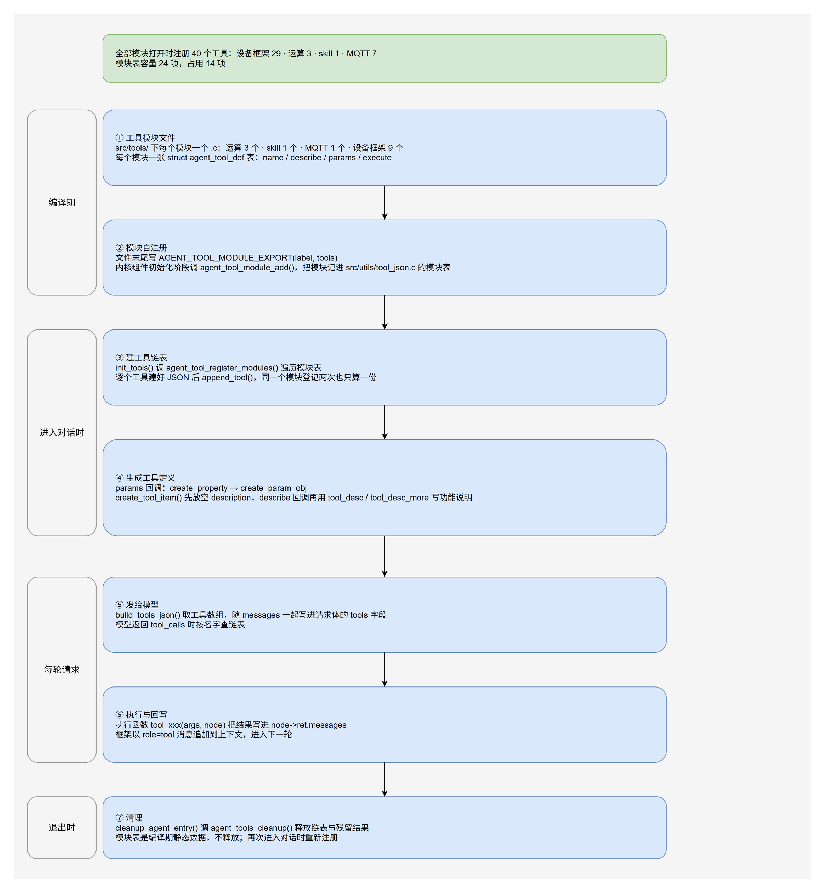

# 工具开发指南

本文说明如何给 Agent 添加工具、注册工具，以及工具执行函数的约定。框架结构见 [framework.md](./framework.md)，接口见 [api.md](./api.md)。

## 1. 调用流程

工具调用由模型发起，框架负责执行和回填：

```text
LLM 返回 tool_calls（函数名 + 参数 JSON）
        ↓
agent_loop 按 function.name 查找工具节点
        ↓
校验参数 JSON，调用 tool_xxx(args, node)
        ↓
工具把结果写入 node->ret.messages
        ↓
结果以 role=tool 消息写入上下文
        ↓
进入下一轮 chat()
```

几条硬性规则：

- 工具函数签名固定为 `void tool_xxx(cJSON *args, AgentToolNode_t node)`。
- 工具结果必须是文本。`role=tool` 消息只接受字符串内容。
- 每个 `tool_call_id` 都必须有一条对应的 tool 消息。工具不存在、参数错误、执行失败时，框架也会补一条错误结果。
- 工具结果为空时，模型容易反复调用同一个工具。返回内容至少包含结果、失败原因或下一步建议。

### 1.1 注册与调用链路



draw.io 源文件：[tool-registration.drawio](../diagrams/tool-registration.drawio)

图分四段：编译期在模块文件里写描述符表并自注册；进入对话时把模块表里的工具挂上链表；每轮请求把工具定义发给模型，模型点名后执行对应工具；退出对话时释放链表。

## 2. 工具定义

每个工具以 OpenAI function-calling 格式发给模型：

```json
{
  "type": "function",
  "function": {
    "name": "add",
    "description": "Calculate the sum of two numbers",
    "parameters": {
      "type": "object",
      "properties": {
        "a": { "type": "number", "description": "First number" },
        "b": { "type": "number", "description": "Second number" }
      },
      "required": ["a", "b"]
    }
  }
}
```

`include/utils/tool_json.h` 提供两组构造函数，参数侧三个，描述侧四个：

| 函数 | 作用 |
|---|---|
| `create_property(props_obj, name, type, desc)` | 添加属性 `{type, description}` |
| `create_param_obj(props_obj, required_arr)` | 包装成 `{type:"object", properties, required}` |
| `create_tool_item(func_name, desc, params_obj)` | 包装成完整的工具项 |
| `tool_desc(func, text)` | 写入功能说明的主体 |
| `tool_desc_more(func, text)` | 追加一句，前面自动补一个空格 |
| `tool_desc_read_only(func)` | 追加 `Read-only.` |
| `tool_desc_state_changing(func)` | 追加 `State-changing: call only after the user authorized this peripheral.` |

工具定义不需要自己拼。每个工具在自己的 `.c` 里写两个构造函数：`<工具名>_desc` 填功能说明，`<工具名>_params` 填参数。注册时框架先用 `create_tool_item` 建出带空 `description` 的工具项，再调 `_desc` 回调补上文字；参数侧依次调 `create_property` 和 `create_param_obj`。

描述写成函数，表里就不用堆叠长字符串。一段说明可以在 `_desc` 里折成两三行，每行不到 100 列。`Read-only.` 这类固定提示句由 `tool_desc_read_only()` 统一给出，各模块的措辞不会各写一套。

参数定义的写法：

- 类型名用小写：`integer`、`number`、`string`、`boolean`、`object`、`array`。
- 整数用 `integer`，浮点用 `number`。两者在 cJSON 里都通过 `cJSON_IsNumber` 校验，区别在模型侧：`integer` 会倾向发整数。
- 数组要写 `items`，对象要写 `properties`，不要只写一个 `"type": "array"`。`create_property` 只填 `type` 和 `description`，这两个字段要在构造函数里自己补，写法见 3.2。
- 必填参数放进 `required`，可选参数不要放，但执行函数要能处理缺失。
- `description` 写清含义、单位、范围和示例值。模型是否调用正确，很大程度取决于这段文字。

## 3. 添加工具

一个工具一个 `.c`，放在 `src/tools/` 下，共 3 步。以 `add` 为例，实现文件是 `src/tools/tool_add.c`。

### 3.1 实现工具函数

```c
#include "tool_base.h"

void tool_add(cJSON *args_obj, AgentToolNode_t node)
{
    if (!args_obj || !node)
    {
        if (node)
        {
            if (node->ret.messages)
            {
                messages_destroy(node->ret.messages);
                node->ret.messages = RT_NULL;
            }
            node->ret.ret = RT_ERROR;
        }
        return;
    }

    /* 节点会复用，先释放上一次的结果 */
    if (node->ret.messages)
    {
        messages_destroy(node->ret.messages);
        node->ret.messages = RT_NULL;
    }

    cJSON *a_json = cJSON_GetObjectItemCaseSensitive(args_obj, "a");
    cJSON *b_json = cJSON_GetObjectItemCaseSensitive(args_obj, "b");
    if (!a_json || !b_json || !cJSON_IsNumber(a_json) || !cJSON_IsNumber(b_json))
    {
        node->ret.ret = RT_ERROR;
        return;
    }

    char ret_buffer[64] = {0};
    rt_snprintf(ret_buffer, sizeof(ret_buffer), "计算结果：%f",
                a_json->valuedouble + b_json->valuedouble);

    node->ret.messages = messages_create(1);
    if (node->ret.messages != RT_NULL)
    {
        messages_append(node->ret.messages, TYPE_TEXT, ret_buffer);
    }
    node->ret.ret = (node->ret.messages != RT_NULL) ? RT_EOK : RT_ERROR;
}
```

参数校验失败时保持 `messages` 为 `RT_NULL`。框架会补一条“参数无效”的 tool 消息。

### 3.2 写描述、参数构造函数和描述符表

描述构造函数只做一件事：用 `tool_desc` 写主体，用 `tool_desc_more` 和两个固定提示句补后面的句子。参数构造函数也只做两件事：用 `create_property` 往 `props` 加属性，用 `cJSON_AddItemToArray` 往 `required` 加必填参数名。

```c
static void add_desc(cJSON *func)
{
    tool_desc(func, "Calculate the sum of two numbers");
}

static void add_params(cJSON *props, cJSON *required)
{
    create_property(props, "a", "number", "First number");
    create_property(props, "b", "number", "Second number");
    cJSON_AddItemToArray(required, cJSON_CreateString("a"));
    cJSON_AddItemToArray(required, cJSON_CreateString("b"));
}

static const struct agent_tool_def add_tools[] =
{
    { "add", add_desc, add_params, tool_add },
};
```

表里四项分别是：工具名（模型看到的 `function.name`）、描述构造函数、参数构造函数、执行函数。一个模块可以放多个工具，一行一个。没有参数的工具把参数构造函数写成 `RT_NULL`，注册时会得到一个空的 `properties` 和 `required`。描述回调不能省，缺省时注册日志会打 `Tool '<name>' has no description`，发给模型的说明是空串。

`create_property` 覆盖不到的字段，在构造函数里把属性对象取回来补：

```c
static void xxx_params(cJSON *props, cJSON *required)
{
    cJSON *ids = RT_NULL;
    cJSON *items = RT_NULL;

    create_property(props, "ids", "array", "Indexes to read, integer array");
    ids = cJSON_GetObjectItemCaseSensitive(props, "ids");
    items = cJSON_CreateObject();
    cJSON_AddStringToObject(items, "type", "integer");
    cJSON_AddItemToObject(ids, "items", items);
    cJSON_AddItemToArray(required, cJSON_CreateString("ids"));
}
```

包内现有工具都只用 `create_property`，`enum`、`items` 这类字段留给你按需要加。

### 3.3 在文件末尾登记

```c
AGENT_TOOL_MODULE_EXPORT(add, add_tools)
```

宏生成模块描述符，并用 `INIT_COMPONENT_EXPORT` 在内核组件初始化阶段调 `agent_tool_module_add()`，把模块登记进 `src/utils/tool_json.c` 的模块表。`init_tools()` 调一次 `agent_tool_register_modules()`，遍历模块表把每个工具挂上工具链表。模块表容量 24 项。

`src/tools/*.c` 由 `SConscript` 自动收录，不需要改构建脚本。加一个工具也不用动 `src/tool_func.c` 和 `include/tools/tools.h`。只有包外还要直接调用这个执行函数时，才需要新建头文件并加进 `tools.h`，`tool_add.h` 就是这种情况。

## 4. 示例：求余工具 mod

`src/tools/tool_mod.c`：

```c
#include "tool_base.h"

void tool_mod(cJSON *args_obj, AgentToolNode_t node)
{
    if (!args_obj || !node)
    {
        if (node)
        {
            if (node->ret.messages)
            {
                messages_destroy(node->ret.messages);
                node->ret.messages = RT_NULL;
            }
            node->ret.ret = RT_ERROR;
        }
        return;
    }

    if (node->ret.messages)
    {
        messages_destroy(node->ret.messages);
        node->ret.messages = RT_NULL;
    }

    cJSON *a_json = cJSON_GetObjectItemCaseSensitive(args_obj, "a");
    cJSON *b_json = cJSON_GetObjectItemCaseSensitive(args_obj, "b");
    if (!a_json || !b_json || !cJSON_IsNumber(a_json) || !cJSON_IsNumber(b_json))
    {
        node->ret.ret = RT_ERROR;
        return;
    }

    long a = (long)a_json->valuedouble;
    long b = (long)b_json->valuedouble;
    char ret_buffer[64] = {0};

    if (b == 0)
    {
        rt_snprintf(ret_buffer, sizeof(ret_buffer), "error: modulo by zero");
    }
    else
    {
        rt_snprintf(ret_buffer, sizeof(ret_buffer), "%ld %% %ld = %ld", a, b, a % b);
    }

    node->ret.messages = messages_create(1);
    if (node->ret.messages != RT_NULL)
    {
        messages_append(node->ret.messages, TYPE_TEXT, ret_buffer);
    }
    node->ret.ret = (node->ret.messages != RT_NULL) ? RT_EOK : RT_ERROR;
}

static void mod_desc(cJSON *func)
{
    tool_desc(func, "Calculate the remainder of a divided by b");
}

static void mod_params(cJSON *props, cJSON *required)
{
    create_property(props, "a", "number", "Dividend");
    create_property(props, "b", "number", "Divisor");
    cJSON_AddItemToArray(required, cJSON_CreateString("a"));
    cJSON_AddItemToArray(required, cJSON_CreateString("b"));
}

static const struct agent_tool_def mod_tools[] =
{
    { "mod", mod_desc, mod_params, tool_mod },
};

AGENT_TOOL_MODULE_EXPORT(mod, mod_tools)
```

## 5. 示例：字符串参数 word_count

参数读取方式与数值工具相同，只是校验函数换成 `cJSON_IsString`。

```c
cJSON *text_json = cJSON_GetObjectItemCaseSensitive(args_obj, "text");
if (!text_json || !cJSON_IsString(text_json))
{
    node->ret.ret = RT_ERROR;
    return;
}

const char *text = text_json->valuestring;
int words = 0;
int in_word = 0;

for (const char *p = text; *p != '\0'; p++)
{
    if (*p == ' ' || *p == '\t' || *p == '\n')
    {
        in_word = 0;
    }
    else if (!in_word)
    {
        in_word = 1;
        words++;
    }
}

char ret_buffer[64] = {0};
rt_snprintf(ret_buffer, sizeof(ret_buffer), "word count: %d", words);

node->ret.messages = messages_create(1);
if (node->ret.messages != RT_NULL)
{
    messages_append(node->ret.messages, TYPE_TEXT, ret_buffer);
}
node->ret.ret = (node->ret.messages != RT_NULL) ? RT_EOK : RT_ERROR;
```

在同一个文件里补齐两个构造函数、描述符表和登记宏：

```c
static void word_count_desc(cJSON *func)
{
    tool_desc(func, "Count the number of words in a text.");
    tool_desc_read_only(func);
}

static void word_count_params(cJSON *props, cJSON *required)
{
    create_property(props, "text", "string", "The text to count words in");
    cJSON_AddItemToArray(required, cJSON_CreateString("text"));
}

static const struct agent_tool_def word_count_tools[] =
{
    { "word_count", word_count_desc, word_count_params, tool_word_count },
};

AGENT_TOOL_MODULE_EXPORT(word_count, word_count_tools)
```

`tool_desc_read_only(func)` 会追加一句 `Read-only.`，最终发给模型的文本是 `Count the number of words in a text. Read-only.`。

可选参数的处理方式相同：往 `props` 加属性，不要往 `required` 加名字，执行函数里判断字段缺失。

## 6. 注册与生命周期

- `init_tools()` 由 `init_agent()` 在进入对话时调用，也可以手动执行 MSH 命令 `init_tools`。
- 模块登记在内核组件初始化阶段完成，早于任何 agent 线程启动。`agent_tool_module_add()` 按描述符指针去重，重复调用不会加两份。
- `agent_tool_register_modules()` 遍历模块表，把每个工具挂上链表。`init_flag` 保证 `init_tools()` 只执行一次。
- `cleanup_agent()` 调用 `agent_tools_cleanup()`，释放工具链表、工具定义 JSON 与残留结果，并复位注册标志。
- 再次进入对话时会重新注册。模块表是静态数据，不需要清理，也不会残留堆内存。工具代码不需要自己管理这些内存。
- 注册哪些工具取决于哪些模块参与了编译：MQTT 模块看 `PKG_AGENT_TOOL_MQTT_ENABLE`，设备模块看 `PKG_AGENT_TOOL_DEVICE_*` 和对应的内核宏，运算与技能模块始终在表里。关掉一个模块不用改任何中心文件。

## 7. 执行函数约定

1. 校验 `args_obj` 与 `node` 是否为 `RT_NULL`。
2. 每次执行前释放 `node->ret.messages`，节点会被复用。
3. 用 `cJSON_GetObjectItemCaseSensitive` 取字段，用 `cJSON_IsXxx` 校验类型。
4. 结果写入 `node->ret.messages`，文本使用 `TYPE_TEXT`。
5. 不要保存 `args_obj` 指针。`agent_loop` 在调用返回后会执行 `cJSON_Delete`。
6. 失败时可以把错误原因作为文本结果返回，也可以让 `messages` 保持 `RT_NULL`。后者会由框架补一条通用错误消息。

`node->ret.ret` 是工具侧的返回值约定，当前主循环不读取它。框架判断失败的依据是 `node->ret.messages == RT_NULL`。

工具结果只支持文本。`append_tool_message()` 只拼接 `TYPE_TEXT` 项，图片、音频等类型会被忽略。需要让模型看到文件时，返回文件路径或 URL 的文本。

## 8. 写设备框架工具

设备框架工具把 `rt_device_*` 包给模型用。除了第 7 节的约定，还要注意下面几点。

1. 参数名固定下来。设备名用 `name`，读写用 `count`、`pos`、`data`、`encoding`，控制命令用 `cmd`、`arg`。模型按名字发参数，名字变了就传不进来。
2. 先查打开状态。读、写、控制都要求设备已打开，引用计数为 0 时返回错误，文本写明要先调 `device_open`。类模块里 `sensor_read` 和 LED 三个工具沿用这条；I2C、SPI、PWM、ADC、DAC 走本类的专用接口，框架不要求先打开，工具不去假装要求。
3. 再查访问模式。驱动把打开模式记在 `open_flag` 里，用 `RT_DEVICE_OFLAG_RDONLY` 与 `RT_DEVICE_OFLAG_WRONLY` 判断。只读句柄上写、只写句柄上读都要拒绝。
4. 保护控制台设备。用 `rt_console_get_device()` 取控制台设备，读和关都拒绝。写控制台会往会话里塞原始字节，也不要主动做。
5. 单位按设备类型换算。字符设备按字节，块设备按块。块大小用 `RT_DEVICE_CTRL_BLK_GETGEOME` 查，工具自己探，不要让模型填。
6. 结果文本写清单位、实际数量和失败原因。模型靠这段文字决定下一步。

写结果时用统一的收尾函数，避免每处都写一遍消息管理。`src/tools/tool_device/tool_device_common.c` 里的 `agent_dev_finish()` 就是这个写法：

```c
void agent_dev_finish(AgentToolNode_t node, rt_err_t result, const char *text)
{
    node->ret.ret = result;
    node->ret.messages = messages_create(1);
    if (!node->ret.messages)
    {
        node->ret.ret = -RT_ENOMEM;
        return;
    }
    if (messages_append(node->ret.messages, TYPE_TEXT, text) != RT_EOK)
    {
        messages_destroy(node->ret.messages);
        node->ret.messages = RT_NULL;
        node->ret.ret = -RT_ENOMEM;
    }
}
```

执行函数入口先调 `agent_dev_reset_result(node)` 释放上一轮的结果，再一路用 `agent_dev_append()` 拼文本，最后调 `agent_dev_finish()` 交出去。参数对象 `args_obj` 由框架释放，工具不要自己删。

包内已经有一组现成的例子：`src/tools/tool_device/tool_device_core.c` 的 7 个通用工具，覆盖发现、生命周期、读写、控制命令与安全护栏。完整说明见 [tool_device.md](./tool_device.md)。

### 8.1 加一类设备模块

一类设备一个文件，放在 `src/tools/tool_device/` 下，SCons 按目录收集，不需要改 `SConscript` 的源文件列表。步骤有四条。

（1）在 `Kconfig` 的 `Agent Tool: Device Framework` 菜单里加开关，`depends on` 写上内核条件，例如 `RT_USING_PWM`。内核条件不满足时这项自动灰掉。

（2）文件全文用开关包住，同时要求 `RT_USING_DEVICE`：

```c
#if defined(RT_USING_DEVICE) && defined(PKG_AGENT_TOOL_DEVICE_PWM)
```

框架里有 v1、v2 两版的（ADC、传感器），把版本条件一起写进这个判断，另一版下整文件不参与编译，免得链到签名不同的接口。

（3）每个工具写成 `void tool_xxx(cJSON *args, AgentToolNode_t node)`，再配两个构造函数，名字用工具名加 `_desc` 和 `_params` 后缀。两个构造函数和执行函数一起写进本模块的描述符表，`src/tools/tool_device/tool_device_pwm.c` 的 `pwm_set` 就是这样：

```c
static void pwm_set_desc(cJSON *func)
{
    tool_desc(func, "Set a PWM channel's period and pulse width in nanoseconds (duty = "
        "pulse/period).");
    tool_desc_state_changing(func);
    tool_desc_more(func, "The channel stays stopped until pwm_enable.");
}

static void pwm_set_params(cJSON *props, cJSON *required)
{
    create_property(props, "name", "string", "Exact PWM device name from device_list.");
    create_property(props, "channel", "number", "PWM channel number.");
    create_property(props, "period_ns", "number", "Period in nanoseconds, 1 ns .. 4.29 s.");
    create_property(props, "pulse_ns", "number",
        "Active pulse width in nanoseconds, 0 .. period_ns.");
    cJSON_AddItemToArray(required, cJSON_CreateString("name"));
    cJSON_AddItemToArray(required, cJSON_CreateString("channel"));
    cJSON_AddItemToArray(required, cJSON_CreateString("period_ns"));
    cJSON_AddItemToArray(required, cJSON_CreateString("pulse_ns"));
}

static const struct agent_tool_def pwm_tools[] =
{
    {
        "pwm_set",
        pwm_set_desc,
        pwm_set_params,
        tool_pwm_set
    },
};
```

设备模块和普通工具用的是同一种表，字段含义见第 3.2 节。参数说明直接写在 `create_property` 的第四个参数里，单位、范围都放进文字。

（4）文件末尾登记，宏自己生成描述符和初始化入口：

```c
AGENT_TOOL_MODULE_EXPORT(pwm, pwm_tools)
```

宏内部用 `INIT_COMPONENT_EXPORT`，在内核组件初始化阶段调 `agent_tool_module_add()`。模块表在 `src/utils/tool_json.c`，容量 24 项：9 个设备模块、3 个运算模块、`skill` 和 MQTT 各 1 个，全开用掉 14 项，余量留给 BSP 自备的模块。`init_tools()` 只调一次 `agent_tool_register_modules()`。

新增模块要一并做三件事：结果文本里给出单位和 `note:`；写类操作在 `_desc` 里调 `tool_desc_state_changing(func)`；在 `skills/device.md` 的类工具一节补一行。

设备工具的类模块不进对外头文件。执行函数的声明集中在 `src/tools/tool_device/tool_device_internal.h`，它 include `utils/tool_json.h` 拿到表结构和注册宏。`include/tools/tools.h` 只导出 `add`、`mul`、`compare`、`tool_mqtt.h` 这些包外还要直接调用的接口，新增加的工具不需要往里加。

## 9. 重复调用与轮次上限

框架对工具循环有四层限制：

- 同一次用户请求中，同一工具、同一参数再次出现时，不再执行。框架会返回一条“结果未变化，请直接回答”的 tool 消息。最近 6 条调用签名会被记住。
- 同一次用户请求中，同一工具调用超过 3 次时仍会执行，但计为无效调用。两组计数在每次 `agent_loop` 开始时清零。
- 连续两轮全部是重复或无效调用时，跳出工具循环，强制模型用文本回答。
- 工具循环最多 6 轮。达到上限后，再发一次不带工具的请求，要求模型给出最终回答。

因此工具结果要尽量包含有效信息。返回空字符串或只有一句“失败”，会让模型继续重试。

## 10. 参数细节

### 10.1 integer 与 number

| 类型 | 含义 | C 端取值 | 典型场景 |
|---|---|---|---|
| `integer` | 整数 | `valueint` | 计数、索引、ID、档位 |
| `number` | 浮点数 | `valuedouble` | 温度、比例、坐标、统计量 |

注意事项：

- cJSON 内部用 double 存储，两种类型都通过 `cJSON_IsNumber`。需要严格区分时，可以比较 `valueint` 与 `valuedouble`。
- `valueint` 的有效范围受平台 `int` 限制。大数用 `valuedouble` 接收，再自行转换。
- 模型偶尔会把数字包成字符串。执行函数必须用 `cJSON_IsNumber` 校验；如果经常出现，在描述里写明 `Please send a number, not a string`。
- 格式化时 `%d` 配 `valueint`，`%f` 配 `valuedouble`，不要混用。

### 10.2 布尔与字符串

- 布尔类型写 `"boolean"`，执行函数用 `cJSON_IsBool` 校验，用 `cJSON_IsTrue` / `cJSON_IsFalse` 判断。
- 字符串类型写 `"string"`，用 `cJSON_IsString` 校验，取 `valuestring`。
- 数组类型写 `"array"` 并给出 `items`，用 `cJSON_IsArray` 校验。
- 对象类型写 `"object"` 并给出 `properties`，用 `cJSON_IsObject` 校验。

### 10.3 长度限制

- 工具参数分片拼接受 `PKG_AGENT_MAX_TOOL_ARG_LEN` 限制，默认 1024 字节。超出后会告警并丢弃后续分片。
- SSE 单行受 `PKG_AGENT_STREAM_LINE_BUFSZ` 限制，默认 1024 字节。带长参数的工具调用如果整行被丢弃，模型侧会表现为“没有工具结果”，此时需要调大该值。
- 工具定义没有数量硬限制，但工具越多，每次请求的 payload 越大。按需注册。

## 11. 检查清单

- [ ] 新建 `src/tools/tool_xxx.c`，include `tool_base.h`，按约定校验参数、释放旧结果、写入文本结果。
- [ ] 写 `xxx_desc()`：`tool_desc` 写主体，`tool_desc_more` 和两个固定提示句补后面的句子。
- [ ] 写 `xxx_params()`：`create_property` 加属性，`cJSON_AddItemToArray` 加必填项。
- [ ] 建 `static const struct agent_tool_def xxx_tools[]`，四项为名字、描述构造函数、参数构造函数、执行函数。
- [ ] 文件末尾写 `AGENT_TOOL_MODULE_EXPORT(xxx, xxx_tools)`。
- [ ] 执行 `scons` 编译。
- [ ] 用 `main_loop_entry` 进入对话，用自然语言触发工具。
- [ ] 反复执行“进入 → 对话 → 清理 → 再进入”，检查 `[mem] cleanup done` 的 `used` 是否持平。

## 12. 常见问题

**新增工具后没有生效？**

检查执行函数指针和表项是否写全，`AGENT_TOOL_MODULE_EXPORT` 是否在文件作用域、没有被包在函数里，以及该文件的编译条件（Kconfig 开关和内核宏）是否满足。再确认已经重新编译并重启。模块表满时日志里有 `Module table full, '<模块>' not registered`，需要调大 `src/utils/tool_json.c` 里的 `AGENT_TOOL_MODULE_MAX`。`init_flag` 在一次 agent 生命周期内保证只注册一次；`cleanup_agent()` 会复位该标志，再次进入时重新注册。

**模型不调用我的工具？**

先改 `_desc` 和 `_params` 里的文字。写清何时使用、输入是什么、返回什么，并给出单位、范围和示例值。

**工具执行失败，结果如何反馈给模型？**

把错误原因作为 `TYPE_TEXT` 结果返回，或者让 `messages` 保持 `RT_NULL`，由框架补一条通用错误消息。模型会在下一轮看到这条结果。

**工具结果能影响后续对话吗？**

能。结果会写入上下文。消息数超过 `PKG_AGENT_MESSAGE_TRIM` 时，框架会用一份滚动摘要替换较早的历史。system 消息和最近几轮保留，较早的工具结果只留在摘要里。

**多模态工具怎么返回图片？**

当前 `role=tool` 消息只接受文本，不能直接返回 `TYPE_IMAGE`。可以返回图片路径或上传后的 URL，让模型在回答中引用。
