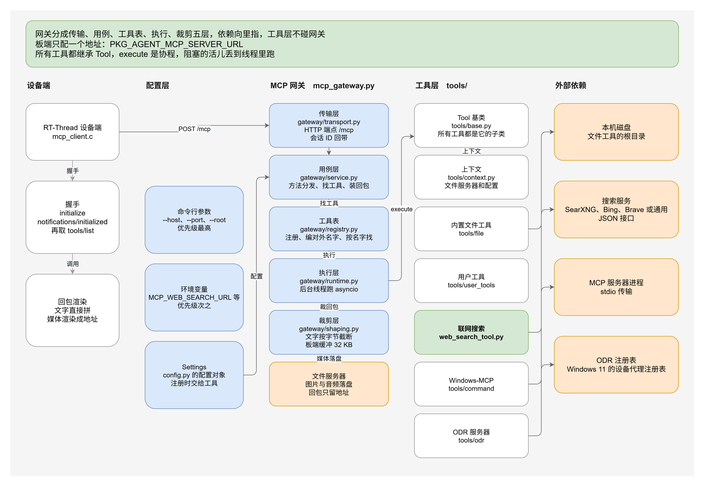
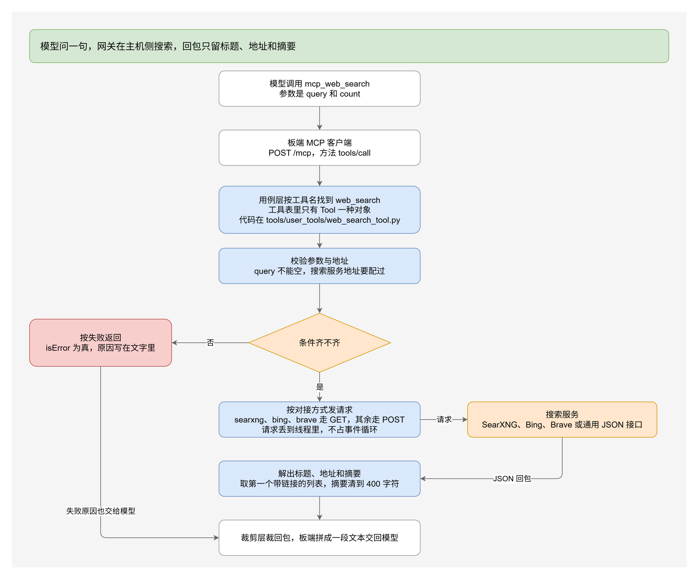

# MCP 工具：连接远端 MCP 服务器

> 面向使用者的 MCP 工具说明：设备端怎么连远端 MCP 服务器，远端工具怎么变成 agent 的工具。
> 服务端部署与启动见 [../resource/file_server/mcp/README.md](../resource/file_server/mcp/README.md)，框架结构见 [framework.md](./framework.md)，接口清单见 [api.md](./api.md)。

---

## 1. 能力概览

设备端只做 MCP 客户端，走 Streamable HTTP 传输。

| 环节 | 行为 |
|---|---|
| 启动握手 | agent 启动时连一次服务端，依次发 `initialize`、`notifications/initialized`、`tools/list` |
| 工具注册 | `tools/list` 里的每个远端工具注册进 agent 工具表，名字加 `mcp_` 前缀 |
| 工具调用 | 模型直接调用 `mcp_` 开头的工具，客户端转成 `tools/call` |
| 结果回传 | 服务端 `result.content` 里的文本内容拼成一段文本，交回模型 |
| 连不上 | 只打告警，agent 照常启动，只是工具表里没有远端工具 |

远端工具名里的非法字符（空格等）换成下划线。名字和本地工具重名时跳过这一条，
并在日志里告警。

注册上限由 `PKG_AGENT_MCP_MAX_TOOLS` 控制，默认 40。远端工具数量超过上限时，
只注册前 N 个，日志会说明实际数量。

## 2. 模块划分

| 文件 | 职责 |
|---|---|
| `inc/tools/tool_mcp/mcp_client.h` | 对外接口：`mcp_client_connect`、`mcp_client_tools`、`mcp_client_call`、`mcp_client_disconnect` |
| `src/tools/tool_mcp/mcp_client.c` | MCP 客户端：JSON-RPC 报文构造、HTTP 收发、SSE 解析、结果拼接 |
| `src/tools/tool_mcp/tool_mcp.c` | 动态注册钩子：把远端工具挂进 agent 工具表，提供统一的执行入口 |

工具注册走 `tool_func.c` 里的弱符号钩子：

```c
rt_weak void agent_tool_register_dynamic(void)   /* 默认空实现 */
rt_weak void agent_tools_cleanup_dynamic(void)  /* 默认空实现 */
```

`init_tools()` 在模块表注册之后、`build_tools_json()` 之前调用注册钩子。
工具 JSON 是首次构建时缓存的，所以远端工具必须在这个时机进来。
`tool_mcp.c` 提供强符号覆盖这两个钩子，其余模块不受影响。

## 3. 握手与调用

握手三次请求：

1. `initialize`：带上 `protocolVersion`（`2025-06-18`）、`capabilities`、`clientInfo`
2. `notifications/initialized`：通知，没有 id，服务端回 202
3. `tools/list`：取回远端工具表

服务端可以在 `initialize` 的响应头里下发 `Mcp-Session-Id`。客户端会记下来，
后续请求都带上这个头。

调用一次远端工具就是一条 `tools/call`，参数原样转发。响应里的 `content` 数组中，
`type` 为 `text` 的条目会被拼成一段文本，条目之间用换行隔开。
服务端把 `isError` 置真时，调用按失败返回，但失败原因同样会交给模型。

回包里 `type` 为 `image` 的条目，带 `url` 时板端渲染成 `[image: <地址>]`，
不带地址时换成一句占位说明。走网关时图片已经由网关存到文件服务器，板端拿到
的是地址，不是占位符。

回包格式两种都支持：纯 JSON 和 `text/event-stream`（SSE）。
SSE 解析按 `data:` 行取报文，优先挑 id 匹配的那一条。

一次请求分四步：连接并发请求头，设收发超时，发请求体，收响应。
分成两段是因为超时：webclient v2.2.0 的超时只能设在已经连上的 socket 上，
连之前设会被丢掉。远端工具算得慢，截屏要 10 秒左右，这段等待必须算在超时里。
包里的 `inc/utils/webclient_util.h` 统一处理超时，见第 4 节。

## 4. 配置

| 选项 | 默认值 | 说明 |
|---|---|---|
| `PKG_AGENT_TOOL_MCP_ENABLE` | `n` | 打开后编译 MCP 客户端与工具模块 |
| `PKG_AGENT_MCP_SERVER_URL` | `http://10.0.2.2:8765/mcp` | 服务端完整地址。只有手动模式下显示，自动模式下这个地址由控制台下发 |
| `PKG_AGENT_MCP_MAX_TOOLS` | `40` | 最多注册多少个远端工具，范围 1 到 64 |
| `PKG_AGENT_MCP_TIMEOUT_MS` | `30000` | 单次 HTTP 请求超时，范围 1000 到 120000 |
| `PKG_AGENT_MCP_RESP_BUFSZ` | `32768` | 单个响应体的上限，范围 2048 到 65536 |

`tools/list` 的结果放不下时，调大 `PKG_AGENT_MCP_RESP_BUFSZ`。这个值同时是
`tools/call` 回包文本的上限。

Windows-MCP 的 `win__screenshot` 回包带一张整屏 PNG，base64 有 780 KB；
`win__snapshot` 的桌面结构有 29 KB。两者都装不下 32 KB 的缓冲，所以网关在
转发前把图片存到文件服务器，回包里只留一句带下载地址的说明；超长的文本截断并
标出省了多少字符。图片的落盘由网关做，板子不碰这张图。

音频同理。外部 MCP 服务器给的 base64 音频，网关按 `mimeType` 定扩展名存到文件
服务器，回包里换成 `[audio saved: <地址> (audio/wav, 1644 bytes)]`。用户工具用
`to_content(audio=...)`，回包里给的是一条 `{"type": "audio", "url": "<地址>"}`。
板端的 `result_to_text` 把这种条目渲染成 `[audio: <地址>]`，拼进给模型的文本。

`PKG_AGENT_MCP_TIMEOUT_MS` 经过 `utils/webclient_util.h` 的封装才真正生效。
webclient v2.2.0 自带的 `webclient_set_timeout()` 有两个问题：连接建立前调用
会被丢掉，那时 socket 还是 -1；毫秒换算成秒时分母写死成 1000，本工程的
`RT_TICK_PER_SECOND` 是 100，15000 毫秒实际只设成 1 秒。封装把这两个问题都绕开了，
同样的问题在聊天、TTS、STT、文件上传下载四条链路上也一并修掉。

默认值按 Windows-MCP 的规模定过。Windows-MCP 一个服务器就 20 个工具，加上网关自带的
11 个文件工具、3 个用户工具和 1 个联网搜索工具，一共 35 个；`tools/list` 的回包有
27 KB。旧的默认值 16 和 8192 装不下。

## 5. 主机端部署

服务端在包的 `resource/file_server/mcp/` 目录，只用 Python 3 标准库。
文件服务器的 deploy 脚本默认把网关一起起起来：

```bat
cd packages\Agent-latest\resource\file_server
deploy.bat
```

只起文件服务器不起网关，用 `--start` 点名：

```bat
deploy.bat --start-only --start file-server
```

网关的分层、路由和回包裁剪规则见
[../resource/file_server/mcp/docs/architecture.md](../resource/file_server/mcp/docs/architecture.md)，
架构图如下：



网关的代码按层拆开，依赖只向里指：传输层（`gateway/transport.py`）不认识工具，
用例层（`gateway/service.py`）不认识 HTTP，工具层（`tools/`）不 import 网关。
命令行和环境变量由 `config.py` 解析一次，往下的层只读配置对象。

单独起网关用本目录的脚本：

```bat
cd packages\Agent-latest\resource\file_server\mcp
start_mcp_gateway.bat 8765 C:\Users\me
```

Windows 11 上网关会读 `odr.exe list`，把 ODR 注册的 MCP 服务器用 stdio 拉起来，
再把它们的工具转发出来。Windows 10 没有 ODR，网关只提供内置文件工具。
细节见 [../resource/file_server/mcp/README.md](../resource/file_server/mcp/README.md)。

要控制本机桌面，启动脚本会自动接入
[Windows-MCP](https://github.com/CursorTouch/Windows-MCP)，用 stdio 拉起它，把它的桌面
控制工具转发给设备。机器上没有 uv 或没有 windows-mcp 包时，脚本会自己装上：

```bat
cd packages\Agent-latest\resource\file_server\mcp
start_mcp_gateway.bat 8765 C:\Users\me
```

不要桌面控制工具时加 `--no-windows-mcp`。

设备端不能直连 Windows-MCP。它的 HTTP 传输按 FastMCP 的规矩回包，
`content-type: text/event-stream` 加分块传输，webclient v2.2.0 处理不了。
必须经网关转成 `Content-Length` 的普通 JSON。

网关默认把回包里的图片存到文件服务器 `http://127.0.0.1:8000`，也就是包里的
`resource/file_server`。文件服务器和网关一起起，用 deploy 脚本：

```bat
cd packages\Agent-latest\resource\file_server
deploy.bat --start-only --start file-server,mcp
```

网关默认听 8765。只想要文件服务器时加 `--no-mcp`，换端口用 `--mcp-port 8766`。

网关启动后会把地址打在日志里，板端拿到的说明长这样：

```
[image saved: http://127.0.0.1:8000/download/<file_id> (image/png, 516817 bytes)]
```

文件服务器在内网、模型在云上时，下载地址要换成公网地址，网关加
`--file-server-url https://你的域名`。参数说明见
[../resource/file_server/mcp/README.md](../resource/file_server/mcp/README.md) 的「图片存到文件服务器」。

设备端把 `PKG_AGENT_MCP_SERVER_URL` 改成网关所在机器的 IP，重新编译固件。选了自动模式就不用改这个宏，只填控制台地址，板端启动时自己向控制台问，见 [framework.md](./framework.md) 的 3.14。

### 5.1 用户自己的工具

网关默认还会加载 `resource/file_server/mcp/tools/user_tools/` 目录里的工具。这是给使用者加自己的工具的入口：
写一个继承 `Tool` 基类的类放进这个目录，一个模块一个工具类，网关启动时自动发现并注册，
不用改网关代码，也不用改设备端固件。网关自带的联网搜索工具也在这个目录里。

```python
from tools.base import Tool, to_content


class EchoTool(Tool):
    @property
    def name(self):
        return "echo"

    @property
    def description(self):
        return "Echo the given text back. Read-only."

    @property
    def parameters(self):
        return {
            "type": "object",
            "properties": {"text": {"type": "string", "title": "text"}},
            "required": ["text"],
        }

    async def execute(self, text="", **kwargs):
        return await to_content(text=text)
```

工具要返回图片或音频，用 `to_content` 的 `image` 和 `audio` 参数。文件会存到文件
服务器，回包里给的是一条带地址的条目：

```python
    async def execute(self, **kwargs):
        return await to_content(text="拍好了", image="D:/tmp/shot.png")
```

`execute` 写成 `async def`。网关在事件循环里等它，工具里有阻塞的活儿就用
`await asyncio.to_thread(...)` 丢到线程里。一个工具在跑的时候，别的工具照样能调。

工具要读配置就实现 `configure(context)`。网关注册工具的时候调一次，`context`
里有文件服务器和网关配置：

```python
    def configure(self, context):
        self.url = context.setting("web_search.url", "")
```

对外暴露的名字带 `user__` 前缀，板端收到后按 MCP 的规则加 `mcp_`，
模型看到的是 `mcp_user__echo`。类里写 `namespace = ""` 就不用这个前缀，
网关自带的联网搜索就是这么做的。换目录用 `--user-tools`，不加载用 `--no-user-tools`。

细节见 [../resource/file_server/mcp/README.md](../resource/file_server/mcp/README.md) 的「用户自己的工具」。

### 5.2 联网搜索

网关自带一个联网搜索工具 `web_search`，模型看到的是 `mcp_web_search`。搜索在主机侧
完成，板端只发一条 `tools/call`。工具的代码在
`resource/file_server/mcp/tools/user_tools/web_search_tool.py`，和用户自己的工具放在一起。

搜索服务的地址由网关参数决定：

| 参数 | 环境变量 | 默认值 | 说明 |
|---|---|---|---|
| `--web-search-url` | `MCP_WEB_SEARCH_URL` | `https://searx.be` | 搜索服务地址 |
| `--web-search-key` | `MCP_WEB_SEARCH_KEY` | 空 | 密钥，Bing 和 Brave 用得上 |
| `--web-search-mode` | `MCP_WEB_SEARCH_MODE` | `auto` | 对接方式：`auto`、`searxng`、`bing`、`brave`、`post` |
| `--web-search-timeout` | 无 | 15 | 超时秒数 |
| `--web-search-max-results` | 无 | 5 | 一次最多返回几条 |
| `--no-web-search` | 无 | 否 | 不接入这个工具 |

`auto` 按地址猜：地址里有 `searx` 就按 SearXNG 发，`bing` 按 Bing，`brave` 按 Brave，
其余的按通用 JSON 接口 POST，请求体是 `{"query": ..., "count": ...}`。

密钥走环境变量，不写进命令行。网关启动时只打印地址和对接方式，不打印密钥。

工具回一段 JSON 文本：

```json
{"query": "RT-Thread", "count": 3, "results": [{"title": "…", "url": "…", "snippet": "…"}]}
```

标题和摘要会被清理一遍，去掉 HTML 标签，摘要最长 400 字符。搜索服务连不上时，
工具回一句失败说明，原因同样交给模型。

公共搜索服务不一定稳定。要长期用，自己起一个 SearXNG，把地址配给网关。
调用过程：



## 6. 验证

主机端自测：

```sh
cd packages/Agent-latest/resource/file_server/mcp
python test_gateway.py --url http://127.0.0.1:8765/mcp
```

设备端离线回归，在 QEMU 里跑：

```
mcp_qemu_test
```

用例覆盖工具注册、名字里的非法字符替换、四步握手、会话 ID 回带、服务端不可达时的
失败提示、恢复后的重连，以及带地址的媒体条目在板端渲染成 `[image: <地址>]`。
工具表放大到 22 项、回包 23 KB 时，客户端照样收得下。回复与请求报文不打印。

真链路回归，板子经 QEMU 的网卡连到 PC 上的网关：

```sh
python build/skill_qemu/run_live.py
```

脚本起文件服务器、带 `--windows-mcp` 的网关和一个本地的搜索服务替身，再起带 SLIRP
网卡的 QEMU，宿主地址是 `10.0.2.2`，所以板子的 `PKG_AGENT_MCP_SERVER_URL` 要配成
`http://10.0.2.2:8765/mcp`。离线回归启动时 `mock_chat` 会拦下这个地址上的请求，
`mcp_live_qemu_test` 先放行，后面的握手、取工具表、调桌面工具都走真链路。
判据是 22 项检查全部通过：工具表要有 35 项，里面要有 `win__` 桌面工具和
`read_text_file`，`win__displayinventory` 要回得出本机的显示器信息，
`win__process` 要回得出本机的进程列表，`win__screenshot` 要回成一句带下载地址的
说明，`win__snapshot` 要回得出桌面结构，`win__app` 要真的把 QQ 启动起来，
`user__audio` 要回成一条带下载地址的音频条目，`web_search` 要回得出搜索服务给的
标题。脚本最后按那个地址把图取回来，确认存下来的确实是 PNG。结果写在
`build/skill_qemu/result_live.json`。

## 7. 已知限制

- 只支持 HTTP 传输。stdio 的 MCP 服务器要先在 PC 上桥接成 HTTP。
- webclient v2.2.0 识别不了 `Transfer-Encoding: chunked`，服务端要用 `Content-Length` 回包。
  FastMCP 系的 HTTP 传输默认就是 chunked，所以这类服务器只能经网关走。
- 远端工具的描述按 1280 字节截断。更长的描述会被裁掉。
- 断开连接只清本地状态，不发 HTTP DELETE：webclient 没有这个动词，服务端在收到新的
  `initialize` 时回收旧会话。
- 一个响应体一个缓冲区上限，超了按失败处理，不会无限增长。整屏截图这种大回包要靠
  网关裁剪后才装得下。
