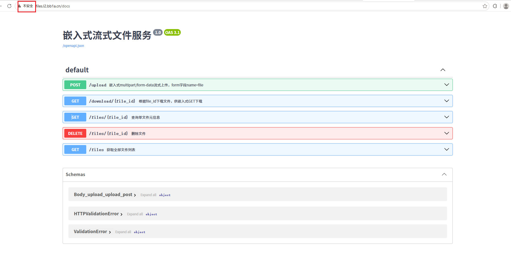
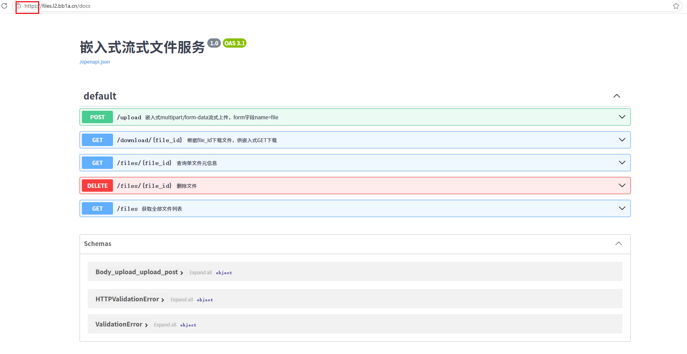
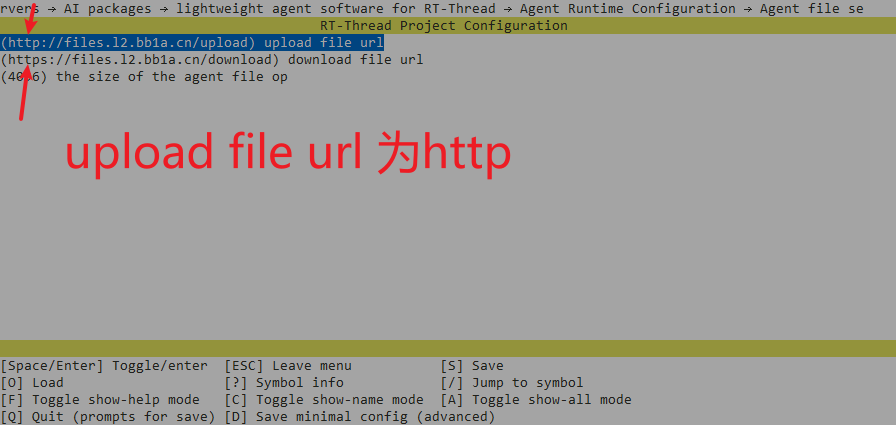
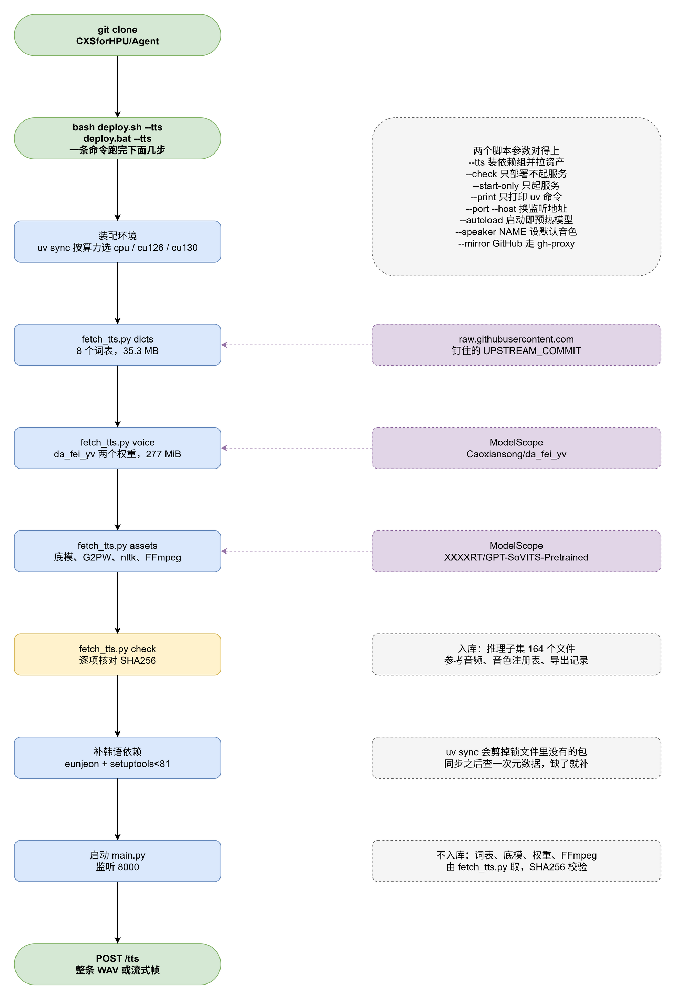
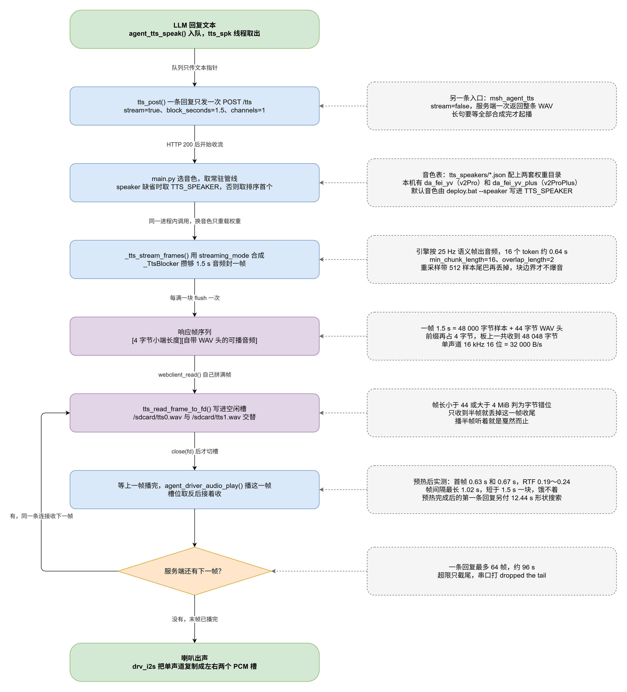

# 文件服务器搭建

文件服务器为 Agent 的多模态功能提供文件上传、下载，以及本地语音转写。只使用纯文本对话时不需要部署。

## 1. 环境准备

安装 uv：

```bash
pip install uv
```

下载慢时可以换清华源：

```bash
pip install uv -i https://pypi.tuna.tsinghua.edu.cn/simple
```

## 2. 安装依赖

用工程下的部署脚本装，它先判断显卡算力，再选对应的 torch 构建：

```bash
cd packages/Agent-latest/resource/file_server
bash deploy.sh --tts      # Linux / macOS，Windows 下 Git Bash 也可
deploy.bat --tts          # Windows
```

脚本取 `nvidia-smi --query-gpu=compute_cap`，按结果同步 `pyproject.toml` 里的依赖组：

| 检测结果 | 依赖组 | torch 来源 |
| --- | --- | --- |
| 没有 NVIDIA 显卡 | `cpu`（默认） | 清华 PyPI 的 CPU / MPS 构建 |
| 算力 5.0 ~ 9.x | `gpu-cu126` | `download.pytorch.org/whl/cu126` |
| 算力 10.0 及以上（Blackwell） | `gpu-cu130` | `download.pytorch.org/whl/cu130` |

cu126 的预编译核函数止于 sm_90，50 系显卡装了会在推理时报 no kernel image is available，所以要分开。

只想看要执行的 uv 命令、不装东西：`bash deploy.sh --print`、`deploy.bat --print`。手工指定后端：`bash deploy.sh --cpu`、`bash deploy.sh --cu130`。

等价的 uv 命令：

```bash
uv sync                                        # 无 GPU
uv sync --group tts                            # 无 GPU + GPT-SoVITS 推理链
uv sync --no-default-groups --group gpu-cu126  # CUDA 12.6
uv sync --no-default-groups --group gpu-cu126 --group tts
uv sync --no-default-groups --group gpu-cu130  # CUDA 13.0（Blackwell）
```

`cpu` / `gpu-cu126` / `gpu-cu130` 三组只决定 torch 的后端，`tts` 组与它们正交：文件服务器本体只需要 `fastapi`、`openai`、`requests`、`openai-whisper`、`soundfile`、`numpy`、`resampy`，GPT-SoVITS 那套（`gradio`、`transformers`、`funasr`、`modelscope`、`onnxruntime-gpu` 等）全部在 `tts` 组里，不带 `--group tts` 就不会装。脚本用 `--tts` 追加该组，详见第 11 节。

三个组在 `[tool.uv]` 的 `conflicts` 里声明为互斥，`uv sync --group gpu-cu126` 会直接报错，必须先 `--no-default-groups` 关掉默认的 `cpu` 组。

默认组设成 `cpu`，目的是让不带参数的 `uv sync` 在没有 GPU 的机器上也能装出可用环境，不会误拉 2 GB 的 CUDA 包。

依赖中包含 `openai-whisper`，它会拉取 torch，体积约 2 GB。只需要文件上传下载、不需要语音转写时，可以自行删除 `pyproject.toml` 里的 `openai-whisper`、`soundfile`、`numpy`、`resampy`，并去掉 `/stt` 接口。

### 镜像与索引

清华源已是默认索引，`uv.lock` 同时锁定三种 torch 构建，换机器不需要重新解析。非国内网络可以删掉 `pyproject.toml` 中名为 `tuna` 的那段 `[[tool.uv.index]]`，回到 PyPI。

torch 生态的三个包按硬件走不同索引：

- `torch`、`torchcodec`：GPU 组走 pytorch 官方索引，带 `+cuXXX` 后缀；`cpu` 组走清华 PyPI。
- `torchaudio`：始终走 PyPI。cu126 / cu130 索引上的 torchaudio 最高到 2.11.0，PyPI 有 2.11.1，实测与 `torch 2.14.1+cu126` 搭配可用。

索引策略设成 `unsafe-best-match` 是必须的：`+cu126` 属于 local version，默认的 first-index-wins 策略会在命第一个索引后停住，解不到带后缀的构建。

`download.pytorch.org` 慢时，可以把 `pytorch-cu126` / `pytorch-cu130` 两段的 `url` 前缀换成 `https://mirror.sjtu.edu.cn/pytorch-wheels`（实测是逐包目录的标准索引，`cu126/torch/` 里有同一个 `torch-2.14.1+cu126-cp312-win_amd64.whl`，`cu126/torchcodec/` 也在）。阿里 `mirrors.aliyun.com/pytorch-wheels/cu126/` 是一整页平铺的 wheel 清单，不是 PEP 503 索引，uv 用不了。换索引后 `uv lock` 会重写 `source` 字段，属于预期内的改动。

解释器本身不由清华提供：`python-build-standalone` 只在 GitHub Releases，uv 须自身下载 Python 时走不了清华源。若本机已有 Python 3.12，uv 会直接复用；被墙又无解释器时，启用 `pyproject.toml` 里注释掉的 `python-install-mirror`（第三方代理，非官方镜像，按需取舍）。

## 3. 启动服务

```bash
uv run --no-sync main.py
```

`uv run` 会先按 `uv.lock` 同步环境，而默认依赖组是 `cpu`。装过 GPU 组的机器上，这一步会把 `torch` 换回 CPU 构建，所以这里要加 `--no-sync`；等价写法是直接用装好的环境跑，`.venv/bin/python main.py`（Windows 为 `.venv\Scripts\python.exe main.py`）。

服务默认监听 `0.0.0.0:8000`。本机可以打开 `http://127.0.0.1:8000/docs` 查看接口文档。

也可以用 `bash deploy.sh` 或 `deploy.bat` 起，它会先装配环境再启动，参数见第 11 节。


服务使用两个本地文件：

- `file_db.sqlite`：文件元信息。
- `upload_files/`：上传的文件。

## 4. 接口

| 接口 | 方法 | 说明 |
|---|---|---|
| `/upload` | POST | 上传文件，form 字段名为 `file`，返回 `file_id` 等信息 |
| `/download/{file_id}` | GET | 按 `file_id` 下载文件 |
| `/files/{file_id}` | GET | 查询单个文件的元信息 |
| `/files` | GET | 列出全部文件 |
| `/files/{file_id}` | DELETE | 删除文件 |
| `/stt` | POST | 语音转文本，form 字段名为 `file`，返回 `{"code":0,"data":{"text":"..."}}` |
| `/tts/speakers` | GET | 列出已装配的音色与可用语种码 |
| `/tts` | POST | 文本转语音，直接返回 `audio/wav` 字节。未装配 GPT-SoVITS 时返回 503，其余接口不受影响 |

上传接口返回示例：

```json
{
  "code": 0,
  "msg": "upload ok",
  "data": {
    "file_id": "0b0f0c7e-...",
    "original_name": "photo.jpg",
    "store_path": "./upload_files/0b0f0c7e-....jpg",
    "file_size": 12345,
    "upload_time": "2026-10-20 10:00:00"
  }
}
```

浏览器直接访问时，下载地址是：

```text
{服务根地址}/download/{file_id}
```

本地调试时为 `http://127.0.0.1:8000/download/{file_id}`。

Agent 侧的 `PKG_AGENT_DOWNLOAD_URL` 要填到 `/download` 为止，例如 `http://127.0.0.1:8000/download`。代码会直接追加 `/{file_id}`，不要再带一层 `/download`。内网穿透后把服务根地址换成公网地址。

## 5. 语音转写

`/stt` 使用 openai-whisper 在本地识别，不调用外部服务。

上传的 wav 不限采样率：`main.py:250-257` 先下混成单声道，非 16 kHz 时用 resampy 重采样后再喂模型。whisper 只在传文件路径时才自己重采样（`whisper/audio.py:25-40` 的 `load_audio` 要 ffmpeg CLI），传 ndarray 必须是 16 kHz（`audio.py:122-123`），否则 32 kHz 音频会被当成两倍速，识别结果退化成乱码。

服务启动时会在后台加载模型。首次运行会下载模型，可能耗时数十秒；加载完成后，后续请求直接复用。

可用环境变量调整：

| 变量 | 默认值 | 说明 |
|---|---|---|
| `STT_MODEL` | `tiny` | whisper 模型，可选 `tiny`、`base`、`small` |
| `STT_LANG` | `zh` | 识别语言 |

Windows PowerShell 示例：

```powershell
$env:STT_MODEL = "base"
$env:STT_LANG = "zh"
uv run --no-sync main.py
```

Agent 侧配置：

1. 打开多模态开关 `PKG_AGENT_MULTIMODAL_ENABLE`。
2. 打开 `PKG_AGENT_STT_ENABLE`。
3. 把 `PKG_AGENT_STT_URL` 填为 `http://<服务器地址>:8000/stt`。

录音格式固定为 16000 Hz、双声道、16 位 WAV。服务端读取后转成单声道再识别。

STT 失败时，Agent 不会上传音频，而是给模型一条“语音消息转写失败，请再说一次”的提示文本。排查时先看服务端是否返回 500，再确认模型是否已下载完成。

## 6. 内网穿透

开发板和 QEMU 通常访问不到宿主机的 `127.0.0.1`。需要把本机 8000 端口映射到公网。

仓库自带飞鸽内网穿透的 Windows 启动器：`resource/飞鸽启动器-0.4.exe`。也可以使用其他穿透工具。

通道类型优先选付费通道，带宽和稳定性更好，大文件上传不容易超时。


通道配置：

| 配置项 | 填写 |
|---|---|
| 本地地址端口 | `127.0.0.1:8000`，与文件服务器监听端口一致 |
| 前置域名 | 自定义前缀 |
| 证书 | 系统默认证书 |


穿透成功后会得到 HTTP 与 HTTPS 两个地址。

HTTP 地址：



HTTPS 地址：



### 上传地址使用 HTTP

Agent 的 `PKG_AGENT_UPLOAD_URL` 必须填 HTTP 地址，例如：

```text
http://xxx.fgnwct.com/upload
```

实测 RT-Thread 通过 HTTPS 上传会遇到问题，表现为上传失败或返回 20040。`PKG_AGENT_STT_URL` 同理，建议使用 HTTP。

`PKG_AGENT_DOWNLOAD_URL` 是给大模型下载文件用的地址，必须是公网可访问的地址。模型服务访问不到内网地址和 `localhost`，使用 HTTPS 时证书也要被公网信任。

## 7. 配置示例

Agent 的多模态配置：

```text
PKG_AGENT_UPLOAD_URL   = http://xxx.fgnwct.com/upload
PKG_AGENT_DOWNLOAD_URL = https://xxx.fgnwct.com/download
PKG_AGENT_STT_URL      = http://xxx.fgnwct.com/stt
```

`PKG_AGENT_DOWNLOAD_URL` 只填到 `/download`，不要带 `file_id`。代码会直接追加 `/{file_id}`，拼出 `{PKG_AGENT_DOWNLOAD_URL}/{file_id}`。

menuconfig 中的填写位置：



## 8. 验证

按顺序检查：

1. `uv run --no-sync main.py` 正常运行，浏览器能打开 `127.0.0.1:8000/docs`。
2. 穿透通道在线，HTTP 地址在浏览器中可访问。
3. `PKG_AGENT_UPLOAD_URL` 使用 HTTP 公网地址。
4. 开发板网络正常；使用 HTTPS 下载时，系统时间已同步。
5. 上传后复制 `file_id` 拼出的下载 URL，在无痕窗口能直接访问。
6. 下载 URL 中的 `file_id` 是完整的 36 位 UUID，没有截断。
7. `curl -I <下载URL>` 返回 200，`Content-Type` 为图片或音频类型。

## 9. 多模态聊天示例

1. 通道选择 `PKG_AGENT_DEBUG_CHANNEL`。
   

2. 发送一张图片。
   

3. 模型回复。
   

## 10. 常见问题

| 现象 | 排查 |
|---|---|
| `uv sync` 超时 | 配置国内镜像源后重试 |
| `no kernel image is available for execution on the device` | torch 的 CUDA 构建与显卡算力不匹配：Blackwell 误装了 `gpu-cu126`，或老卡装了 `gpu-cu130`。重跑 `bash deploy.sh` / `deploy.bat` 让脚本重新判定 |
| GPU 环境莫名变回 CPU | 跑过不带 `--group` 的 `uv sync`，或不带 `--no-sync` 的 `uv run`。默认组是 `cpu`，重新按组同步即可 |
| 板子上传返回 20040 | 确认上传地址是 HTTP；确认穿透地址公网可访问；确认 `file_id` 完整；确认下载响应的 `Content-Type` 是图片类型 |
| 设备连不上服务器 | 检查穿透通道的本地端口是否为 `127.0.0.1:8000`，检查防火墙 |
| 上传成功，但模型下载不了图片 | 下载 URL 必须公网可达；HTTPS 证书需被公网信任 |
| 下载返回 404 | `file_id` 不完整或已被删除，可用 `/files` 核对 |
| `/stt` 返回 500 | 查看服务端日志，确认 whisper 模型已下载、音频文件可读 |
| 首次语音识别很慢 | 首次请求会加载模型，等待时间取决于模型大小与磁盘速度 |
| `/stt` 请求超时 | Agent 侧连接后等待 120 s；模型过大或机器太慢时，换 `tiny` 模型 |
| `/tts` 返回 503 | 没装 GPT-SoVITS 推理链，或权重没落到 `GPT_weights_v2Pro/` | 跑 `bash deploy.sh --tts` / `deploy.bat --tts`，再用 `python fetch_tts.py check` 核对 |
| 第一次合成等了两三分钟 | 服务端没预热，首次请求要建管线并即时编译 | 设 `TTS_AUTOLOAD=1`，服务启动时就在后台把模型拉起来 |

## 11. 可选：GPT-SoVITS 语音合成

`main.py` 里的 `/tts` 是可选功能。推理代码已经抽进仓库，放在 `third_party/gpt-sovits-infer/`，只留合成一条链。预训练模型、大词表、FFmpeg 不入库，装配前该接口返回 503，其余接口照常工作。音色是自家微调的 `da_fei_yv`：参考音频、`manifest.json` 与音色注册表在仓库里，两个权重文件 148 MiB 与 129 MiB 放在 ModelScope 的 `Caoxiansong/da_fei_yv`，由 `voice` 步骤拉回并核对 SHA256。

装配这条链有三个动作，装环境、拉第三方资产、逐项自检。脚本一次跑完：

```bash
bash deploy.sh --tts             # Linux/macOS：装配 + 拉取 + 自检 + 启动
```

```bat
deploy.bat --tts                 :: Windows：同样的流程
```

两个脚本的参数对得上，只有一处默认不同：

| 参数 | 作用 |
|---|---|
| `--tts` | 装 TTS 依赖组，并拉词表、权重与底模 |
| `--check` | 只部署不起服务，装完自检完就退出 |
| `--start-only` | 跳过装配与拉取，直接起服务 |
| `--print` | 只打印要执行的 uv 命令，什么都不改 |
| `--port N`、`--host ADDR` | 换监听地址，默认 `0.0.0.0:8000` |
| `--autoload` | 启动时在后台预热 TTS 模型 |
| `--cpu`、`--cu126`、`--cu130` | 指定 torch 后端，默认按显卡探测 |
| `--mirror` | GitHub 下载走 gh-proxy，`deploy.bat` 默认开，`deploy.sh` 默认关 |
| `--no-mirror` | 只有 `deploy.bat` 有，关掉代理直连 github.com |

脚本先跑 `uv sync`，这一步会剪掉锁文件里没有的包，其中 `eunjeon` 是韩语那条路要用的，它又依赖 `setuptools<81` 才有的 `pkg_resources`，所以拉完资产查一次元数据，缺了就把这两个补回去。

`deploy.bat` 要用 CRLF 行尾保存。cmd 找标签时按 CRLF 断行，文件一大，LF 行尾会让 `goto` 报“系统找不到指定的批处理文件”。本仓库的 `core.autocrlf` 是 true，检出时会是 CRLF，手工改完记得确认。

想手动分步跑时，顺序是这样：

```bash
bash deploy.sh --tts --check                    # 装配 + 拉取 + 自检，不起服务
python fetch_tts.py dicts voice assets          # 都要联网，assets 要几 GB 空间
python fetch_tts.py check                       # 逐项自检，缺什么一眼看到
```



draw.io 源文件：[tts-deploy-flow.drawio](../../diagrams/tts-deploy-flow.drawio)

`fetch_tts.py` 做的事，全部幂等（已存在即跳过）：

- `dicts`：取 8 个上游放在 git 里、单个就超过 500 KB 的数据文件（`text/cmudict.rep`、`text/engdict_cache.pickle`、`text/ja_userdic/userdict.csv`、`Accel/vendor/cuda/bin/cudart64_12.dll` 等），共 35.3 MB。按钉住的 commit 从 `raw.githubusercontent.com` 下载，逐个核对 SHA256；本地已经存在且校验通过就跳过，校验失败则删掉重下。
- `voice`：从 ModelScope 的 `Caoxiansong/da_fei_yv` 拉 `GPT_weights_v2Pro/da_fei_yv-e40.ckpt` 与 `SoVITS_weights_v2Pro/da_fei_yv_e6_s162.pth`，落到同名目录，逐个核对 SHA256，值与 `refs/da_fei_yv/manifest.json` 一致。直链匿名可下，不需要 token；curl 带 `-C -`，断点续传。
- `assets`：从 ModelScope 的 `XXXXRT/GPT-SoVITS-Pretrained` 解出 `pretrained_models.zip`（hubert、bert 等）到 `third_party/gpt-sovits-infer/GPT_SoVITS/`、`G2PWModel.zip` 到 `GPT_SoVITS/text/`、`nltk_data.zip` 到 `runtime/`，解压目录沿用上游 `install.sh:262`、`:275`、`:362` 的目标；再从 fastText 官方下 `lid.176.bin` 并校验 MD5；Windows 上额外解一份 FFmpeg 共享库到 `runtime/`，因为 venv 里 torchaudio 2.11 的 `load()` 已转发 TorchCodec，没有外部 FFmpeg 就报 `Could not find module libtorchcodec_coreN.dll`。

换源与代理：`--source hf` / `--source hf-mirror` 切 zip 来源，`--mirror` 让 GitHub 走 gh-proxy。国内直连 BtbN 的 FFmpeg Release 会报 curl 退出码 35（SSL 连接被断），所以 Windows 上这一步基本要配 `--mirror`；gh-proxy 实测只有 80 KB/s ~ 400 KB/s，88 MB 的 zip 得等几分钟。`lid.176.bin` 已随 `pretrained_models.zip` 落地，脚本仍按 MD5 复核一遍。

取完之后 `third_party/gpt-sovits-infer/` 是 5.8 GB：`GPT_SoVITS/pretrained_models/` 4.6 GB、`GPT_SoVITS/text/G2PWModel/` 608 MB、`runtime/` 231 MB、8 个词表 35.3 MB、自家 v2Pro 权重 277 MiB（148 MiB 与 129 MiB）、参考音频 0.3 MB。入库的代码和配置只有 1.4 MB。

推理子集怎么选出来的，记在 `third_party/gpt-sovits-infer/README.md`：判据是一次真实中文合成在 `sys.modules` 里留下的 97 个上游 .py，再按目录规则放宽到其它语种的文本模块和各个 `__init__.py`；训练、导出、WebUI、ASR、人声分离全部丢掉。落库 164 个文件，其中 157 个是上游推理文件，另加上游 MIT `LICENSE`、本说明、一份音色注册表和自家音色的 6 个文件。升级或重抽用同目录的 `extract_infer.py`，取舍清单是里面的 `DROP_PREFIX`。

装配自检，不经过 HTTP。在 `file_server` 目录里用带 tts 组的 venv 起 Python，把下面这段从标准输入喂进去（`python -` 与交互式解释器都把当前目录放进 `sys.path`，写成 .py 文件用绝对路径跑则 `import main` 会失败）：

```bash
./.venv/Scripts/python.exe - <<'PY'      # Linux/macOS 换成 ./.venv/bin/python
from pathlib import Path
import main

out = Path("out.wav").resolve()          # 先转绝对路径，_tts_synth_wav 会切走工作目录
speakers = main._tts_speakers()
name = main._tts_default(speakers)
sr, wav = main._tts_synth_wav(speakers[name], "今天天气不错，我们出去走走吧。", "zh", 1.0, 16000, 2)
out.write_bytes(wav)                     # 2 声道、16 kHz，板侧播放用的就是这档
print(name, sr, len(wav))
PY
```

实测输出 `da_fei_yv 16000 253484`，落盘的 `out.wav` 是 2 声道、16 kHz、3.96 s。`_tts_synth_wav` 内部把工作目录切到 `third_party/gpt-sovits-infer/`，之后再写相对路径就落到别处去了。上游的 `inference_cli.py`、`inference_webui.py`、`api_v2.py` 没有抽进子集，别照着它们写调用。

七个语种各合成一句，都出音频。自家 `da_fei_yv` 音色在同一台机器上的实测（16 kHz 双声道，峰值是 int16 幅度）：

| `language` | 字节 | 时长 | 峰值 | 削顶样本 |
|---|---|---|---|---|
| `zh` | 253 484 | 3.96 s | 21 857 | 0 |
| `all_zh` | 151 084 | 2.36 s | 18 486 | 0 |
| `en` | 215 084 | 3.36 s | 26 926 | 0 |
| `ja` | 201 004 | 3.14 s | 26 620 | 0 |
| `yue` | 171 564 | 2.68 s | 24 633 | 0 |
| `ko` | 126 764 | 1.98 s | 26 544 | 0 |
| `auto` | 302 124 | 4.72 s | 24 917 | 0 |

`ko` 要先补两个包，缺任何一个，建管线时都报 `TypeError: exceptions must derive from BaseException`：

```bash
uv pip install --python ./.venv/Scripts/python.exe eunjeon "setuptools<81"
```

这条报错不是抽取造成的，来自第三方包 `g2pk2`。`g2pk2/g2pk2.py:90` 的 Windows 分支把加载 eunjeon 的任何异常塞进 `raise print(...)`，`print()` 返回 `None`，于是真正的原因（`eunjeon/__init__.py:11` 要 `import pkg_resources`，setuptools 84 已删除该模块）被盖掉了。`pyproject.toml` 的 `tts` 组声明了 `g2pk2`、`ko-pron` 和 `python-mecab-ko ; sys_platform != 'win32'`，Windows 上的 Korean MeCab 只能靠 eunjeon，得手动补。补齐后「오늘 날씨가 좋습니다.」走 `/tts` 返回 200、126 764 字节、1.98 s，峰值 26 544，无削顶。同一句在进程内自检时长会差几十毫秒，是 GPT 采样本身的抖动。

`ja` 第一次合成实测 253.9 s（解 pyopenjtalk 词典），词典落盘之后同语种稳定在 2～3 s。多出来的是解词典的开销，不是推理变慢。

### 做成服务

装配完成后，`main.py` 里的 `/tts` 直接可用。它在同一进程内调 `GPT_SoVITS/TTS_infer_pack/TTS.py` 的 `TTS_Config` 与 `TTS`，不另起 api_v2 服务，也不碰 gradio。`main.py:377` 的 `_tts_activate()` 复用上游自己的 `tools/portable_runtime.activate()`。它会把工作目录切到 `third_party/gpt-sovits-infer/`，所以 `main.py:28-30` 先把 `UPLOAD_DIR`、`DB_PATH` 和上传记录里的相对路径统一按 `__file__` 展开成绝对路径。

音色靠扫描注册。权重按训练版本分目录，`main.py:304` 的 `_TTS_WEIGHT_DIRS` 列出版本到目录的对应关系：`v2` 用 `GPT_weights_v2/` 与 `SoVITS_weights_v2/`，`v2Pro` 用 `GPT_weights_v2Pro/` 与 `SoVITS_weights_v2Pro/`。同一版本目录内的 `.ckpt` 与 `.pth` 按权重名前缀配对，`da_fei_yv-e40.ckpt` 加 `da_fei_yv_e6_s162.pth` 得到音色 `da_fei_yv`，目录名同时给出这个音色的推理版本。再要求 `tts_speakers/da_fei_yv.json` 提供参考音频。仓库里带的注册表内容如下：

```json
{
  "ref_audio": "refs/da_fei_yv/dwg_0002.wav",
  "ref_text": "refs/da_fei_yv/prompt.txt",
  "ref_language": "zh"
}
```

两个路径相对 `third_party/gpt-sovits-infer/`。再加一个音色，放好两套同名权重、仿照这份 JSON 写一份注册表就行；权重若来自社区，按 `.gitignore` 挡住不入库。

### 导入本地导出的权重

自己微调导出的权重按下面的布局摆放：两套权重、参考音频与它的转写文本、一份音色注册表。仓库里带的 `da_fei_yv` 就是这么放的，训练导出目录里的原始文件名是 `dafeiyu2_v2Pro-e40.ckpt`、`dafeiyu2_v2Pro_e6_s162.pth`、`refs/dwg_0002.wav` 和一份 `manifest.json`，入库时统一换成 `da_fei_yv` 前缀，`manifest.json` 里留了 `renamed_from` 字段：

```text
third_party/gpt-sovits-infer/
├── GPT_weights_v2Pro/da_fei_yv-e40.ckpt         fetch_tts.py voice 从 ModelScope 拉
├── SoVITS_weights_v2Pro/da_fei_yv_e6_s162.pth   同上
├── refs/da_fei_yv/dwg_0002.wav                  入库，参考音频
├── refs/da_fei_yv/manifest.json                 入库，导出时的测量值留档
├── refs/da_fei_yv/prompt.txt                    入库，从 manifest 的 prompt_text 落一份
└── tts_speakers/da_fei_yv.json                  入库，只有三个字段
```

两个权重合计 277 MiB，超过 GitHub 的单文件上限，仓库里不带：`fetch_tts.py voice` 从 ModelScope 取，SHA256 对得上才留下。换音色时照这个布局再放一套即可，目录名决定推理版本。

文件名要能配成对：`.ckpt` 去掉 `-e\d+` 之后的前缀，和 `.pth` 去掉 `_e\d+_s\d+` 之后的前缀要一致，两边都得到 `da_fei_yv`。权重名里带不带版本都行，版本由所在目录决定。

`main.py` 不需要为 v2Pro 改推理调用。建管线时把目录给出的版本传给 `TTS_Config`（`main.py:399`），换音色走 `init_t2s_weights` 与 `init_vits_weights`。上游读 s2 权重头两字节判版本（`process_ckpt.py:77` 的 `head2version`，`b"05"` 就是 v2Pro），Pro 系列顺手加载 ERes2NetV2 说话人模型（`TTS.py:584`），`TTS.py:646` 置 `is_v2pro`，推理时据此把参考音频重采样到 16 kHz（`TTS.py:909`）并取说话人向量（`TTS.py:1411`）。

一条管线能在 v2 与 v2Pro 之间来回切。实测同一进程按 v2 → v2Pro → v2Pro → v2 连做四次合成，原生采样率都是 32 000 Hz：首次含建管线 105.8 s 出 6.48 s 音频，切到 v2Pro 11.3 s 出 6.44 s，换一句 2.0 s 出 4.16 s，切回 v2 3.5 s 出 3.00 s。加载 VITS 权重时打印的 `missing_keys=['enc_q.*']` 不是导入出错，推理权重本来不带 `enc_q`，上游用 `strict=False` 加载。

走 `/tts` 的端到端实测：请求 `{"speaker":"da_fei_yv","language":"all_zh","sample_rate":16000,"channels":2}`，返回 200、294 444 字节，响应头 `x-speaker: da_fei_yv`、`x-sample-rate: 16000`；产物 16 kHz 双声道、4.60 s、峰值 31031、无削顶，`/stt` 回读「你好 我是大飛魚今天天氣不錯」。用 manifest 里那句 23 字自测文本合成得 6.44 s，落在导出记录写的 6.12～7.72 s 抖动带内；导出侧固定 seed 43，`/tts` 这条链路没传 seed，时长每次会抖。

有两个前提要满足。s2 权重如果前两个字节不是 `PK`，必须经 `load_sovits_new`（`process_ckpt.py:141`）补上 `b"PK"` 再 `torch.load`，`init_vits_weights` 已经这么调了，别绕过它自己加载。v2Pro 依赖 `GPT_SoVITS/pretrained_models/sv/pretrained_eres2netv2w24s4ep4.ckpt`（107 528 697 字节，`sv.py:6` 按相对路径找它），缺了 `init_sv_model()` 会在加载时抛文件不存在；这份由 `fetch_tts.py assets` 取，`fetch_tts.py check` 会报。

导出包里的 `manifest.json` 和 `tts_infer.custom.yaml` 建议一起放进 `refs/<音色名>/` 留档，训练参数、seed 和当时的时长都记在里面，验收时对着看。

`language` 传 `TTS_infer_pack` 的引擎语种码：`all_zh`、`zh`、`en`、`all_ja`、`ja`、`all_yue`、`yue`、`all_ko`、`ko`、`auto`、`auto_yue`。中文名也收，`main.py:314` 的 `_TTS_LANG_ALIAS` 先换算，表抄上游 WebUI 的 `dict_language_v2`（`inference_webui.py` 未抽进子集，对照时用上游 commit）。只能用引擎码这条限制来自 `TTS.py:1251` 的 `assert text_lang in self.configs.languages`，而 `TTS_Config.languages` 就是英文码表（`TTS.py:359`）。传成 WebUI 的显示名时，断言没有消息文本，接口只会回一条 `tts failed: AssertionError:`，看不出原因。

请求体字段：

| 字段 | 默认值 | 说明 |
|---|---|---|
| `text` | 必填 | 待合成文本，空串返回 400 |
| `speaker` | `TTS_SPEAKER`，未设则取音色名排序首个 | 名字不在表里返回 404 |
| `language` | `zh` | 中英混合。取值见上一段 |
| `speed` | `1.0` | 语速倍率 |
| `sample_rate` | 不重采样 | 板侧播放填 `16000` |
| `channels` | `1` | 填 `2` 时把单声道复制成左右两份；只接受 1 和 2，其他值返回 400 |

成功时响应体就是 WAV 字节，`Content-Type: audio/wav`，另带 `X-Sample-Rate` 与 `X-Speaker` 两个响应头。`TTS.run()` 交回来的是 int16 PCM（`TTS.py:1814`、`TTS.py:1822` 先乘 32768 再 `astype(np.int16)`），`main.py:438` 把它除以 32768 归到 [-1, 1]，之后才重采样、交给 soundfile 写 PCM_16。少了这一步，重采样分支拿到的是上万量级的浮点数，soundfile 全部削顶，产出的音频时长正常，内容是方波噪声。

同一句文本的对照实测：32 kHz 原生音频 `/stt` 回读为「這是第一次請求 模型又現場加載」，未归一化的 16 kHz 回读成一片乱码；归一化之后 16 kHz 回读为「这是第一次请求 模型又现场加载」，峰值 0.817，削波样本占比 0。

实测耗时（RTX 2080 Ti、CUDA 12.6，音色 da_fei_yu）：

| 场景 | 耗时或占用 |
|---|---|
| 模型预热 | 约 60 s，显存增加 1.4 GB，进程常驻内存 3.7 GB |
| 预热后的首次合成 | 约 40 s，含 G2PW 与 numba 的即时编译 |
| 稳定后合成 4.5 s 音频 | 3.5 s |
| 未开 `TTS_AUTOLOAD` 的首个请求 | 99.5 s，加载和首帧都压在这次请求上 |

换成自家的 `da_fei_yv` 音色后：进程内第一次合成 47.3 s（含建管线、G2PW 与 numba 即时编译），之后每句 2～3 s；HTTP 首次请求 61.3 s，管线在服务进程里现建，之后每句同样 2～3 s。v2 与 v2Pro 之间换音色不重建管线，只重载两套权重，实测 11.3 s（含换权重与一次合成）。

推理全程由 `_TTS_LOCK` 保护，同一时刻只跑一帧，多请求排队等待。请求处理放在 `asyncio.to_thread`，合成期间 `/upload`、`/download`、`/stt` 照常响应。CPU 推理没在这台机器上计时，`TTS_DEVICE=cpu` 的代价请按你机器自测。

| 变量 | 默认值 | 说明 |
|---|---|---|
| `TTS_AUTOLOAD` | `0` | 填 `1` 时启动即在后台线程预热模型，否则首个请求自己承担加载 |
| `TTS_SPEAKER` | 音色名排序首个 | 默认音色 |
| `TTS_DEVICE` | 有 CUDA 用 `cuda`，否则 `cpu` | 填 `cpu` 可在无显卡机器上跑 |
| `TTS_IS_HALF` | `cuda` 时 `1`，否则 `0` | 半精度开关 |

curl 示例。含中文的请求体不要拼在命令行里，Windows 的 shell 会改掉字节，FastAPI 回 `There was an error parsing the body`；写成文件再传：

```bash
printf '{"text":"今天天气不错。","language":"all_zh","sample_rate":16000}' > req.json
curl -s localhost:8000/tts/speakers
curl -s -X POST -H "Content-Type: application/json" --data @req.json localhost:8000/tts -o out.wav
```

板侧已经接上：`src/utils/tts.c` 里的 `msh_agent_tts` 合成后落盘播放，请求固定带 `sample_rate:16000` 和 `channels:2`。

`channels` 取 2 的原因在板的音频通道。AC97 一帧固定携带左右两个 PCM 槽，QEMU vexpress 的 pl041 模型也按这个约定写死（`hw/audio/pl041.c` 每次出帧取两个采样）。实测同一句「你好，我是大肥鱼，今天天气不错」（当时用的大肥鱼 v2 音色），单声道文件 4.40 s 的内容 2.20 s 播完，`/stt` 回读是乱码；换立体声后 5.24 s 内容捕获 5.29 s，`/stt` 回读为「你好 我是大肥鱼今天天气不错」。

回复文本里的表情符号要单独处理。上游 `TextPreprocessor.pre_seg_text` 有一句 `print(text)`，中文 Windows 的 stdout 默认 GBK，遇到 😸 这类字符直接抛 `UnicodeEncodeError`，`/tts` 回 500，看着像推理坏了。`main.py:23` 把 stdout/stderr 重设成 UTF-8，`main.py:487` 再剥掉非 BMP 平面（`U+10000` 以上）的表情符号。实测三种输入：中英混排带 😸 返回 200、531 244 字节；纯表情返回 400「text 去掉表情符号后为空」；`✅` 这类 BMP 符号（GBK 也编不了）返回 200。板侧遇到 500 只打印 `reply synth failed, skip playback` 并继续处理下一条，不会卡住队列。

### 全新 clone 复刻

从空目录 clone 一份 `Agent-latest`，按上面三步装配，整条链能自己跑起来。2026-10-30 的实测记录：

| 步骤 | 结果 |
|---|---|
| `bash deploy.sh --tts` | torch 2.14.1+cu126，CUDA 可用，`.venv` 5.2 GB |
| `fetch_tts.py dicts` | 8 个词表逐个核对 SHA256 通过 |
| `fetch_tts.py voice` | 两个权重从 ModelScope 拉回，SHA256 对上 |
| `fetch_tts.py assets` | 解出 `pretrained_models.zip` 4.24 GB，`third_party` 合计 5.8 GB |
| `fetch_tts.py check` | `all third-party pieces present` |

起服务后合成一句「今天天气不错，我们出去走走吧。」：

| 请求 | 字节 | 耗时 | 产物 |
|---|---|---|---|
| 首次 | 268 844 | 203.3 s | 2 声道、16 kHz、4.20 s、峰值 29 870 |
| 第二次 | 268 844 | 2.62 s | 同上 |

首次那 203 s 里包含建管线、G2PW 与 numba 的即时编译，模型常驻后每句 2～3 s。两次返回的字节数相同，长度稳定。整个 clone 加 `.venv` 占 12 GB，其中 5.2 GB 是 Python 环境，5.8 GB 是推理资产。

### 重新部署与启动

已经装配好的环境再跑一遍脚本是幂等的，不重下资产。2026-10-30 的实测记录：

| 命令 | 结果 |
|---|---|
| `bash deploy.sh --tts --check` | `all third-party pieces present` |
| `deploy.bat --tts --check` | 同上，输出逐条一致 |
| `deploy.bat --tts --port 8001` | 起服务，`/tts/speakers` 返回 `da_fei_yv` |
| `deploy.sh --start-only --port 8002` | 5 s 内起来，`/tts/speakers` 同样返回 `da_fei_yv` |

`uv sync` 每次都会把 `eunjeon` 与 `setuptools` 剪回锁文件里的版本，`setuptools` 从 80.10.2 退回 84.0.0。脚本在拉完资产后查一次分发元数据，缺了就补回去，所以每次跑完环境都是对的。

合成一句「今天天气不错，我们出去走走吧。」，请求体 `{"language":"all_zh","sample_rate":16000,"channels":2}`：

| 请求 | 字节 | 耗时 | 产物 |
|---|---|---|---|
| 首次 | 258 604 | 81.1 s | 2 声道、16 kHz、4.04 s、峰值 29 660 |
| 第二次 | 240 684 | 1.91 s | 2 声道、16 kHz、3.76 s、峰值 29 589 |

首次那 81 s 是服务进程里现建管线，加上 G2PW 与 numba 的即时编译。管线建好后每句 2 s 上下。两次字节数不同，因为 `/tts` 这条链路没有传 seed，采样每次会抖，时长跟着变。

### 运行时链路

板端发出合成请求到喇叭出声，中间经过这几步：



draw.io 源文件：[tts-runtime-flow.drawio](../../diagrams/tts-runtime-flow.drawio)

## 12. 第三方与许可

`.gitignore` 只挡体积大或许可受限的第三方资产（`third_party/gpt-sovits-infer/` 下的 `pretrained_models/`、`G2PWModel/`、`runtime/`、`output/`、`GPT_weights_*/`、`SoVITS_weights_*/`、8 个 `dicts` 大文件），以及运行时改写的两个文件：上游每次建管线都会把权重绝对路径写回 `GPT_SoVITS/configs/tts_infer.yaml`，G2PW 词典重建后会改写 `GPT_SoVITS/text/g2pw/polyphonic.md5`。推理代码、参考音频、`manifest.json`、导出记录与音色注册表入库。`git add` 预演带的是自有文件（`.python-version`、`README.md`、`framework.md`、`pyproject.toml`、`uv.lock`、`.gitignore`、`main.py`、`fetch_tts.py`、`extract_infer.py`、`deploy.bat`、`deploy.sh`、`test/`）加 `third_party/gpt-sovits-infer/` 里的 164 个文件。两个权重不在仓库里，由 `fetch_tts.py voice` 从 ModelScope 拉。表里“入库”一列说的就是这个边界。

| 组件 | 来源 | 许可 | 入库 |
|---|---|---|---|
| GPT-SoVITS 推理代码 | `RVC-Boss/GPT-SoVITS` @ `b4570b8`，只抽合成链 | MIT，随上游 `LICENSE` 一起进 | 是，157 个文件 |
| 自家音色 `da_fei_yv` 的权重与参考音频 | 本工程自训，训练数据 `YinZilu/da-fei-yu-girl-voice-zh`；权重发布在 ModelScope `Caoxiansong/da_fei_yv` | 训练数据是 **CC BY-NC 4.0**：仅限非商业，须署名「尹紫鹭幻想社（Bilibili）」，不得用于冒充真人。权重是衍生作品，同受此约束 | 权重否，`fetch_tts.py voice` 从 ModelScope 拉；参考音频 0.3 MB 入库 |
| 上游 git 里的词表与 CUDA 运行库 | 同一 commit 的 `raw.githubusercontent.com` | 随上游仓库（MIT） | 否，`fetch_tts.py dicts` 取，8 个 35.3 MB，逐个校验 SHA256 |
| chinese-hubert-base、chinese-roberta-wwm-ext-large、G2PWModel、nltk_data | 上游 `XXXXRT/GPT-SoVITS-Pretrained` 的 zip | 以各自来源页声明为准，本仓库不重新授权 | 否 |
| `lid.176.bin` | fastText 官方 supervised models | CC BY-SA 3.0（fastText 文档页写明，不是常见的 NC 误传） | 否 |
| FFmpeg 共享库 | BtbN `ffmpeg-master-latest-win64-gpl-shared` | GPL v3（该构建含 x264 等） | 否 |

内容改动核对过：抽取只做取舍，157 个文件与上游 commit 比，没有一处真实内容差异（按 LF 归一后逐字节相同）。剩下的差别全是行尾。上游 clone 用 `core.autocrlf=true` checkout，工作树是 CRLF；本仓库同样开 autocrlf，`git add` 时折回 LF。实测入库后的 blob 哈希有 128 个与上游一致，另外 29 个（`Accel/` 下的引擎文件、`text/korean.py`、`text/cantonese.py`、`process_ckpt.py`、`sv.py`、`tools/audio_sr.py` 等）上游自己就是把 CRLF 提交进 git 的，入库后只差行尾，代码字符一致。

对外发布要守三条：

1. 不要用 `git add -f` 把被忽略的路径塞进仓库。预训练模型和 GPL 二进制一旦进历史就很难干净撤回。
2. 权重是自己训的，但训练数据是 CC BY-NC 4.0，权重是衍生作品，同样受非商业与署名约束。仓库首页、发行物和对外演示都要写明音色数据来自「尹紫鹭幻想社（Bilibili）」，按 CC BY-NC 4.0 使用。
3. 两个权重分别是 148 MiB 与 129 MiB，超过 GitHub 普通 git 对象的 100 MB 上限，LFS 又要占配额，所以放到 ModelScope（`Caoxiansong/da_fei_yv`），由 `fetch_tts.py voice` 匿名直链拉取并校验 SHA256。CC BY-NC 4.0 的衍生权重本来也不适合再分发到 GitHub。

ModelScope 上的许可字段要单独改一次。仓库建好时平台的 `License` 默认是 `Apache License 2.0`，权重实际的许可却是 CC BY-NC 4.0，两者冲突。README 里的 front matter 改不了这个字段，要在网页的模型信息里把 License 选成 CC BY-NC 4.0。字段不改，别人只看平台标签就会以为可以商用。

历史核对：`git log --all -- resource/file_server/third_party/gpt-sovits-infer` 只输出引入推理子集的那次提交，整仓上游 clone、第三方权重与二进制从未进过任何提交。权重只存在于 ModelScope，仓库里留下的是参考音频与导出记录。推理子集是首次入库的第三方代码，MIT 允许再分发，保留 `LICENSE` 和出处记录即可，公开这个仓库不需要改写历史。

