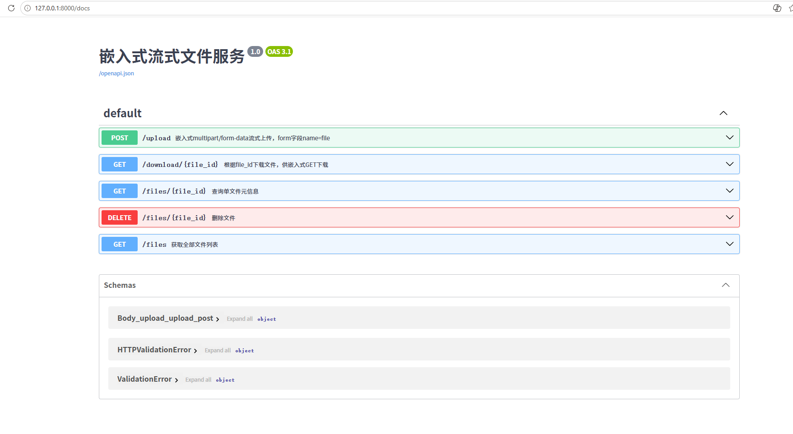
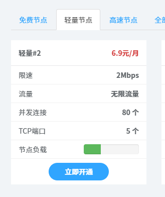
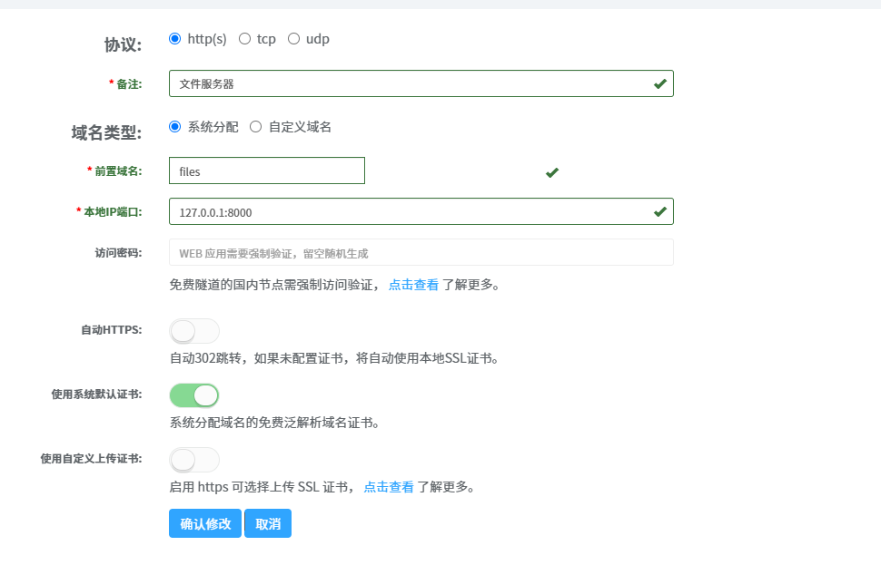
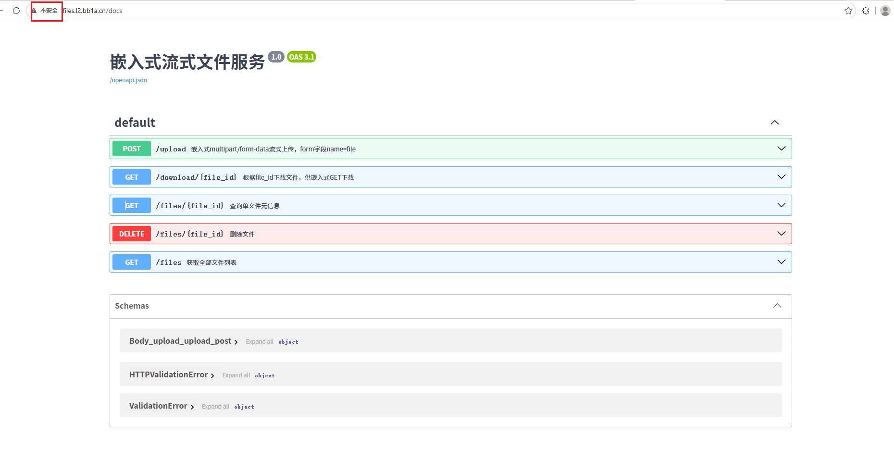
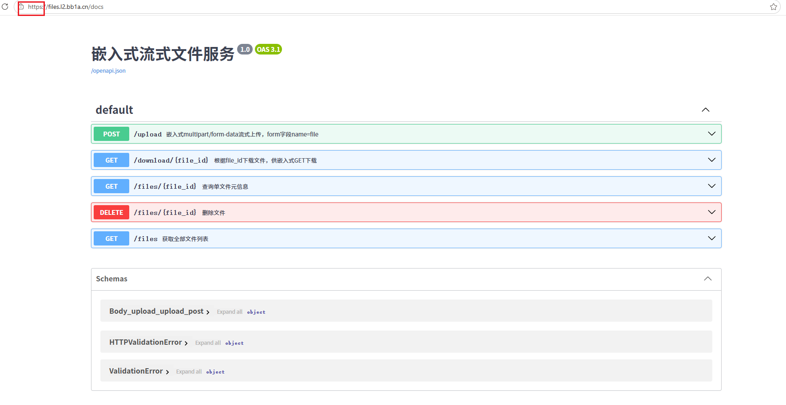
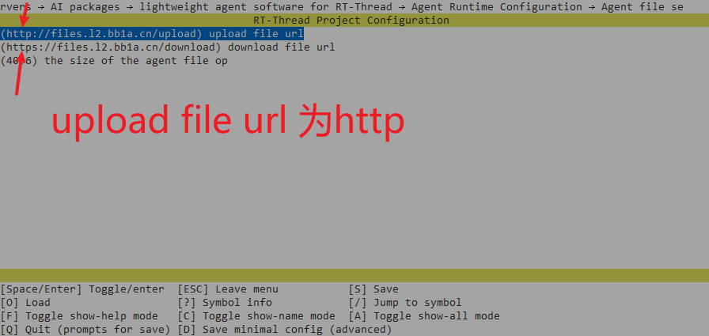
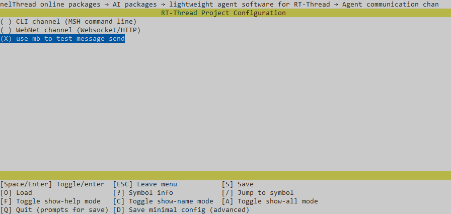
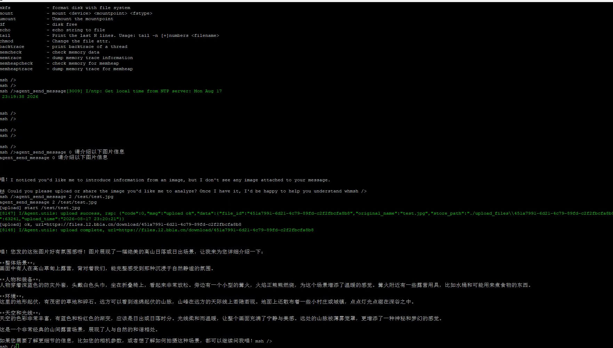

# 文件服务器搭建

文件服务器为 Agent 的多模态功能提供文件上传、下载，以及本地语音转写。只使用纯文本对话时不需要部署。

## 1. 环境准备

安装 uv：

```bash
pip install uv
```

下载慢时可以换清华源：

```bash
pip install uv -i https://pypi.tuna.tsinghua.edu.cn/simple
```

## 2. 安装依赖

```bash
cd packages/Agent-latest/resource/file_server
uv sync
```

`uv sync` 读取 `pyproject.toml` 与 `uv.lock`，按锁定版本安装依赖。

依赖中包含 `openai-whisper`，它会拉取 torch，体积约 2 GB。只需要文件上传下载、不需要语音转写时，可以自行删除 `pyproject.toml` 里的 `openai-whisper`、`soundfile`、`numpy`，并去掉 `/stt` 接口。

安装慢时，可在 `pyproject.toml` 末尾添加：

```toml
[tool.uv]
index-url = "https://pypi.tuna.tsinghua.edu.cn/simple"
```

## 3. 启动服务

```bash
uv run main.py
```

服务默认监听 `0.0.0.0:8000`。本机可以打开 `http://127.0.0.1:8000/docs` 查看接口文档。



服务使用两个本地文件：

- `file_db.sqlite`：文件元信息。
- `upload_files/`：上传的文件。

## 4. 接口

| 接口 | 方法 | 说明 |
|---|---|---|
| `/upload` | POST | 上传文件，form 字段名为 `file`，返回 `file_id` 等信息 |
| `/download/{file_id}` | GET | 按 `file_id` 下载文件 |
| `/files/{file_id}` | GET | 查询单个文件的元信息 |
| `/files` | GET | 列出全部文件 |
| `/files/{file_id}` | DELETE | 删除文件 |
| `/stt` | POST | 语音转文本，form 字段名为 `file`，返回 `{"code":0,"data":{"text":"..."}}` |

上传接口返回示例：

```json
{
  "code": 0,
  "msg": "upload ok",
  "data": {
    "file_id": "0b0f0c7e-...",
    "original_name": "photo.jpg",
    "store_path": "./upload_files/0b0f0c7e-....jpg",
    "file_size": 12345,
    "upload_time": "2026-10-20 10:00:00"
  }
}
```

浏览器直接访问时，下载地址是：

```text
{服务根地址}/download/{file_id}
```

本地调试时为 `http://127.0.0.1:8000/download/{file_id}`。

Agent 侧的 `PKG_AGENT_DOWNLOAD_URL` 要填到 `/download` 为止，例如 `http://127.0.0.1:8000/download`。代码会直接追加 `/{file_id}`，不要再带一层 `/download`。内网穿透后把服务根地址换成公网地址。

## 5. 语音转写

`/stt` 使用 openai-whisper 在本地识别，不调用外部服务。

服务启动时会在后台加载模型。首次运行会下载模型，可能耗时数十秒；加载完成后，后续请求直接复用。

可用环境变量调整：

| 变量 | 默认值 | 说明 |
|---|---|---|
| `STT_MODEL` | `tiny` | whisper 模型，可选 `tiny`、`base`、`small` |
| `STT_LANG` | `zh` | 识别语言 |

Windows PowerShell 示例：

```powershell
$env:STT_MODEL = "base"
$env:STT_LANG = "zh"
uv run main.py
```

Agent 侧配置：

1. 打开多模态开关 `PKG_AGENT_MULTIMODAL_ENABLE`。
2. 打开 `PKG_AGENT_STT_ENABLE`。
3. 把 `PKG_AGENT_STT_URL` 填为 `http://<服务器地址>:8000/stt`。

录音格式固定为 16000 Hz、双声道、16 位 WAV。服务端读取后转成单声道再识别。

STT 失败时，Agent 不会上传音频，而是给模型一条“语音消息转写失败，请再说一次”的提示文本。排查时先看服务端是否返回 500，再确认模型是否已下载完成。

## 6. 内网穿透

开发板和 QEMU 通常访问不到宿主机的 `127.0.0.1`。需要把本机 8000 端口映射到公网。

仓库自带飞鸽内网穿透的 Windows 启动器：`resource/飞鸽启动器-0.4.exe`。也可以使用其他穿透工具。

通道类型优先选付费通道，带宽和稳定性更好，大文件上传不容易超时。



通道配置：

| 配置项 | 填写 |
|---|---|
| 本地地址端口 | `127.0.0.1:8000`，与文件服务器监听端口一致 |
| 前置域名 | 自定义前缀 |
| 证书 | 系统默认证书 |



穿透成功后会得到 HTTP 与 HTTPS 两个地址。

HTTP 地址：



HTTPS 地址：



### 上传地址使用 HTTP

Agent 的 `PKG_AGENT_UPLOAD_URL` 必须填 HTTP 地址，例如：

```text
http://xxx.fgnwct.com/upload
```

实测 RT-Thread 通过 HTTPS 上传会遇到问题，表现为上传失败或返回 20040。`PKG_AGENT_STT_URL` 同理，建议使用 HTTP。

`PKG_AGENT_DOWNLOAD_URL` 是给大模型下载文件用的地址，必须是公网可访问的地址。模型服务访问不到内网地址和 `localhost`，使用 HTTPS 时证书也要被公网信任。

## 7. 配置示例

Agent 的多模态配置：

```text
PKG_AGENT_UPLOAD_URL   = http://xxx.fgnwct.com/upload
PKG_AGENT_DOWNLOAD_URL = https://xxx.fgnwct.com/download
PKG_AGENT_STT_URL      = http://xxx.fgnwct.com/stt
```

`PKG_AGENT_DOWNLOAD_URL` 只填到 `/download`，不要带 `file_id`。代码会直接追加 `/{file_id}`，拼出 `{PKG_AGENT_DOWNLOAD_URL}/{file_id}`。

menuconfig 中的填写位置：



## 8. 验证

按顺序检查：

1. `uv run main.py` 正常运行，浏览器能打开 `127.0.0.1:8000/docs`。
2. 穿透通道在线，HTTP 地址在浏览器中可访问。
3. `PKG_AGENT_UPLOAD_URL` 使用 HTTP 公网地址。
4. 开发板网络正常；使用 HTTPS 下载时，系统时间已同步。
5. 上传后复制 `file_id` 拼出的下载 URL，在无痕窗口能直接访问。
6. 下载 URL 中的 `file_id` 是完整的 36 位 UUID，没有截断。
7. `curl -I <下载URL>` 返回 200，`Content-Type` 为图片或音频类型。

## 9. 多模态聊天示例

1. 通道选择 `PKG_AGENT_DEBUG_CHANNEL`。
   

2. 发送一张图片。
   

3. 模型回复。
   

## 10. 常见问题

| 现象 | 排查 |
|---|---|
| `uv sync` 超时 | 配置国内镜像源后重试 |
| 板子上传返回 20040 | 确认上传地址是 HTTP；确认穿透地址公网可访问；确认 `file_id` 完整；确认下载响应的 `Content-Type` 是图片类型 |
| 设备连不上服务器 | 检查穿透通道的本地端口是否为 `127.0.0.1:8000`，检查防火墙 |
| 上传成功，但模型下载不了图片 | 下载 URL 必须公网可达；HTTPS 证书需被公网信任 |
| 下载返回 404 | `file_id` 不完整或已被删除，可用 `/files` 核对 |
| `/stt` 返回 500 | 查看服务端日志，确认 whisper 模型已下载、音频文件可读 |
| 首次语音识别很慢 | 首次请求会加载模型，等待时间取决于模型大小与磁盘速度 |
| `/stt` 请求超时 | Agent 侧连接后等待 120 s；模型过大或机器太慢时，换 `tiny` 模型 |
