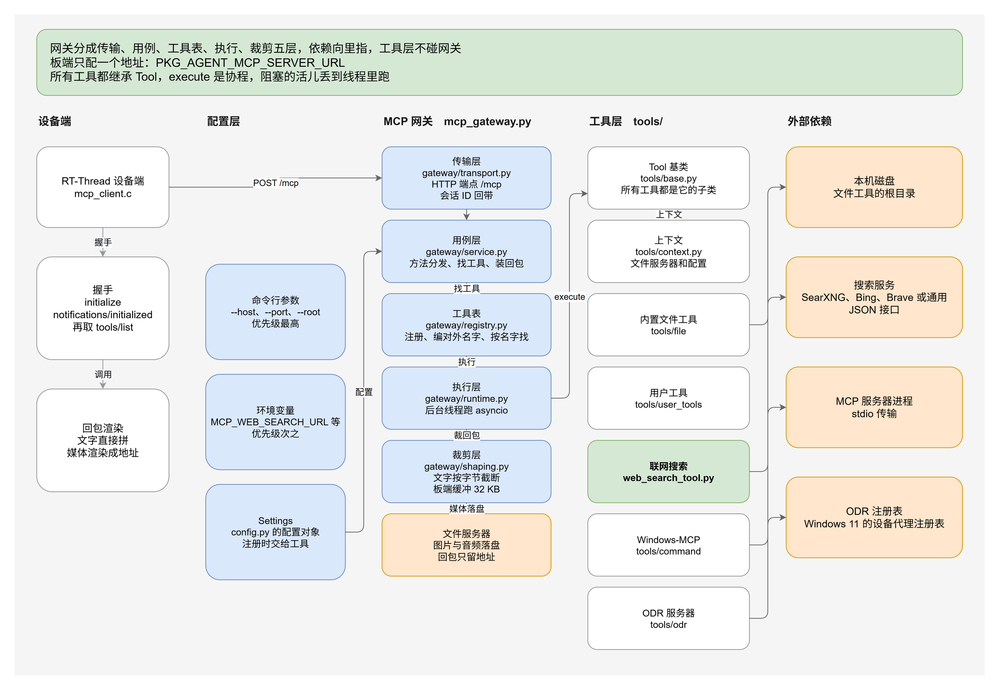

# 网关架构

网关在 PC 上跑，把主机能用的东西统一成一个 MCP 端点，设备端只配一个地址。



## 1. 分层

代码按层拆开，依赖只向里指：外层可以叫里层，里层不反过来叫外层。

| 层 | 代码 | 做什么 | 不做什么 |
|---|---|---|---|
| 传输 | `gateway/transport.py` | 收 HTTP 请求，解 JSON，编 JSON，回写响应 | 不认识工具 |
| 用例 | `gateway/service.py` | JSON-RPC 方法分发，找工具，装回包 | 不认识 HTTP，不读配置文件 |
| 工具表 | `gateway/registry.py` | 注册工具，编对外的名字，按名字找工具 | 不认识 HTTP |
| 裁剪 | `gateway/shaping.py` | 回包裁剪，base64 媒体落盘 | 不认识工具 |
| 执行 | `gateway/runtime.py` | 一个后台线程跑 asyncio，工具的协程都在这个循环里跑 | 不认识 HTTP |
| 协议 | `gateway/protocol.py` | 协议版本、错误码、回包的形状 | 不认识工具 |
| 配置 | `config.py` | 命令行和环境变量只在这里解析一次 | 不认识工具 |
| 工具 | `tools/` | 一个工具一个类，网关按名字路由，不分来源 | 不 import `gateway/` |

`mcp_gateway.py` 是组装根：解析配置，建对象，装工具，起服务。它本身没有业务
逻辑。

外部依赖有三样：文件服务器、搜索服务、MCP 服务器进程。网关自己不发版，业务方
自己维护。

工具类在 `tools/base.py`，成员有五个：

| 成员 | 说明 |
|---|---|
| `name` | 工具名 |
| `description` | 工具说明，这段文字会发给模型 |
| `parameters` | 参数表，JSON Schema |
| `execute` | 协程，执行工具，返回 `{"content": [...], "isError": bool}` |
| `namespace`、`prefix` | 两个名字前缀，见第 2 节 |

所有工具都继承这个类，没有例外。内置文件工具、联网搜索、外部 MCP 服务器的
工具、用户自己的工具，都是 `Tool` 的子类。子类实现 `name`、`description`、
`parameters` 和 `execute` 四个成员，构造函数不传参。

工具要读配置就实现 `configure(context)`。网关注册的时候调一次，`context` 里有
文件服务器和配置对象。工具自己不读 `os.environ`。

工具里的阻塞活儿用 `asyncio.to_thread` 丢到线程里跑，不占事件循环。

## 2. 工具路由

`ToolRegistry._build_routes()` 按加入的顺序遍历，把对外名字映射到工具对象。
对外名字是 namespace 加工具名。

两个前缀分开用：

| 前缀 | 什么时候用 | 值 |
|---|---|---|
| namespace | 一直带在名字前面，用来区分来源 | 用户工具 `user__`，命令行服务器 `win__`，ODR 服务器用服务器名 |
| prefix | 只在和别的工具撞名时用上 | `file__`、`user__`、`win__`、服务器名、`web__` |

撞名的那个工具改用 prefix 加原名，还是重就再加序号。`tools/list` 里看到的是
最终名字。

## 3. 执行

网关起一个事件循环，放在后台线程里跑。HTTP 的处理线程收到请求后，用
`asyncio.run_coroutine_threadsafe` 把调用丢给循环，等结果。

工具的 `execute` 是协程。工具里的阻塞活儿用 `asyncio.to_thread` 丢到线程里，
不占着事件循环。并发进来的调用互不阻塞，一个工具在等网络的时候，别的工具
照样能调。

文件服务器和配置放在 `ToolContext` 里，用 `contextvars.ContextVar` 传。调用
工具的时候按工具名复制一份放进去，工具里用 `current_context()` 取。多个工具
同时跑不会互相覆盖。

## 4. 回包裁剪

板端的接收缓冲是 32 KB，超了整个调用就失败。网关在发包前把回包裁到装得下：

- 文字按 `--max-text-bytes` 截断，结尾标出丢了多少字符。
- 图片和音频先存到文件服务器，回包里换成一句带下载地址的说明。
- 用户工具自己给的 `{"type": "image", "url": ...}` 原样带给板端。

裁剪的预算按转义后的字节算。JSON 转义会把非 ASCII 字符放大，按字符数算会超。

## 5. 目录约定

```
mcp/
├── mcp_gateway.py          组装根：解析配置、建对象、装工具、起服务
├── config.py               配置层：命令行和环境变量只在这里解析一次
├── test_gateway.py         主机侧自测
├── gateway/
│   ├── transport.py        HTTP 传输
│   ├── service.py          用例层：方法分发、找工具、装回包
│   ├── registry.py         工具表：注册、命名、查找
│   ├── shaping.py          回包裁剪
│   ├── runtime.py          后台事件循环
│   └── protocol.py         协议常量和 JSON-RPC 回包
├── tools/
│   ├── base.py             工具基类、to_content 和 as_result
│   ├── context.py          工具调用的上下文
│   ├── loader.py           扫描用户工具目录
│   ├── media.py            文件服务器客户端和媒体落盘
│   ├── file/               内置文件工具，一个工具一个模块
│   ├── user_tools/         内置联网搜索和用户自己的工具
│   ├── remote.py           外部 MCP 服务器工具的适配类
│   ├── odr.py              Windows ODR 接入
│   ├── command.py          命令行接入
│   └── stdio.py            stdio 传输的客户端
└── docs/
    ├── api.md              接口和工具清单
    ├── architecture.md     本文
    └── diagrams/
        ├── gateway-architecture.puml   网关架构图源文件
        └── web-search-flow.puml         联网搜索调用过程源文件
```

一个工具一个模块，一个模块一个继承 `Tool` 的类。

文件工具的模块给出一个类，`file/__init__.py` 收成一张表，构造时把根目录
传进去。用户工具的模块也给出一个类，网关启动时扫描 `tools/user_tools/` 目录，
用无参构造函数实例化。工具多了以后，一个文件塞十几个类就不好找。

外部 MCP 服务器的工具由 `remote.py` 的 `RemoteTool` 适配，把远端的 `tools/call`
包成一次 `execute`。

## 6. 为什么这么设计

**只用标准库。** 主机端的环境由 `deploy.sh` 的虚拟环境管，标准库以外的东西
都要装。网关是链路的一环，少一个依赖少一处装不上。

**按层拆开，依赖向里指。** 以前所有东西在一个文件里，HTTP 层要拿 JSON-RPC
的私有方法，用例层要管文件服务器和工具表，改一处牵一片。分层之后，外层叫
里层，里层不反过来叫外层：传输层不认识工具，用例层不认识 HTTP，工具层不
import 网关。加一个来源只动工具层，加一种传输只动传输层。

**工具层不碰全局。** 文件服务器和配置以前放在模块级变量里，谁改谁说了算，
多个工具同时跑还会互相覆盖。现在放在 `ToolContext` 里，按调用传进去，工具
通过 `current_context()` 取。

**配置只在一处解析。** 命令行和环境变量由 `config.py` 解析成配置对象，往下的
层只读这个对象。工具不认命令行，也不读 `os.environ`，加一个配置项不用改
每个读它的地方。

**工具只有一个类。** 以前分成提供者和工具两层，加一个来源要写两个类。
合成一个类之后，工具表就是一张平表，网关不分来源，路由和裁剪都少一层判断。

**执行走异步。** 工具可能等网络，也可能等另一个进程。同步执行时，一个慢工具
就把整个网关堵住，后面的调用排队等。异步执行时，阻塞的活儿丢到线程里，
事件循环空出来接着处理下一个请求。

**板端不能直连外部 MCP 服务器。** 设备端的 MCP 客户端只支持 HTTP，Windows-MCP
这类服务器用 stdio，只能在 PC 上拉起来。网关把进程拉起，再把工具换成 JSON。

**回包一定带 `Content-Length`。** webclient v2.2.0 认不出 `Transfer-Encoding:
chunked`，会把响应体读到超时。FastMCP 系的 HTTP 传输默认就是 chunked，
这类服务器只能经网关走。

**媒体落盘放在网关做。** 板端的缓冲装不下整段 base64。网关存到文件服务器，
回包里只留一个地址，板端和模型都拿得到。

**搜索服务做成可配置的。** 各家搜索服务的接口和回包都不一样。网关按第一个
带链接的列表认结果，Bing、Tavily、SearXNG 的回包都能解。地址和对接方式用参数
配，密钥走环境变量，不写进命令行。

## 7. 图

架构图和调用过程图的源文件在 `docs/diagrams/`，渲染出来的图在
`packages/Agent-latest/docs/diagrams/`。

| 图 | 源文件 | 渲染图 |
|---|---|---|
| 网关架构 | `docs/diagrams/gateway-architecture.puml` | `docs/diagrams/mcp-gateway.png` |
| 联网搜索的调用过程 | `docs/diagrams/web-search-flow.puml` | `docs/diagrams/mcp-web-search.png` |
